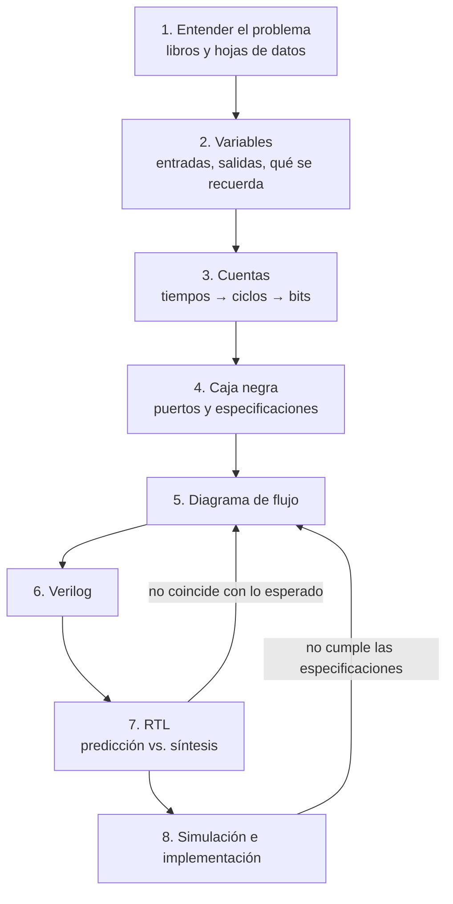
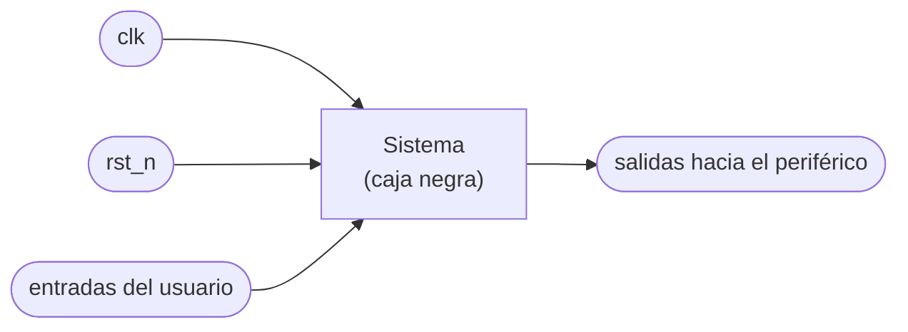

# 1. Metodología: cómo abordar un problema de diseño digital

[← Fundamentos](README.md) · [Siguiente: Verilog básico →](02_Verilog_basico.md)

Un problema de diseño digital no empieza escribiendo código. Empieza **entendiendo qué se pide**, identificando qué hay que medir, contar y recordar, y especificando el sistema como una caja negra antes de decidir cómo se construye por dentro. El código en Verilog es casi una traducción de ese razonamiento, y las herramientas de síntesis se encargan de convertirlo en hardware.

En este laboratorio, **su aporte es el razonamiento de diseño y el dominio de las herramientas**. Por eso la evaluación se apoya en evidencias que solo pueden salir de su propio proceso: sus cuentas, sus predicciones y la salida de las herramientas sobre su propio diseño.

---

## Contenido

1. [Las ocho etapas](#1-las-ocho-etapas)
2. [Etapa 1: entender el problema](#2-etapa-1-entender-el-problema)
3. [Etapa 2: variables](#3-etapa-2-variables)
4. [Etapa 3: cuentas](#4-etapa-3-cuentas)
5. [Etapa 4: caja negra y especificaciones](#5-etapa-4-caja-negra-y-especificaciones)
6. [Etapa 5: diagrama de flujo](#6-etapa-5-diagrama-de-flujo)
7. [Etapa 6: del diagrama de flujo a Verilog](#7-etapa-6-del-diagrama-de-flujo-a-verilog)
8. [Etapa 7: RTL y herramientas de síntesis](#8-etapa-7-rtl-y-herramientas-de-síntesis)
9. [Etapa 8: simulación e implementación](#9-etapa-8-simulación-e-implementación)
10. [Dónde buscar](#10-dónde-buscar)

---

## 1. Las ocho etapas

| Etapa | Pregunta que responde | Producto en la bitácora |
|---|---|---|
| 1. Entender el problema | ¿Cómo funciona el periférico y qué señal necesita? | Resumen con citas a libro y hoja de datos |
| 2. Variables | ¿Qué entra, qué sale y qué hay que recordar? | Tabla de variables |
| 3. Cuentas | ¿Cuántos ciclos de reloj dura cada tiempo y cuántos bits se necesitan? | Tabla de cálculos |
| 4. Caja negra | ¿Qué puertos tiene el sistema y qué debe cumplir? | Diagrama de la caja negra y tabla de especificaciones |
| 5. Diagrama de flujo | ¿Cómo se comporta, paso a paso? | Diagrama de flujo |
| 6. Verilog | ¿Cómo se describe ese comportamiento? | Código comentado |
| 7. RTL | ¿Qué hardware infirió la herramienta? ¿Es el que esperábamos? | Predicción, RTL, estadísticas y explicación de diferencias |
| 8. Simulación e implementación | ¿Cumple cada especificación? | Testbench, capturas, mediciones en la tarjeta |

El [ejemplo resuelto](12_Ejemplo_resuelto.md) recorre las ocho etapas con un problema sencillo que no es ninguno de los periféricos del laboratorio. Úsenlo como modelo del nivel de detalle esperado.

## 2. Etapa 1: entender el problema

Antes de diseñar, hay que saber **qué entiende el periférico**: qué señal espera, con qué tiempos, con qué voltajes. Esa información está en la **hoja de datos** (*datasheet*) del dispositivo y en los libros de diseño digital.

Preguntas guía:

- ¿Qué hace el periférico y cómo se controla?
- ¿Qué señales recibe y entrega? ¿Son niveles, pulsos, señales periódicas?
- ¿Qué tiempos importan (periodos, anchos de pulso, retardos)? ¿De dónde salen esos valores?
- ¿Qué voltajes y corrientes maneja? ¿Puede conectarse directamente a la FPGA?

Escriban el resumen **con sus palabras** y citen la fuente de cada dato.

## 3. Etapa 2: variables

Una **variable** es cualquier señal con nombre en el diseño. Para cada una, definan:

| Columna | Qué indicar |
|---|---|
| Nombre | Como aparecerá en el código, por ejemplo `cnt` o `led` |
| Tipo | Entrada, salida o interna |
| Rango o valores | Por ejemplo 0 a 9, o 0/1 |
| Unidad | Ciclos de reloj, centímetros, grados... |
| **¿Se recuerda entre ciclos?** | Sí o no |

La última columna es la más importante. **Toda variable que debe recordar su valor de un ciclo de reloj al siguiente se convierte en un registro**, es decir, en flip-flops. Una cuenta se recuerda; el resultado de una comparación se recalcula en cada instante y no se recuerda.

Con esta tabla pueden **predecir cuántos flip-flops** tendrá su diseño antes de sintetizarlo. En la etapa 7 lo comprobarán con la herramienta.

## 4. Etapa 3: cuentas

En una FPGA el tiempo se mide contando ciclos de reloj. Cada tiempo del problema se convierte a ciclos, y cada cuenta define cuántos bits necesita su registro:

$$N = t \cdot f_{clk} \qquad \text{bits} = \lceil \log_2 N \rceil$$

Para esto necesitan conocer `CLK_FREQ`, la frecuencia del reloj de su tarjeta ([cómo averiguarla](08_Frecuencia_del_reloj.md)). Detalles en [Contadores y tiempo](04_Contadores_y_tiempo.md).

## 5. Etapa 4: caja negra y especificaciones

La **caja negra** describe el sistema **desde afuera**: sus puertos y lo que debe hacer, sin decir cómo lo hace por dentro.

Acompáñenla de una **tabla de especificaciones**: una lista de requisitos **medibles**, cada uno con un identificador, que luego se verifica uno por uno en la simulación y en la tarjeta.

| ID | Especificación | Cómo se verifica |
|---|---|---|
| E1 | (por ejemplo) El LED cambia de estado cada 0.5 s ± 1 ciclo | Medición en simulación y con cronómetro |
| E2 | ... | ... |

Una especificación como "el LED parpadea bien" no es medible; "el LED cambia cada 0.5 s" sí lo es.

## 6. Etapa 5: diagrama de flujo

El diagrama de flujo describe el **comportamiento**: qué decisiones toma el sistema y qué hace en cada caso.

- Los **rombos** son decisiones (¿se presionó el pulsador?, ¿terminó la cuenta?).
- Los **rectángulos** son acciones (reiniciar la cuenta, invertir el LED).
- Las acciones que modifican una variable que se recuerda corresponden a lo que pasa **en cada flanco de reloj**.

Un buen diagrama de flujo cubre **todos los casos**: ningún pulsador, varios a la vez, valores extremos.

## 7. Etapa 6: del diagrama de flujo a Verilog

La traducción es casi directa:

| En el diagrama de flujo | En Verilog |
|---|---|
| Rombo (decisión) | `if` / `else`, `case`, o el operador `? :` |
| Acción sobre una variable que **se recuerda** | Asignación con `<=` dentro de `always @(posedge clk)` |
| Cálculo que **no se recuerda** (una comparación, una selección) | `assign` o `always @(*)` con `=` |
| Un tiempo de la tabla de cálculos | Un `localparam` calculado a partir de `CLK_FREQ` |

No hace falta pensar en compuertas: se describe el **comportamiento** y la herramienta de síntesis decide la implementación. El trabajo de ustedes es que la descripción sea correcta y **sintetizable**, y entender qué hardware resulta de ella. Ver [Verilog básico](02_Verilog_basico.md).

## 8. Etapa 7: RTL y herramientas de síntesis

Antes de sintetizar, **predigan**: ¿cuántos flip-flops?, ¿qué sumadores, comparadores y multiplexores esperan? Luego generen el RTL con `make rtl`, obtengan las estadísticas de Yosys y comparen. Cada diferencia entre lo esperado y lo obtenido se explica en la bitácora.

Esta etapa incluye una serie de **experimentos de síntesis** sobre su propio diseño: [Herramientas de síntesis](10_Herramientas_de_sintesis.md#5-experimentos-de-síntesis).

## 9. Etapa 8: simulación e implementación

- **Simulación:** un testbench que verifique cada especificación de la tabla de la etapa 4 y reporte `OK` o `ERROR` ([Simulación](09_Simulacion.md)).
- **Implementación:** síntesis, archivo de restricciones, conexión segura del periférico y medición en la tarjeta de cada especificación ([Herramientas de síntesis](10_Herramientas_de_sintesis.md), [Conexión eléctrica](11_Conexion_electrica.md)).

Si algo no cumple, se vuelve a la etapa 5: el error casi siempre está en el razonamiento, no en la sintaxis.

## 10. Dónde buscar

Los temas de este laboratorio (contadores, PWM, displays de 7 segmentos, motores, sensores) están en los libros clásicos de diseño digital desde hace décadas. Busquen allí primero:

| Libro | Útil para |
|---|---|
| Harris, D. y Harris, S. *Digital Design and Computer Architecture*. Morgan Kaufmann | Lógica secuencial, Verilog, metodología de diseño |
| Brown, S. y Vranesic, Z. *Fundamentals of Digital Logic with Verilog Design*. McGraw-Hill | Contadores, decodificadores, displays, Verilog |
| Chu, P. P. *FPGA Prototyping by Verilog Examples*. Wiley | Diseño para FPGA, periféricos (PWM, displays, temporización) |
| Mano, M. M. y Ciletti, M. D. *Diseño digital*. Pearson | Bloques combinacionales y secuenciales, Verilog |
| Wakerly, J. F. *Diseño digital: principios y prácticas*. Pearson | Diseño combinacional y secuencial, buenas prácticas |
| Floyd, T. L. *Fundamentos de sistemas digitales*. Pearson | Introducción: contadores, displays, decodificadores |
| [Notas de electrónica digital, Johnny Cubides](https://codeberg.org/johnnycubides/digital-electronics-i-book/releases/download/v0.1/book.pdf) | Notas del curso |

Para cada periférico, la **hoja de datos del fabricante** es la fuente obligatoria de tiempos y voltajes. Citen todas las fuentes en la bitácora.

---

[← Fundamentos](README.md) · [Siguiente: Verilog básico →](02_Verilog_basico.md)
