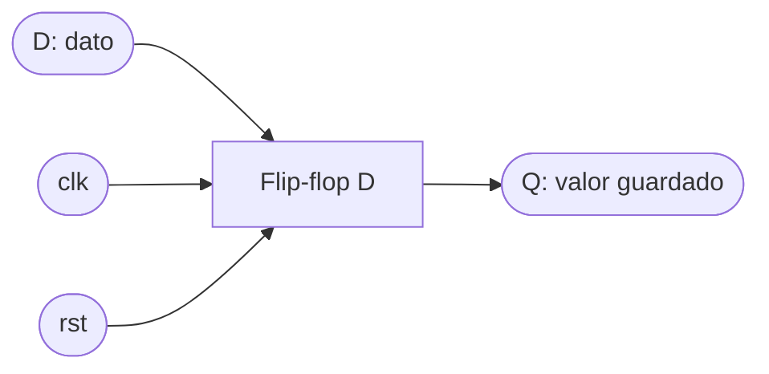

# 3. Lógica secuencial: el reloj y el flip-flop

[← Verilog básico](02_Verilog_basico.md) · [Fundamentos](README.md) · [Siguiente: Contadores y tiempo →](04_Contadores_y_tiempo.md)

Un circuito que solo tiene compuertas no recuerda nada: su salida cambia apenas cambian sus entradas. Para contar, medir tiempo o guardar un dato hace falta **memoria**, y en un circuito digital síncrono la memoria básica es el **flip-flop**.

En este laboratorio el flip-flop se trata como una **caja negra**: no importa cómo está construido por dentro, sino **qué hace**, cómo se describe en Verilog y cómo reconocerlo en lo que produce la herramienta de síntesis.

---

## Contenido

1. [Lógica combinacional y lógica secuencial](#1-lógica-combinacional-y-lógica-secuencial)
2. [La señal de reloj](#2-la-señal-de-reloj)
3. [El flip-flop como caja negra](#3-el-flip-flop-como-caja-negra)
4. [Cómo se describe en Verilog](#4-cómo-se-describe-en-verilog)
5. [Registros y variables que se recuerdan](#5-registros-y-variables-que-se-recuerdan)
6. [Cómo aparece en el RTL](#6-cómo-aparece-en-el-rtl)
7. [Flip-flop y latch: no son lo mismo](#7-flip-flop-y-latch-no-son-lo-mismo)
8. [Señales externas y metaestabilidad](#8-señales-externas-y-metaestabilidad)

---

## 1. Lógica combinacional y lógica secuencial

| | Lógica combinacional | Lógica secuencial |
|---|---|---|
| La salida depende de... | Solo las entradas actuales | Las entradas y un **estado guardado** |
| Tiene memoria | No | Sí, en flip-flops |
| Necesita reloj | No | Sí |
| Ejemplos | Decodificador, multiplexor, comparador, sumador | Contador, registro, máquina de estados |

$$\text{Combinacional: Salida} = f(\text{Entradas}) \qquad \text{Secuencial: Salida} = f(\text{Entradas}, \text{Estado})$$

## 2. La señal de reloj

El **reloj** (`clk`) es una señal cuadrada que un oscilador de la tarjeta genera continuamente. Marca el ritmo de todo el circuito.

```
clk  __|‾‾|__|‾‾|__|‾‾|__|‾‾|__
       ↑     ↑     ↑     ↑        ↑ = flancos de subida (posedge)
       |<-T->|                    T = periodo
```

- **Periodo** $T$: lo que dura un ciclo completo.
- **Frecuencia** $f = 1/T$: ciclos por segundo. En el código se llama `CLK_FREQ`.
- **Flanco de subida** (*posedge*): el instante en que el reloj pasa de 0 a 1. Es cuando los flip-flops actualizan su valor.

Por ejemplo, un reloj de 25 MHz tiene $T = 40\ \text{ns}$: hay 25 millones de flancos de subida por segundo.

## 3. El flip-flop como caja negra



Un **flip-flop tipo D** es una memoria de **un bit**. Su comportamiento:

- En cada **flanco de subida** del reloj, copia en `Q` el valor que tiene `D` en ese instante.
- Entre un flanco y el siguiente, `Q` **mantiene** ese valor, aunque `D` cambie.
- Con **reset** activo, `Q` va a un valor conocido (normalmente 0) en el siguiente flanco.

| `clk` | `rst` | `D` | `Q` después |
|---|---|---|---|
| ↑ | 1 | X | 0 |
| ↑ | 0 | 0 | 0 |
| ↑ | 0 | 1 | 1 |
| sin flanco | X | X | no cambia |

```
clk  __|‾‾|__|‾‾|__|‾‾|__|‾‾|__|‾‾|
D    ____|‾‾‾‾‾‾‾‾‾‾|_|‾|__________
Q    ________|‾‾‾‾‾‾‾‾‾‾‾|_________
             ↑ copia 1   ↑ copia 0
```

El pulso corto de `D` entre el tercer y el cuarto flanco ocurre **entre** flancos: `Q` no lo ve. Esa es la clave del diseño síncrono: solo importa el valor en el flanco.

Algunos flip-flops tienen además una **habilitación** (*enable*): solo copian `D` cuando la habilitación vale 1. Así se hace que algo avance más lento que el reloj.

## 4. Cómo se describe en Verilog

Los flip-flops no se dibujan ni se arman con compuertas: se **describen** con `always @(posedge clk)` y la herramienta los crea.

```verilog
// Flip-flop D con reset síncrono y habilitación
always @(posedge clk) begin
    if (rst)
        q <= 1'b0;      // con reset: vuelve a 0
    else if (en)
        q <= d;         // con habilitación: copia d
                        // si en = 0 no se asigna nada: q mantiene su valor
end
```

Que `q` mantenga su valor cuando no se le asigna nada es **exactamente** lo que se quiere en un bloque con reloj: esa es la memoria.

## 5. Registros y variables que se recuerdan

Un **registro** es un grupo de flip-flops que comparten reloj y guardan un número de varios bits. Un registro de 24 bits son 24 flip-flops.

La regla que conecta el razonamiento con el hardware es:

> **Toda variable que se asigna con `<=` dentro de `always @(posedge clk)` se recuerda entre ciclos y se convierte en un registro, con tantos flip-flops como bits tenga.**

Por eso, en la [etapa de variables](01_Metodologia.md#3-etapa-2-variables) pueden **predecir** cuántos flip-flops tendrá su diseño: sumen los bits de todas las variables que se recuerdan. Las variables que se calculan con `assign` o `always @(*)` no generan flip-flops.

## 6. Cómo aparece en el RTL

En el diagrama que genera `make rtl` y en las estadísticas de Yosys, los registros aparecen como:

| Celda | Qué es |
|---|---|
| `$dff` | Registro simple |
| `$sdff` | Registro con reset síncrono |
| `$dffe` | Registro con habilitación |
| `$sdffe` | Registro con reset síncrono y habilitación |

Cada celda es un registro completo: su ancho en bits indica cuántos flip-flops tiene. Al sintetizar para la FPGA, cada bit se convierte en un flip-flop físico del dispositivo (en las iCE40, celdas `SB_DFF...`). En el [ejemplo resuelto](12_Ejemplo_resuelto.md#etapa-7-rtl-predicción-vs-síntesis) se predicen 29 flip-flops y la herramienta produce exactamente 29.

## 7. Flip-flop y latch: no son lo mismo

Un **latch** también guarda un bit, pero es **transparente**: mientras está habilitado, la salida sigue a la entrada todo el tiempo, no solo en el flanco. En una FPGA los latches causan comportamientos difíciles de predecir, y en este curso **se consideran un error**.

Casi siempre aparecen sin querer, en un `always @(*)` que no asigna una señal en todos los casos:

```verilog
// MAL: si sel = 0, y no recibe valor -> la herramienta crea un latch para "recordarlo"
always @(*) begin
    if (sel)
        y = a;
end

// BIEN: y tiene valor en todos los casos -> combinacional puro
always @(*) begin
    y = 1'b0;          // valor por defecto
    if (sel)
        y = a;
end
```

Con el primer bloque, Yosys reporta `Latch inferred for signal` y una celda `$dlatch`. Provocarlo a propósito es uno de los [experimentos de síntesis](10_Herramientas_de_sintesis.md#5-experimentos-de-síntesis).

## 8. Señales externas y metaestabilidad

Para funcionar bien, un flip-flop necesita que `D` esté estable un poco antes y un poco después del flanco. Las señales internas cumplen esto porque cambian al ritmo del mismo reloj; las **externas** (pulsadores, interruptores, sensores) cambian en cualquier momento. Si una cambia justo en el flanco, el flip-flop puede quedar un instante en un valor intermedio: **metaestabilidad**.

La solución es un **sincronizador**: dos flip-flops en serie antes de usar la señal. Se explica en [Entradas externas](07_Entradas_externas.md).

---

[← Verilog básico](02_Verilog_basico.md) · [Fundamentos](README.md) · [Siguiente: Contadores y tiempo →](04_Contadores_y_tiempo.md)
