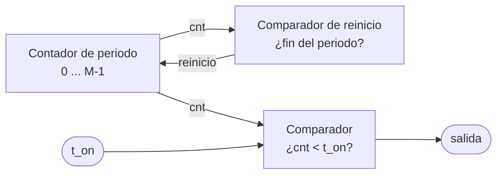

# 6. Señales periódicas y PWM

[← Bloques combinacionales](05_Bloques_combinacionales.md) · [Fundamentos](README.md) · [Siguiente: Entradas externas →](07_Entradas_externas.md)

Muchos periféricos se controlan con una **señal periódica**: una forma de onda que se repite con un periodo fijo. Las dos más importantes son la **PWM** y la **onda cuadrada**, y ambas se generan con un contador y un comparador.

---

## Contenido

1. [Periodo, frecuencia y ciclo de trabajo](#1-periodo-frecuencia-y-ciclo-de-trabajo)
2. [PWM: modulación por ancho de pulso](#2-pwm-modulación-por-ancho-de-pulso)
3. [Contador + comparador](#3-contador--comparador)
4. [Onda cuadrada de frecuencia variable](#4-onda-cuadrada-de-frecuencia-variable)
5. [Preguntas que debe responder su diseño](#5-preguntas-que-debe-responder-su-diseño)

---

## 1. Periodo, frecuencia y ciclo de trabajo

```
      ██████......██████......██████......
      |<-Ton->|
      |<---- T ---->|
```

- **Periodo** $T$: lo que tarda la señal en repetirse. **Frecuencia** $f = 1/T$.
- **Tiempo en alto** $T_{on}$: cuánto del periodo pasa en 1.
- **Ciclo de trabajo** (*duty cycle*): la fracción del periodo en alto.

$$\text{Duty} = \frac{T_{on}}{T}$$

## 2. PWM: modulación por ancho de pulso

Una señal **PWM** tiene periodo fijo y ciclo de trabajo variable. Según el periférico, el ancho del pulso puede significar cosas distintas:

| Uso | Qué significa el ancho del pulso |
|---|---|
| **Potencia** | El valor promedio de la señal: un motor recibe un voltaje promedio proporcional al ciclo de trabajo |
| **Referencia** | Un dato codificado en el tiempo: el periférico mide el ancho del pulso y actúa según su valor |

Cuál de los dos aplica a su periférico, y con qué periodo y anchos, lo dice su hoja de datos.

## 3. Contador + comparador

Un generador de señal periódica tiene tres bloques:



El contador dibuja un diente de sierra y el comparador lo "corta" a la altura `t_on`:

```
cnt      0 1 2 3 4 5 6 7 8 9 0 1 2 3 4 5 6 7 8 9 0     (M = 10, t_on = 3)
salida   1 1 1 0 0 0 0 0 0 0 1 1 1 0 0 0 0 0 0 0 1
```

$$M = T \cdot f_{clk} \qquad t_{on}\,[\text{ciclos}] = T_{on} \cdot f_{clk} \qquad f_{señal} = \frac{f_{clk}}{M}$$

Casos extremos: con `t_on = 0` la salida queda siempre en 0; con `t_on ≥ M`, siempre en 1.

## 4. Onda cuadrada de frecuencia variable

Una **onda cuadrada** es una señal periódica con ciclo de trabajo del 50 %. Si lo que debe cambiar es la **frecuencia**, lo que se varía es el periodo M del contador, y el comparador corta en M / 2.

Un detalle importante: si el periodo puede cambiar mientras el contador está corriendo, el comparador de reinicio debe usar `>=` y no `==`. Si el nuevo periodo es menor que la cuenta actual, con `==` el contador no encontraría nunca la igualdad y seguiría hasta desbordarse. El [ejemplo resuelto](12_Ejemplo_resuelto.md) usa esta técnica.

## 5. Preguntas que debe responder su diseño

- ¿Qué periodo y qué anchos de pulso exige la hoja de datos de su periférico? ¿Con qué tolerancia?
- ¿Cuántos ciclos de reloj son, con su `CLK_FREQ`? ¿Cuántos bits necesita el contador?
- ¿El periodo es fijo o variable? ¿Qué pasa si cambia a mitad de un periodo?
- ¿Cómo llega el valor de `t_on` o de M desde las entradas del usuario?
- ¿Cómo verificarán en simulación el periodo y el ancho del pulso?

---

[← Bloques combinacionales](05_Bloques_combinacionales.md) · [Fundamentos](README.md) · [Siguiente: Entradas externas →](07_Entradas_externas.md)
