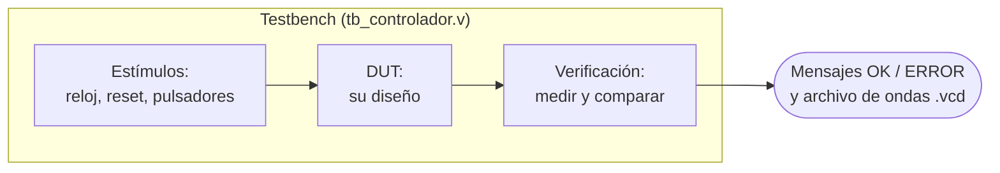

# 9. Simulación con testbench

[← Frecuencia del reloj](08_Frecuencia_del_reloj.md) · [Fundamentos](README.md) · [Siguiente: Herramientas de síntesis →](10_Herramientas_de_sintesis.md)

Simular es probar el diseño en el computador antes de llevarlo a la FPGA. Un error encontrado en la simulación se corrige en minutos; el mismo error en la tarjeta puede costar una tarde entera. Por eso la simulación es obligatoria **antes** de sintetizar.

---

## Contenido

1. [Qué es un testbench](#1-qué-es-un-testbench)
2. [Estructura de un testbench, paso a paso](#2-estructura-de-un-testbench-paso-a-paso)
3. [Un `CLK_FREQ` reducido para simular rápido](#3-un-clk_freq-reducido-para-simular-rápido)
4. [Simular pulsadores](#4-simular-pulsadores)
5. [Verificación automática](#5-verificación-automática)
6. [Ejecutar la simulación](#6-ejecutar-la-simulación)
7. [Leer las ondas en GTKWave](#7-leer-las-ondas-en-gtkwave)

---

## 1. Qué es un testbench

Un **testbench** es un módulo de Verilog que **no se sintetiza**: solo existe en la simulación. Hace tres cosas:

1. Genera las **entradas** del diseño: el reloj, el reset, los pulsadores.
2. Contiene una copia del diseño, llamada **DUT** (*Device Under Test*, dispositivo bajo prueba).
3. **Observa** las salidas, las mide y las compara con lo esperado.



## 2. Estructura de un testbench, paso a paso

```verilog
`timescale 1ns/1ps                // 1) unidad de tiempo: #1 significa 1 ns

module tb_controlador;            // 2) un testbench no tiene puertos

    // 3) Parámetros de simulación
    localparam CLK_FREQ_TB = 1_000_000;                    // reloj de 1 MHz
    localparam T_CLK       = 1_000_000_000 / CLK_FREQ_TB;  // periodo en ns (1000 ns)

    // 4) Señales: reg para lo que el testbench maneja, wire para lo que entrega el DUT
    reg        clk   = 1'b0;
    reg        rst_n = 1'b0;      // reset presionado al inicio (activo en bajo)
    reg  [3:0] btn_n = 4'b1111;   // ningún pulsador presionado (activos en bajo)
    wire       salida;

    // 5) Generador de reloj: invierte clk cada medio periodo, para siempre
    always #(T_CLK/2) clk = ~clk;

    // 6) El diseño bajo prueba, con un CLK_FREQ reducido
    top #(.CLK_FREQ(CLK_FREQ_TB)) dut (
        .clk   (clk),
        .rst_n (rst_n),
        .btn_n (btn_n),
        .salida(salida)
    );

    // 7) Estímulos: se ejecutan en orden, una sola vez
    initial begin
        $dumpfile("tb_controlador.vcd");  // archivo donde se guardan las ondas
        $dumpvars(0, tb_controlador);     // guardar todas las señales

        #(10*T_CLK) rst_n = 1'b1;         // suelta el reset después de 10 ciclos
        #(20_000_000);                    // espera 20 ms sin pulsadores
        btn_n = 4'b1110;                  // presiona btn[0]...
        #(50_000_000);                    // ...y lo mantiene 50 ms
        btn_n = 4'b1100;                  // btn[0] y btn[1] a la vez: prueba la prioridad
        #(50_000_000);
        btn_n = 4'b1111;                  // suelta todo
        #(20_000_000);
        $finish;                          // 8) termina la simulación
    end

endmodule
```

Como `T_CLK` se calcula a partir de `CLK_FREQ_TB`, **el tiempo simulado coincide con el tiempo real**: 1 ms del diseño se ve como 1 ms en GTKWave, y las mediciones se comparan directamente con la tabla de cálculos.

Ejemplo completo y funcional: [ejemplos/tb_parpadeo_dos_velocidades.v](ejemplos/tb_parpadeo_dos_velocidades.v), explicado en el [ejemplo resuelto](12_Ejemplo_resuelto.md).

## 3. Un `CLK_FREQ` reducido para simular rápido

Con el reloj real (por ejemplo 25 MHz), simular un segundo son 25 millones de ciclos: la simulación tarda y el archivo de ondas se vuelve enorme. Por eso el testbench usa un `CLK_FREQ` menor. El diseño no cambia: solo recibe otro valor del parámetro.

**La regla para elegirlo:** el intervalo más corto del diseño debe seguir durando **al menos 10 ciclos** de reloj. Si dura menos, la simulación ya no representa al diseño.

| Intervalo más corto del diseño | Con `CLK_FREQ_TB` = 1 MHz | ¿Válido? |
|---|---|---|
| Un pulso de 1 ms | 1 000 ciclos | Sí |
| Un intervalo de 50 µs | 50 ciclos | Sí |
| Un pulso de 20 µs | 20 ciclos | Sí |
| El mismo pulso de 20 µs con `CLK_FREQ_TB` = 10 kHz | 0.2 ciclos | **No**: el pulso desaparece |

Para diseños con tiempos largos (como el reloj de 60 s) y sin intervalos cortos, se puede bajar mucho más: con 10 kHz, un minuto son 600 000 ciclos.

## 4. Simular pulsadores

En la ruta de este laboratorio los pulsadores se leen por nivel, así que simularlos es sencillo: se cambia el valor y se espera.

```verilog
btn_n = 4'b1110;      // presiona btn[0] (activo en bajo: 0 = presionado)
#(50_000_000);        // lo mantiene 50 ms (con timescale de 1 ns)
btn_n = 4'b1111;      // lo suelta
```

Cada fila de las tablas de verdad del paso 1 debe aparecer en la simulación: ningún pulsador, cada pulsador por separado y al menos una combinación de varios a la vez.

## 5. Verificación automática

Mirar ondas sirve para entender, pero un buen testbench **mide y decide** por sí mismo. Tres técnicas, todas en los ejemplos:

**Medir tiempos.** Se anota `$time` en los flancos de la salida y se compara la diferencia con lo esperado ([tarea `medir_medio_periodo` del ejemplo](ejemplos/tb_parpadeo_dos_velocidades.v)):

```verilog
time t_sube, t_baja;                         // tiempos de 64 bits, en ns

@(posedge salida) t_sube = $time;            // espera a que la salida suba y anota
@(negedge salida) t_baja = $time;            // espera a que baje y anota
if (t_baja - t_sube == 1_500_000)            // ¿el pulso duró 1.5 ms?
    $display("OK:    ancho = %0d ns", t_baja - t_sube);
else
    $display("ERROR: ancho = %0d ns (esperado 1500000)", t_baja - t_sube);
```

**Recorrer toda la tabla de verdad.** Para un bloque combinacional, un ciclo `for` aplica todas las combinaciones de entrada y compara cada salida con la que indica la tabla.

**Contar errores.** Una variable `errores` que suma 1 en cada `ERROR`, y un mensaje final con el total.

Los mensajes `OK` y `ERROR` en la terminal, junto con las capturas de GTKWave, son la **evidencia de la etapa de simulación** en la bitácora.

## 6. Ejecutar la simulación

En los ejemplos del curso, el comando `make sim` compila, simula y abre GTKWave. Es equivalente a ejecutar a mano:

```bash
iverilog -o sim.vvp tb_controlador.v top.v otros_modulos.v   # compila (Icarus Verilog)
vvp sim.vvp                                                  # simula: imprime OK / ERROR
gtkwave tb_controlador.vcd                                   # abre las formas de onda
```

- `iverilog` revisa la sintaxis y arma la simulación. Si hay un error, indica el archivo y la línea.
- `vvp` ejecuta la simulación: aquí aparecen los mensajes de `$display`.
- `gtkwave` muestra las ondas guardadas en el archivo `.vcd`.

Prueben el ejemplo resuelto: desde `Fundamentos/ejemplos/`, `iverilog -o sim.vvp tb_parpadeo_dos_velocidades.v parpadeo_dos_velocidades.v && vvp sim.vvp`.

## 7. Leer las ondas en GTKWave

1. En el panel de la izquierda, seleccionen el módulo (`tb_...` y luego `dut`) y agreguen las señales que necesitan.
2. Usen el botón de **ajustar zoom** (*zoom fit*) para ver toda la simulación y luego acerquen la zona de interés.
3. Para ver un contador como número, clic derecho sobre la señal → *Data Format* → *Decimal*.
4. Para **medir un tiempo**, coloquen marcadores en dos flancos: GTKWave muestra la diferencia de tiempo entre ellos en la parte superior.
5. Guarden la configuración de señales (*File → Write Save File*) para no repetir los pasos en cada simulación.

**Las capturas para la bitácora** deben mostrar la medición, no solo la forma de onda: que se vean los marcadores, el tiempo medido y las señales con nombre.

---

[← Frecuencia del reloj](08_Frecuencia_del_reloj.md) · [Fundamentos](README.md) · [Siguiente: Herramientas de síntesis →](10_Herramientas_de_sintesis.md)
