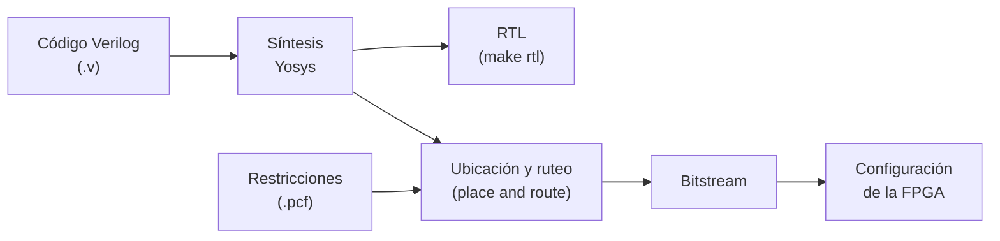

# 10. Herramientas de síntesis: RTL, experimentos y configuración

[← Simulación con testbench](09_Simulacion.md) · [Fundamentos](README.md) · [Siguiente: Conexión eléctrica →](11_Conexion_electrica.md)

La herramienta de síntesis convierte la descripción en Verilog en hardware. Dominarla significa poder **predecir** lo que va a producir, **leer** lo que produjo y **explicar** las diferencias. Eso es lo que se evalúa en la etapa 7 de la [metodología](01_Metodologia.md). Todo el flujo usa herramientas de código abierto, llamadas desde el `Makefile` de los ejemplos `.zip` del curso.

---

## Contenido

1. [Del Verilog a la FPGA](#1-del-verilog-a-la-fpga)
2. [`make rtl`: el circuito que infiere Yosys](#2-make-rtl-el-circuito-que-infiere-yosys)
3. [Predecir antes de sintetizar](#3-predecir-antes-de-sintetizar)
4. [Comparar el RTL con su diseño](#4-comparar-el-rtl-con-su-diseño)
5. [Experimentos de síntesis](#5-experimentos-de-síntesis)
6. [El archivo de restricciones físicas](#6-el-archivo-de-restricciones-físicas)
7. [`make clean syn conf`: sintetizar y configurar](#7-make-clean-syn-conf-sintetizar-y-configurar)
8. [Errores frecuentes](#8-errores-frecuentes)

---

## 1. Del Verilog a la FPGA



| Etapa | Qué hace | Comando |
|---|---|---|
| Síntesis | Traduce el Verilog a registros, sumadores, comparadores, multiplexores y lógica | `make syn` (Yosys) |
| RTL | Dibuja ese circuito para revisarlo | `make rtl` (Yosys y netlistsvg) |
| Ubicación y ruteo | Decide qué recursos físicos usa cada parte y cómo se conectan, respetando los pines | parte de `make syn` |
| Bitstream | Genera el archivo que configura la FPGA | parte de `make syn` |
| Configuración | Carga el bitstream en la tarjeta | `make conf` |

En las FPGA iCE40, como la de la BlackIce, el flujo típico usa Yosys para la síntesis y nextpnr para la ubicación y el ruteo.

## 2. `make rtl`: el circuito que infiere Yosys

**RTL** (*Register Transfer Level*) describe el circuito como **registros** y la **lógica** entre ellos. Las celdas más comunes:

| Celda | Qué es | De dónde sale en el código |
|---|---|---|
| `$dff`, `$sdff` | Registro, sin o con reset síncrono | `always @(posedge clk)` |
| `$dffe`, `$sdffe` | Registro con habilitación | `if (condición) x <= ...` dentro de un bloque con reloj |
| `$add`, `$sub` | Sumador, restador | `cnt + 1`, `limite - 1` |
| `$eq`, `$ne` | Comparador de igualdad | `cnt == 9` |
| `$lt`, `$le`, `$gt`, `$ge` | Comparador de magnitud | `cnt < t_on`, `cnt >= limite - 1` |
| `$mux` | Multiplexor 2:1 | `if` / `else`, `? :` |
| `$pmux` | Multiplexor de varias entradas | `case` |
| `$not`, `$and`, `$or`, `$logic_or`, `$reduce_or` | Lógica | `~`, `&`, `\|`, `\|\|` |
| `$dlatch` | **Latch** | Casi siempre un error |

Los nombres exactos pueden variar según los comandos que use `make rtl`.

## 3. Predecir antes de sintetizar

Antes de correr la herramienta, escriban en la bitácora qué esperan obtener, a partir de su tabla de variables y su diagrama de bloques:

- **Flip-flops:** la suma de los bits de todas las variables que se recuerdan ([por qué](03_Logica_secuencial.md#5-registros-y-variables-que-se-recuerdan)).
- **Sumadores y restadores:** uno por cada contador, más los que aparezcan en expresiones.
- **Comparadores:** uno por cada decisión del diagrama de flujo que compare números.
- **Multiplexores:** uno por cada selección o `if` que elija entre valores.

Luego obtengan las **estadísticas** de Yosys. Para el nivel RTL:

```bash
yosys -p "read_verilog top.v otros.v; hierarchy -top top; proc; opt; stat"
```

Y para los recursos reales de la FPGA (iCE40):

```bash
yosys -p "read_verilog top.v otros.v; synth_ice40 -top top; stat"
```

**Ejemplo real** (el [ejemplo resuelto](12_Ejemplo_resuelto.md#etapa-7-rtl-predicción-vs-síntesis)): la predicción era de 29 flip-flops; `synth_ice40` reporta 4 `SB_DFF` + 24 `SB_DFFSR` + 1 `SB_DFFESR` = 29.

## 4. Comparar el RTL con su diseño

1. Ubiquen las entradas y salidas.
2. **Cuenten los registros** y relacionen cada uno con una variable de su tabla. Un registro que no esperaban es memoria que no planearon.
3. Sigan la lógica entre registros y salidas, e identifiquen cada bloque de su diagrama.
4. **Anoten y expliquen cada diferencia.**

Diferencias esperables:

- **Constantes propagadas:** comparaciones contra valores fijos simplificadas o eliminadas.
- **Multiplexores fusionados:** varios `if` o un `case` como un solo `$pmux` o una cadena de `$mux`.
- **Habilitación absorbida:** un `if (condición)` como registro con habilitación (`$dffe`, `$sdffe`).
- **Lógica eliminada:** Yosys borra lo que no afecta ninguna salida. Si falta un bloque completo, revisen que su salida esté conectada.

## 5. Experimentos de síntesis

Estos experimentos se hacen **sobre su propio diseño** y se registran en la bitácora: qué se hizo, qué se esperaba, qué reportó la herramienta y la explicación.

| # | Experimento | Qué se registra |
|---|---|---|
| S1 | **Predicción vs. síntesis.** Predicen flip-flops y bloques, sintetizan y comparan | Tabla con la predicción, el resultado de `stat` y la explicación de cada diferencia |
| S2 | **Dos descripciones, un comportamiento.** Describen un mismo bloque de dos formas (por ejemplo `case` vs. `if`, `==` vs. `>=`, constantes vs. una fórmula) | RTL y estadísticas de ambas versiones; ¿cuál es mejor y por qué? |
| S3 | **Error provocado.** Quitan el valor por defecto o un `else` de un bloque `always @(*)` | El aviso `Latch inferred`, la celda `$dlatch` y qué cambia en la simulación |
| S4 | **Cambio de parámetro.** Cambian `CLK_FREQ` o un tiempo de la especificación (por ejemplo, el doble) | Cómo cambian los bits de los contadores y los recursos; ¿coincide con sus cuentas? |
| S5 | **Reporte de implementación.** Revisan la salida de `make syn` | Celdas lógicas y flip-flops usados, frecuencia máxima reportada frente a `CLK_FREQ` |

Una sugerencia para S2 y S3: hagan cada experimento en una copia del archivo o en una rama de git, para no romper el diseño principal.

## 6. El archivo de restricciones físicas

El archivo de restricciones dice en qué pin físico va cada puerto del módulo top. Para las FPGA iCE40 tiene extensión `.pcf`:

```
# Reloj: oscilador de la tarjeta
set_io clk 60

# Pulsador activo en bajo, con pull-up interno
set_io -pullup yes rst_n 49

# Salida
set_io led 38
```

Los números de pin de este ejemplo son ilustrativos: tomen los reales del archivo y del diagrama de pines de su tarjeta, que vienen en los ejemplos.

- Cada puerto del top aparece con **exactamente el mismo nombre**, y cada bit de un bus en su propia línea (`btn_n[0]`, `btn_n[1]`, ...).
- El reloj va al pin del oscilador.
- Las señales activas en bajo se invierten en el módulo top, no en este archivo.

## 7. `make clean syn conf`: sintetizar y configurar

| Objetivo | Qué hace |
|---|---|
| `clean` | Borra los archivos generados antes |
| `syn` | Síntesis, ubicación y ruteo, y bitstream |
| `conf` | Carga el bitstream en la FPGA conectada por USB |

En la salida de `make syn` revisen tres cosas: los **avisos** ("latch inferred", "multiple drivers", "wire is used but has no driver" casi siempre señalan un error real), los **recursos usados** y la **frecuencia máxima**, que debe ser mayor que `CLK_FREQ`.

## 8. Errores frecuentes

| Síntoma | Causa probable | Qué revisar |
|---|---|---|
| "Latch inferred" | Un `always @(*)` no asigna una salida en todos los casos | Valor por defecto al inicio del bloque |
| Error de pin o de nombre | El `.pcf` no coincide con los puertos del top | Mayúsculas, guiones bajos, índices de bus |
| Funciona en simulación, no en la tarjeta | `CLK_FREQ` incorrecto, entradas activas en bajo sin invertir, pin equivocado | [Frecuencia del reloj](08_Frecuencia_del_reloj.md), [Entradas externas](07_Entradas_externas.md) |
| El diseño "desaparece" en el RTL | La salida no está conectada a un puerto del top | Conexiones del módulo top |
| Tiempos al doble o a la mitad | `CLK_FREQ` no corresponde al reloj real | Prueba de parpadeo |

---

[← Simulación con testbench](09_Simulacion.md) · [Fundamentos](README.md) · [Siguiente: Conexión eléctrica →](11_Conexion_electrica.md)
