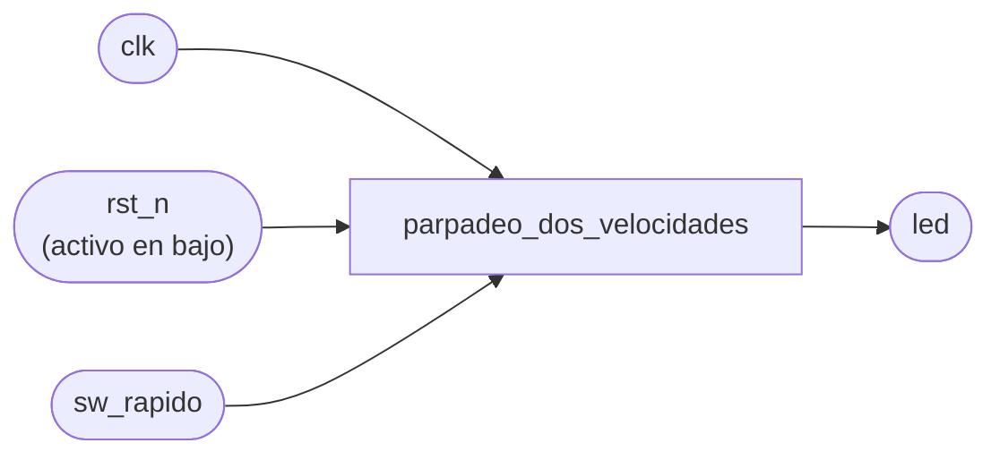
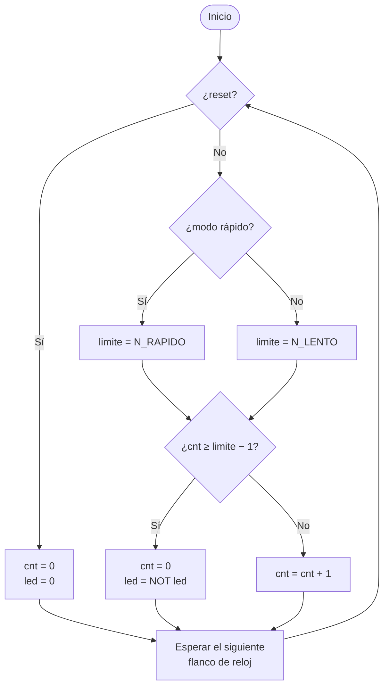

# 12. Ejemplo resuelto: un LED de dos velocidades

[← Conexión eléctrica](11_Conexion_electrica.md) · [Fundamentos](README.md)

Este ejemplo recorre las **ocho etapas** de la [metodología](01_Metodologia.md) con un problema sencillo que no es ninguno de los periféricos del laboratorio. Muestra el nivel de detalle que se espera en la bitácora. El código completo, comentado y probado, está en [ejemplos/](ejemplos/).

**Problema:** un LED debe parpadear continuamente. Un interruptor elige la velocidad: 1 Hz o 4 Hz. Un pulsador de reset apaga el LED y reinicia el sistema.

---

## Contenido

- [Etapa 1: entender el problema](#etapa-1-entender-el-problema)
- [Etapa 2: variables](#etapa-2-variables)
- [Etapa 3: cuentas](#etapa-3-cuentas)
- [Etapa 4: caja negra y especificaciones](#etapa-4-caja-negra-y-especificaciones)
- [Etapa 5: diagrama de flujo](#etapa-5-diagrama-de-flujo)
- [Etapa 6: Verilog](#etapa-6-verilog)
- [Etapa 7: RTL, predicción vs. síntesis](#etapa-7-rtl-predicción-vs-síntesis)
- [Etapa 8: simulación e implementación](#etapa-8-simulación-e-implementación)

---

## Etapa 1: entender el problema

- "Parpadear a 1 Hz" significa un ciclo completo (encendido + apagado) por segundo: el LED **cambia de estado cada 0.5 s**. A 4 Hz, cambia cada 0.125 s.
- El LED cambia de estado cada **medio periodo**, así que lo que hay que medir es ese medio periodo.
- Un LED de la tarjeta se maneja directamente desde un pin de la FPGA. Según el esquemático, puede encender con 1 o con 0.
- El interruptor y el pulsador son entradas externas: hay que sincronizarlas. El pulsador de reset es activo en bajo.

## Etapa 2: variables

| Variable | Tipo | Valores | Unidad | ¿Se recuerda? | Flip-flops |
|---|---|---|---|---|---|
| `clk` | Entrada | — | — | — | — |
| `rst_n` | Entrada externa | 0/1 | — | Se sincroniza | 2 |
| `sw_rapido` | Entrada externa | 0/1 | — | Se sincroniza | 2 |
| `limite` | Interna | N_LENTO o N_RAPIDO | ciclos | No: se elige en cada instante | 0 |
| `cnt` | Interna | 0 a N_LENTO − 1 | ciclos | **Sí**: la cuenta avanza de ciclo en ciclo | 24 |
| `fin` | Interna | 0/1 | — | No: es una comparación | 0 |
| `led` | Salida | 0/1 | — | **Sí**: debe mantener su estado entre cambios | 1 |
| | | | | **Total predicho** | **29** |

El ancho de `cnt` sale de la etapa 3.

## Etapa 3: cuentas

Con un reloj de 25 MHz (el de la tarjeta de referencia; verifiquen el suyo):

| Parámetro | Tiempo | Fórmula | Ciclos | Bits | En el código |
|---|---|---|---|---|---|
| Medio periodo lento (1 Hz) | 0.5 s | 0.5 · f_clk | 12 500 000 | 24 | `N_LENTO = CLK_FREQ / 2` |
| Medio periodo rápido (4 Hz) | 0.125 s | 0.125 · f_clk | 3 125 000 | 22 | `N_RAPIDO = CLK_FREQ / 8` |
| Ancho del contador | — | el mayor de los dos | — | **24** | `ANCHO = $clog2(N_LENTO)` |

## Etapa 4: caja negra y especificaciones



| ID | Especificación | Cómo se verifica |
|---|---|---|
| E1 | Con `sw_rapido = 0`, el LED cambia de estado cada 0.5 s | Testbench mide el tiempo entre cambios; en la tarjeta, 60 parpadeos en 60 s |
| E2 | Con `sw_rapido = 1`, el LED cambia de estado cada 0.125 s | Testbench mide el tiempo entre cambios |
| E3 | Con el reset presionado, el LED queda apagado | Testbench y observación directa |
| E4 | Al cambiar de velocidad, el nuevo ritmo empieza en menos de un medio periodo | Testbench (al cambiar a rápido) |

## Etapa 5: diagrama de flujo



La comparación usa **≥** y no **=**: si se pasa de lento a rápido cuando la cuenta ya superó el nuevo límite, con = la cuenta seguiría hasta dar la vuelta completa (casi 0.7 s) y E4 no se cumpliría.

## Etapa 6: Verilog

Archivo: [ejemplos/parpadeo_dos_velocidades.v](ejemplos/parpadeo_dos_velocidades.v). Cada elemento del diagrama de flujo tiene su lugar en el código:

| Diagrama de flujo | Código |
|---|---|
| Rombo "¿modo rápido?" y las dos acciones `limite = ...` | `wire [ANCHO-1:0] limite = rapido ? N_RAPIDO : N_LENTO;` (combinacional: no se recuerda) |
| Rombo "¿cnt ≥ limite − 1?" | `wire fin = (cnt >= limite - 1);` (combinacional) |
| Acciones sobre `cnt` | `always @(posedge clk)` con `cnt <= 0` o `cnt <= cnt + 1` |
| Acciones sobre `led` | `always @(posedge clk)` con `led <= ~led` cuando `fin = 1` |
| "Esperar el siguiente flanco" | Implícito: los bloques `always @(posedge clk)` solo actúan en el flanco |

El núcleo del diseño:

```verilog
// Mux de constantes: el interruptor elige el límite (no se recuerda)
wire [ANCHO-1:0] limite = rapido ? N_RAPIDO : N_LENTO;

// Contador de medio periodo (se recuerda: 24 flip-flops)
reg  [ANCHO-1:0] cnt;
wire fin = (cnt >= limite - 1);           // comparador: terminó el medio periodo

always @(posedge clk) begin
    if (rst || fin)
        cnt <= 0;
    else
        cnt <= cnt + 1;
end

// LED (se recuerda: 1 flip-flop)
always @(posedge clk) begin
    if (rst)
        led <= 1'b0;
    else if (fin)
        led <= ~led;
end
```

El archivo completo incluye además la sincronización de las entradas (4 flip-flops) y los `localparam` de la etapa 3.

## Etapa 7: RTL, predicción vs. síntesis

**Predicción** (de la tabla de variables): 29 flip-flops; 1 sumador para `cnt + 1`; 1 restador para `limite − 1` (porque `limite` no es constante); 1 comparador de magnitud; 1 multiplexor para `limite`; lógica para `rst || fin` y para las inversiones.

**Resultado de Yosys** a nivel RTL (`proc; opt; stat`):

| Celda | Cantidad | Corresponde a |
|---|---|---|
| `$dff` | 2 | `ent_meta` y `ent_sync`, de 2 bits cada uno: el sincronizador (4 flip-flops) |
| `$sdff` | 1 | `cnt`, 24 bits, con reset síncrono (`rst \|\| fin`) |
| `$sdffe` | 1 | `led`, con reset síncrono y habilitación (`fin`) |
| `$add` | 1 | `cnt + 1` |
| `$sub` | 1 | `limite - 1` |
| `$ge` | 1 | `cnt >= limite - 1` |
| `$mux` | 1 | selección de `limite` |
| `$logic_or` | 1 | `rst \|\| fin` |
| `$not` | 2 | `~rst_n` y `~led` |

**Resultado para la FPGA** (`synth_ice40; stat`): 4 `SB_DFF` + 24 `SB_DFFSR` + 1 `SB_DFFESR` = **29 flip-flops**, igual a la predicción, más 46 `SB_LUT4` y 48 `SB_CARRY` para la lógica y la aritmética.

**Explicación de las diferencias:**

- La predicción de bloques coincide uno a uno.
- La herramienta absorbió `if (fin)` como habilitación del registro del LED (`$sdffe`) en lugar de un multiplexor.
- El `$sub` existe porque `limite` es variable. Si el límite fuera una constante, el restador desaparecería: es una buena idea para el experimento S2.

**Experimento S3 (error provocado), como ilustración:** al escribir un bloque `always @(*)` con un `if` sin `else`, Yosys reporta `Latch inferred for signal ... y` y aparece una celda `$dlatch`.

## Etapa 8: simulación e implementación

**Testbench:** [ejemplos/tb_parpadeo_dos_velocidades.v](ejemplos/tb_parpadeo_dos_velocidades.v). Usa `CLK_FREQ = 1 000` Hz: el intervalo más corto (0.125 s) dura 125 ciclos, y toda la simulación tarda menos de un segundo. Cada especificación tiene su verificación automática:

```
OK:    E1 lento: medio periodo = 500000000 ns
OK:    E2 rapido: medio periodo = 125000000 ns
OK:    E3 reset: LED apagado
Simulacion correcta: 0 errores
```

La medición E2 se hace justo después de cambiar a modo rápido, así que también evidencia E4.

```bash
cd ejemplos
iverilog -o sim.vvp tb_parpadeo_dos_velocidades.v parpadeo_dos_velocidades.v
vvp sim.vvp
gtkwave tb_parpadeo_dos_velocidades.vcd
```

**Implementación:** el archivo de restricciones asigna `clk` al oscilador, `rst_n` a un pulsador, `sw_rapido` a un interruptor y `led` a un LED. En la tarjeta se verifica E1 contando 60 parpadeos en 60 segundos, lo que además **confirma `CLK_FREQ`** ([Frecuencia del reloj](08_Frecuencia_del_reloj.md#d-verificarla-experimentalmente)).

---

[← Conexión eléctrica](11_Conexion_electrica.md) · [Fundamentos](README.md)
