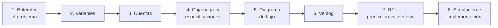

# Laboratorio: Implementación de periféricos en FPGA

[← Inicio del curso](../../README.md)

El propósito de este laboratorio es seguir el **flujo completo de desarrollo** de un sistema digital, presentando cada uno de los artefactos requeridos (diagramas, código, descripciones, simulaciones, evidencias). El laboratorio consiste en la creación de una **tarea de hardware** que funcione como controlador de un periférico.

Como equipo de trabajo, realicen la implementación de un controlador para **uno** de los periféricos de la lista. Seleccionen el dispositivo de interés y discutan con el profesor el alcance del controlador a desarrollar.

Los periféricos son sencillos a propósito, y su funcionamiento está documentado desde hace décadas en libros y hojas de datos. **El reto no es el periférico: es abordar el problema con método, describirlo en Verilog y dominar las herramientas de síntesis.**

---

## Contenido

- [Objetivos de aprendizaje](#objetivos-de-aprendizaje)
- [Periféricos](#periféricos)
- [Cómo se trabaja](#cómo-se-trabaja)
- [Antes de empezar](#antes-de-empezar)
- [Flujo de desarrollo](#flujo-de-desarrollo)
- [Entregables](#entregables)
- [Evaluación](#evaluación)
- [Material](#material)
- [Mejoras propuestas](#mejoras-propuestas)

---

## Objetivos de aprendizaje

Al finalizar el laboratorio, el grupo será capaz de:

- Abordar un problema de diseño digital: identificar variables, hacer las cuentas de tiempo y bits, y especificar el sistema como una caja negra.
- Describir el comportamiento con diagramas de flujo y tablas de verdad, y traducirlo a Verilog sintetizable.
- **Predecir** el hardware que producirá su descripción y **contrastarlo** con el RTL y las estadísticas de la herramienta de síntesis.
- Verificar el diseño con un testbench que compruebe cada especificación.
- Sintetizar, configurar la FPGA y validar el funcionamiento con el periférico real.

## Periféricos

Cada grupo elige **uno**. Cada enlace lleva a las **instrucciones** del periférico: alcance, qué investigar, preguntas guía por etapa, conexión segura y qué verificar.

| Periférico | Enunciado | Temas a investigar | Instrucciones |
|---|---|---|---|
| Servomotor SG90 | Controlar la posición del servomotor a través de pulsadores | Servomotores, señal de control, PWM | [Servomotor](Perifericos/Servomotor/README.md) |
| Sensor de ultrasonido HC-SR04 | Mostrar por medio de LEDs la distancia a la que está un objeto | Medición de tiempo con contadores, comparadores | [Ultrasonido](Perifericos/Ultrasonido/README.md) |
| Puente H con PWM | Controlar el sentido de giro de un motor y su velocidad a través de pulsadores | Puente H, control de motores DC, PWM | [Puente H](Perifericos/Puente_H/README.md) |
| Generador de tonos | Enviar a un parlante diferentes tonos audibles, seleccionando el tono con pulsadores | Sonido, escala musical, divisores de frecuencia | [Generador de tonos](Perifericos/Generador_Tonos/README.md) |
| Reloj de segundos con 2 displays de 7 segmentos | Construir un contador de segundos que se reinicie cada 60 segundos | Displays, BCD, contadores en cascada, multiplexación | [Reloj de segundos](Perifericos/Reloj_7_Segmentos/README.md) |
| Motor paso a paso | Controlar el giro de un motor paso a paso a través de pulsadores | Motores paso a paso, secuencias de excitación | [Motor paso a paso](Perifericos/Motor_Paso_a_Paso/README.md) |

## Cómo se trabaja

El laboratorio sigue una **metodología de ocho etapas**, que se explica en detalle en [Fundamentos: metodología](Fundamentos/01_Metodologia.md) y se ilustra con un [ejemplo resuelto](Fundamentos/12_Ejemplo_resuelto.md):

Tres principios:

1. **Investigar antes de diseñar.** El funcionamiento de cada periférico se busca en su hoja de datos y en los libros de diseño digital ([dónde buscar](Fundamentos/01_Metodologia.md#10-dónde-buscar)). Las guías de este repositorio dan las bases y las preguntas, no las soluciones.
2. **Describir comportamiento, no armar compuertas.** El diseño se describe en Verilog a partir del diagrama de flujo; la herramienta de síntesis se encarga de la implementación.
3. **Entender lo que produce la herramienta.** Antes de sintetizar, el grupo predice el hardware; después lo compara con el RTL y las estadísticas, y explica cada diferencia. Los [experimentos de síntesis](Fundamentos/10_Herramientas_de_sintesis.md#5-experimentos-de-síntesis) son parte obligatoria del laboratorio.

## Antes de empezar

1. **Lean los [Fundamentos](Fundamentos/README.md)** en orden, incluido el ejemplo resuelto.
2. **Verifiquen sus herramientas:** Icarus Verilog, GTKWave, Yosys, netlistsvg y las herramientas de síntesis y configuración de los ejemplos `.zip`. Todas son de código abierto.
3. **Averigüen `CLK_FREQ`** de su tarjeta y verifíquenlo con el ejemplo resuelto: [Frecuencia del reloj](Fundamentos/08_Frecuencia_del_reloj.md).
4. **Elijan el periférico**, acuerden el alcance con el profesor y anoten los parámetros asignados a su grupo.

## Flujo de desarrollo

Los seis pasos del enunciado del laboratorio corresponden a las ocho etapas de la metodología:

| Paso del enunciado | Etapas de la metodología | Apoyo |
|---|---|---|
| 1. Definir el comportamiento: diagrama de flujo y tablas de verdad | 1 a 5 | [Metodología](Fundamentos/01_Metodologia.md), [Bloques combinacionales](Fundamentos/05_Bloques_combinacionales.md) |
| 2. Definir la estructura: diagrama de bloques | 4 y 5 | [Contadores y tiempo](Fundamentos/04_Contadores_y_tiempo.md), [Señales periódicas](Fundamentos/06_Senales_periodicas_PWM.md) |
| 3. Describir el diseño en Verilog, sintetizable | 6 | [Verilog básico](Fundamentos/02_Verilog_basico.md), [Lógica secuencial](Fundamentos/03_Logica_secuencial.md) |
| 4. Representar en RTL con Yosys y netlistsvg (`make rtl`) y comparar con la estructura propuesta | 7 | [Herramientas de síntesis](Fundamentos/10_Herramientas_de_sintesis.md) |
| 5. Simular con Icarus Verilog y GTKWave (`make sim`) y verificar contra el paso 1 | 8 | [Simulación](Fundamentos/09_Simulacion.md) |
| 6. Sintetizar y configurar la FPGA (`make clean syn conf`), con el archivo de restricciones físicas | 8 | [Herramientas de síntesis](Fundamentos/10_Herramientas_de_sintesis.md), [Conexión eléctrica](Fundamentos/11_Conexion_electrica.md) |

Si la simulación no cumple lo especificado, se vuelve a los pasos 2, 3 y 4; si la tarjeta muestra discrepancias, a los pasos 3 y 4.

## Entregables

| Entregable | Contenido | Guía |
|---|---|---|
| **Bitácora grupal** | Las ocho etapas, los experimentos de síntesis, resultados y análisis | [Guía de la bitácora](Bitacora.md) |
| **Repositorio en GitHub Classroom** | Código Verilog, testbench, archivo de restricciones, README corto y commits que muestren el proceso | [Guía de la bitácora: repositorio](Bitacora.md#el-repositorio-en-github-classroom) |
| **Video** | Explicación del flujo de desarrollo con su diseño y demostración del prototipo | [Guía de la bitácora: video](Bitacora.md#el-video) |

## Evaluación

La evaluación se basa en lo **registrado en la bitácora** y en evidencias que solo pueden salir del proceso de cada grupo. Los criterios generales del curso están en la [metodología del curso](../../README.md#metodología); para este laboratorio:

| Criterio | Qué se revisa |
|---|---|
| **Habilitantes** | Asistencia, preinforme a tiempo, commits realizados y justificados |
| **Investigación** | Funcionamiento del periférico explicado con sus palabras y con fuentes citadas |
| **Etapa de diseño** | Tabla de variables, cuentas, caja negra con especificaciones medibles, diagrama de flujo, tablas de verdad |
| **Etapa de descripción en HDL** | Verilog sintetizable, comentado y trazable al diagrama de flujo |
| **Dominio de las herramientas** | Predicción vs. síntesis, experimentos S1 a S5, explicación de las diferencias |
| **Etapa de simulación** | Testbench que verifica cada especificación, capturas con mediciones |
| **Etapa de implementación** | Restricciones, conexión segura, mediciones en la tarjeta |
| **Sustentación** | Preguntas sobre el propio diseño y, si el profesor lo indica, un **cambio en vivo** (por ejemplo, otro tiempo u otra posición) que el grupo debe recalcular, describir y sintetizar en la sesión |
| **Valor agregado** | Mejoras, optimizaciones o un análisis más profundo |

El profesor puede asignar **parámetros distintos a cada grupo** (tiempos, posiciones, notas, rangos). Cada ficha de periférico tiene una tabla para anotarlos.

## Material

- Tarjeta FPGA del curso y cable USB.
- El periférico elegido y lo necesario para conectarlo de forma segura: fuente externa, módulo driver, transistores, resistencias, según sus instrucciones.
- Protoboard, cables y multímetro.
- Osciloscopio o analizador lógico.
- Software de código abierto: Icarus Verilog, GTKWave, Yosys, netlistsvg y las herramientas de síntesis y configuración de los ejemplos `.zip`.

## Mejoras propuestas

La versión base de cada periférico puede resolverse con control por nivel de los pulsadores, contadores y bloques combinacionales. Las mejoras agregan memoria o secuencias y suman en el criterio de valor agregado. Antes de empezar una, acuerden su alcance con el profesor y asegúrense de que la versión base funciona en la tarjeta.

| Mejora | Qué implica investigar | Periféricos |
|---|---|---|
| Que cada pulsación avance un paso y el valor se mantenga al soltar | Debounce, detector de flanco, registros con saturación | Servo, puente H, tonos |
| Parada automática antes de invertir el giro | Máquinas de estados con temporizador | Puente H |
| Secuencias con registro de desplazamiento | Registros de desplazamiento circulares | Motor paso a paso |
| Melodía que se reproduce sola | Máquinas de estados, memorias de notas | Generador de tonos |
| Rampa de aceleración | Registros que se acercan a un valor objetivo | Puente H, motor paso a paso |
| Distancia en centímetros en displays | Conversión a BCD, displays de 7 segmentos | Ultrasonido |

---

[← Inicio del curso](../../README.md)
