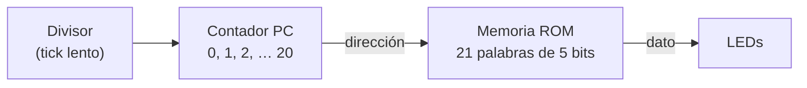
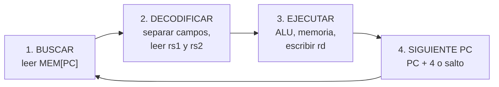
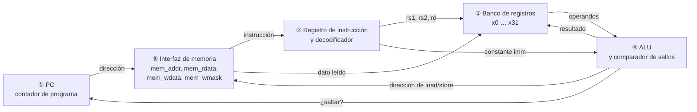
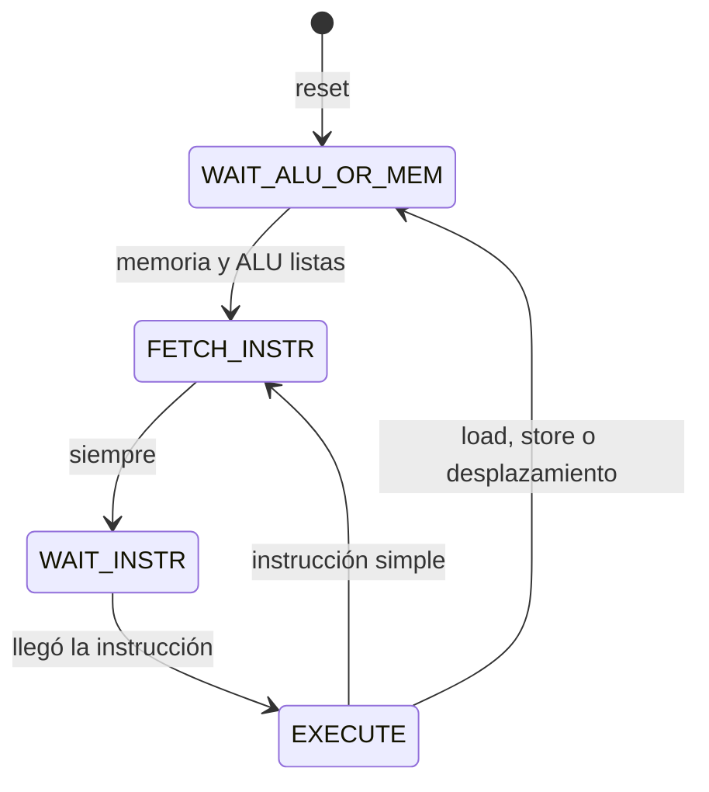

# Fundamentos 01 · RISC-V y el procesador FemtoRV

[← Volver a la guía](../README.md)

Este documento supone que **nunca han visto un procesador por dentro**. Parte de algo que ya saben hacer (un contador que recorre una memoria) y llega hasta el código Verilog del FemtoRV.

---

## Contenido

1. [Un procesador es un contador que lee una memoria](#1-un-procesador-es-un-contador-que-lee-una-memoria)
2. [RISC-V es un idioma; el FemtoRV es quien lo habla](#2-risc-v-es-un-idioma-el-femtorv-es-quien-lo-habla)
3. [Lo que ve el programador: registros, PC y memoria](#3-lo-que-ve-el-programador-registros-pc-y-memoria)
4. [Las instrucciones de RV32I](#4-las-instrucciones-de-rv32i)
5. [Cómo se codifica una instrucción en 32 bits](#5-cómo-se-codifica-una-instrucción-en-32-bits)
6. [El ciclo buscar → decodificar → ejecutar](#6-el-ciclo-buscar--decodificar--ejecutar)
7. [Las cinco partes del FemtoRV Quark](#7-las-cinco-partes-del-femtorv-quark)
8. [La máquina de estados y los ciclos por instrucción](#8-la-máquina-de-estados-y-los-ciclos-por-instrucción)
9. [Lo que el Quark no tiene](#9-lo-que-el-quark-no-tiene)
10. [Preguntas de autoevaluación](#10-preguntas-de-autoevaluación)

---

## 1. Un procesador es un contador que lee una memoria

En la Semana 1 empiezan con el **blinker desde memoria** (`blinker/rtl/blinker.v`). Tiene tres bloques que ya conocen del laboratorio de periféricos:



El contador se llama **PC** (*program counter*, contador de programa). En cada paso el PC apunta a una posición de la memoria y el contenido de esa posición sale a los LEDs.

Un procesador hace **exactamente lo mismo**, con dos diferencias:

| Blinker | Procesador |
|---|---|
| Lo que lee de la memoria va directo a los LEDs | Lo que lee es una **instrucción**: se **decodifica** ("esto es una suma") y se **ejecuta** |
| El PC siempre avanza de 1 en 1 | El PC normalmente avanza a la siguiente instrucción, pero una instrucción de **salto** puede cambiarlo a cualquier valor (así se hacen los `if` y los bucles) |
| No guarda resultados | Tiene **registros** donde guarda datos y una **ALU** que hace operaciones con ellos |
| Solo lee | También **escribe** en la memoria |

Esa es la idea completa. Todo lo demás son detalles de cómo se hace cada parte.

## 2. RISC-V es un idioma; el FemtoRV es quien lo habla

Hay dos cosas que se confunden con facilidad:

- **Un conjunto de instrucciones** (ISA, *Instruction Set Architecture*): es una **especificación**, un documento. Dice qué instrucciones existen, qué hace cada una y cómo se escribe cada una en bits. Es como un idioma: define palabras y gramática.
- **Una implementación** (microarquitectura): es un **circuito** concreto que ejecuta esas instrucciones. Es como una persona que habla el idioma.

| Conjunto de instrucciones (el idioma) | Implementaciones (quien lo habla) |
|---|---|
| x86 | procesadores Intel y AMD de los computadores |
| ARM | procesadores de celulares, microcontroladores STM32 |
| AVR | microcontrolador del Arduino Uno |
| **RISC-V** | **FemtoRV** (este laboratorio), PicoRV32, procesadores de SiFive, ESP32-C3… |

**RISC-V** tiene una característica que lo hace ideal para un curso con herramientas abiertas: es **abierto y libre**. Cualquiera puede diseñar un procesador RISC-V, publicarlo y meterlo en una FPGA sin pagar licencias. Con x86 o ARM eso no es posible.

**RISC** significa *Reduced Instruction Set Computer*: pocas instrucciones y simples. La base de RISC-V para 32 bits se llama **RV32I** ("32" por los 32 bits de datos, "I" por *integer*, enteros) y tiene unas 40 instrucciones. Sobre esa base se agregan **extensiones** opcionales, cada una con una letra:

| Extensión | Agrega | ¿La tiene el Quark? |
|---|---|---|
| I | Base: enteros | Sí |
| M | Multiplicación y división | **No** |
| C | Instrucciones comprimidas de 16 bits | No |
| F, D | Punto flotante | No |

El **FemtoRV** es una colección de procesadores RISC-V escritos por Bruno Levy para enseñar. Usamos el más sencillo, el **Quark**: un solo archivo Verilog de unas 200 líneas de código (`soc/rtl/cpu/femtorv32_quark.v`).

## 3. Lo que ve el programador: registros, PC y memoria

Un programa en RISC-V solo "ve" tres cosas:

**Los 32 registros.** Son 32 variables internas de 32 bits cada una, llamadas `x0` a `x31`. Son muy rápidas porque están dentro del procesador. Toda operación (sumar, comparar…) se hace **entre registros**. Cada registro tiene también un nombre de uso convencional, que es el que aparece en los listados del compilador:

| Registro | Nombre | Uso convencional |
|---|---|---|
| `x0` | `zero` | **Siempre vale 0.** Escribir en él no tiene efecto |
| `x1` | `ra` | Dirección de retorno de una función (*return address*) |
| `x2` | `sp` | Puntero de pila (*stack pointer*) |
| `x5`–`x7`, `x28`–`x31` | `t0`–`t6` | Temporales |
| `x8`, `x9`, `x18`–`x27` | `s0`–`s11` | Variables que se conservan entre llamadas |
| `x10`–`x17` | `a0`–`a7` | Argumentos de funciones; `a0` también es el valor de retorno |

**El PC.** Guarda la dirección de la instrucción que se está ejecutando. Como cada instrucción ocupa 4 bytes, normalmente avanza de 4 en 4: `0x00`, `0x04`, `0x08`…

**La memoria.** Es un arreglo de bytes, cada uno con una dirección de 32 bits. El procesador lee y escribe **palabras** de 4 bytes (también bytes sueltos o medias palabras). RISC-V es **little endian**: en una palabra, el byte de la dirección más baja es el **menos** significativo.

> **Idea clave del laboratorio:** el procesador no sabe qué hay detrás de cada dirección. Si detrás hay una RAM, guarda el dato. Si detrás hay un periférico, el periférico hace algo con el dato (enciende LEDs, envía un carácter). Eso se llama **E/S mapeada en memoria** y se explica en [Fundamentos 02](02_Bus_y_perifericos.md).

## 4. Las instrucciones de RV32I

No hay que memorizarlas: hay que **saber leerlas** en un listado. Estas son las familias:

| Familia | Ejemplos | Qué hace | Equivalente en C |
|---|---|---|---|
| Aritmética entre registros | `add a0, a1, a2` · `sub` | `a0 = a1 + a2` | `x = y + z;` |
| Aritmética con constante | `addi a0, a0, 4` | `a0 = a0 + 4` (constante de 12 bits con signo) | `x = x + 4;` |
| Lógica | `and`, `or`, `xor`, `andi`, `ori`, `xori` | operaciones bit a bit | `x & y`, `x \| y` |
| Desplazamientos | `sll`, `srl`, `sra`, `slli`… | desplazar bits | `x << 3`, `x >> 2` |
| Comparación | `slt a0, a1, a2` | `a0 = (a1 < a2) ? 1 : 0` | `x = (y < z);` |
| **Carga** (*load*) | `lw a0, 8(a1)` · `lb`, `lbu`, `lh` | lee de la memoria: `a0 = MEM[a1 + 8]` | `x = *p;` |
| **Almacenamiento** (*store*) | `sw a0, 8(a1)` · `sb`, `sh` | escribe en la memoria: `MEM[a1 + 8] = a0` | `*p = x;` |
| Salto condicional (*branch*) | `beq a0, a1, etiqueta` · `bne`, `blt`, `bge`… | si `a0 == a1`, salta a `etiqueta` | `if`, `while`, `for` |
| Salto incondicional | `jal ra, función` · `jalr` | salta y guarda la dirección de regreso en `ra` | llamar a una función |
| Constantes grandes | `lui a0, 0x400` | `a0 = 0x400 << 12 = 0x0040_0000` | `x = 0x400000;` |

Fíjense en dos cosas:

1. **Solo `lw`/`sw` (y sus variantes) tocan la memoria.** Las demás trabajan entre registros. Esto se llama arquitectura *load/store*.
2. En `lw a0, 8(a1)` la dirección se calcula como **registro base + desplazamiento**. Así accede el programa a los registros de un periférico: un registro con la dirección base y un desplazamiento para cada registro del periférico.

**Pseudo-instrucciones.** El listado del compilador muestra a veces nombres que no son instrucciones reales sino atajos:

| Pseudo-instrucción | Instrucción real |
|---|---|
| `li a0, 5` | `addi a0, zero, 5` |
| `mv a0, a1` | `addi a0, a1, 0` |
| `j etiqueta` | `jal zero, etiqueta` (salta sin guardar regreso) |
| `ret` | `jalr zero, 0(ra)` (vuelve de una función) |
| `beqz a0, etiqueta` | `beq a0, zero, etiqueta` |
| `nop` | `addi zero, zero, 0` (no hace nada) |

## 5. Cómo se codifica una instrucción en 32 bits

Toda instrucción RV32I ocupa **32 bits**. Los bits se reparten en **campos**, y hay seis formatos según la familia:

```
 31          25 24     20 19     15 14  12 11          7 6        0
┌──────────────┬─────────┬─────────┬──────┬─────────────┬──────────┐
│    funct7    │   rs2   │   rs1   │funct3│     rd      │  opcode  │  R: add, sub, and…
├──────────────┴─────────┼─────────┼──────┼─────────────┼──────────┤
│       imm[11:0]        │   rs1   │funct3│     rd      │  opcode  │  I: addi, lw, jalr…
├──────────────┬─────────┼─────────┼──────┼─────────────┼──────────┤
│  imm[11:5]   │   rs2   │   rs1   │funct3│  imm[4:0]   │  opcode  │  S: sw, sb…
├──────────────┼─────────┼─────────┼──────┼─────────────┼──────────┤
│ imm[12,10:5] │   rs2   │   rs1   │funct3│ imm[4:1,11] │  opcode  │  B: beq, bne…
├──────────────┴─────────┴─────────┴──────┼─────────────┼──────────┤
│               imm[31:12]                │     rd      │  opcode  │  U: lui, auipc
├─────────────────────────────────────────┼─────────────┼──────────┤
│        imm[20,10:1,11,19:12]            │     rd      │  opcode  │  J: jal
└─────────────────────────────────────────┴─────────────┴──────────┘
```

- **opcode** (7 bits): la familia de la instrucción.
- **rd**: número del registro destino (5 bits: 0 a 31).
- **rs1, rs2**: números de los registros fuente.
- **funct3, funct7**: qué operación exacta dentro de la familia.
- **imm**: constante (*immediate*) que viene dentro de la instrucción.

Los campos `rd`, `rs1` y `rs2` están **siempre en la misma posición**. Eso simplifica mucho el decodificador.

### Ejemplo 1: `addi a0, a0, 4` = `0x00450513`

Esta instrucción aparece en el listado de `hola.c`. En binario:

```
0x00450513 = 0000 0000 0100 | 0101 0 | 000 | 0101 0 | 001 0011
              imm[11:0] = 4  | rs1=10 | f3=0 | rd=10  | opcode = 0010011 (ALU con constante)
```

`rs1 = 10` es `x10 = a0`, `rd = 10` es también `a0`, `funct3 = 000` es suma: `a0 = a0 + 4`.

### Ejemplo 2: `sw a3, 0(a4)` = `0x00d72023`

Es la instrucción que envía un carácter a la UART en `hola.c`:

```
0x00d72023 = 0000000 | 01101 | 01110 | 010 | 00000 | 010 0011
             imm=0    | rs2=13| rs1=14| f3=2| imm=0 | opcode = 0100011 (STORE)
```

Escribe el registro `x13 = a3` (el carácter) en la dirección `x14 + 0` (`a4` contiene `0x0040_0008`, el registro de dato de la UART). `funct3 = 010` significa palabra de 32 bits.

## 6. El ciclo buscar → decodificar → ejecutar

Todo procesador repite estos pasos sin parar:



**Ejemplo a mano.** El listado de `soc/firmware/crt0.S` (lo primero que ejecuta el procesador al salir del reset) empieza así. El PC arranca en `0x00`:

| PC | Instrucción | Qué hace | Registros después | Siguiente PC |
|---|---|---|---|---|
| `0x00` | `li sp, …` | carga el tope de la pila | `sp` = tope de la pila | `0x04` |
| `0x04` | `li a0, …` | inicio de la zona `.bss` | `a0` = inicio | `0x08` |
| `0x08` | `li a1, …` | fin de la zona `.bss` | `a1` = fin | `0x0C` |
| `0x0C` | `li a2, 0` | | `a2 = 0` | `0x10` |
| `0x10` | `bgeu a0, a1, 0x20` | si `a0 ≥ a1`, salta a `0x20` | (sin cambios) | `0x14` o `0x20` |
| `0x14` | `sw a2, 0(a0)` | escribe 0 en `MEM[a0]` | (memoria cambia) | `0x18` |
| `0x18` | `addi a0, a0, 4` | avanza a la siguiente palabra | `a0 = a0 + 4` | `0x1C` |
| `0x1C` | `j 0x10` | vuelve a la comparación | (sin cambios) | `0x10` |
| `0x20` | `jal main` | llama a `main()` | `ra = 0x24` | dirección de `main` |

Las instrucciones en `0x10`–`0x1C` son un **bucle** que pone en cero una zona de memoria: es un `while` hecho con un salto condicional y uno incondicional.

## 7. Las cinco partes del FemtoRV Quark

Abran `soc/rtl/cpu/femtorv32_quark.v`. **No tienen que entender cada línea.** Tienen que **ubicar** estas cinco partes y explicar qué hace cada una:



| Parte | Dónde está (líneas aproximadas) | Qué buscar |
|---|---|---|
| **① PC y siguiente PC** | 193–212 y 354–356 | `PCplus4 = PC + 4`; `PCplusImm` para saltos; en el estado `EXECUTE`, `PC <= …` elige entre ellos |
| **② Registro de instrucción y decodificador** | 55–92 y 348 | `instr <= mem_rdata` guarda la instrucción; `rdId = instr[11:7]`; señales `isALU`, `isLoad`, `isStore`, `isBranch`… comparan el opcode |
| **③ Banco de registros** | 94–107 y 346–347 | `reg [31:0] registerFile [31:0]`: 32 registros de 32 bits; se escribe solo si `rdId != 0` (por eso `x0` siempre es 0) |
| **④ ALU** | 109–191 | `aluOut`: suma, resta, lógica, desplazamientos; `predicate`: decide si un salto condicional se toma |
| **⑤ Interfaz de memoria** | 213–291 | `mem_addr` es el PC (al buscar) o `loadstore_addr` (al leer o escribir datos); `LOAD_data` y `STORE_wmask` manejan bytes y medias palabras |

Comparen con el blinker: la parte ① es su contador, la parte ⑤ es su lectura de la ROM. Las partes ②, ③ y ④ son las que el blinker no tiene.

## 8. La máquina de estados y los ciclos por instrucción

El Quark no hace todo en un ciclo de reloj. Usa una **máquina de estados** de 4 estados (líneas 292–370), con codificación *one-hot*:



| Estado | Qué pasa |
|---|---|
| `FETCH_INSTR` | Pone el PC en `mem_addr` y activa `mem_rstrb`: pide la instrucción a la memoria |
| `WAIT_INSTR` | La instrucción llega por `mem_rdata`: se guarda en `instr` y se leen `rs1` y `rs2` del banco |
| `EXECUTE` | La ALU calcula; se escribe `rd`; si es load/store se hace el acceso a memoria; se actualiza el PC |
| `WAIT_ALU_OR_MEM` | Espera un ciclo más a la memoria (load/store) o varios a la ALU (desplazamientos) |

De ahí salen los **ciclos de reloj por instrucción** del Quark:

| Tipo de instrucción | Estados que recorre | Ciclos |
|---|---|---|
| ALU (`add`, `addi`, `and`, `lui`…), saltos (`beq`, `jal`, `j`…) | FETCH → WAIT → EXECUTE | **3** |
| Load y store (`lw`, `sw`, `lbu`…) | FETCH → WAIT → EXECUTE → WAIT_ALU_OR_MEM | **4** |
| Desplazamientos (`sll`, `srli`…) | igual que load/store, pero espera más según cuántos bits se desplaza | **4 o más** |

> **Para qué sirve esta tabla:** con el listado del compilador y esta tabla se puede **predecir** cuánto tarda un trozo de programa. Es el experimento de la Semana 2.

## 9. Lo que el Quark no tiene

Conocer las limitaciones es parte de entender el diseño:

- **No tiene la extensión M**: no hay instrucción de multiplicar ni de dividir. Cuando un programa en C usa `*`, `/` o `%`, el compilador llama a una **rutina de software** que lo hace con sumas, restas y desplazamientos (decenas o cientos de ciclos). Por eso el SoC trae un **multiplicador por hardware** como periférico.
- **No tiene interrupciones**: el programa no puede ser "avisado" por un periférico. Tiene que **preguntar** una y otra vez (*polling*): por ejemplo, `while (UART_CONTROL & UART_OCUPADA) {}`.
- **Ejecuta una instrucción a la vez** (no tiene *pipeline*): mientras busca una instrucción no ejecuta otra. Es más lento que un procesador comercial, pero mucho más fácil de entender.

## 10. Preguntas de autoevaluación

1. ¿Cuál es la diferencia entre RISC-V y el FemtoRV? Den un ejemplo análogo con otro conjunto de instrucciones.
2. ¿Por qué escribir en el registro `x0` no tiene efecto? ¿En qué línea del Quark se ve?
3. Decodifiquen a mano `0x00e7a023`. ¿Qué instrucción es y qué registros usa?
4. ¿Qué tiene el Quark que no tiene el blinker? ¿Qué tiene el blinker que también tiene el Quark?
5. ¿Cuántos ciclos tarda este bucle en el Quark? `loop: addi a0, a0, 1` / `bne a0, a1, loop`
6. ¿Por qué un programa que divide (`x / 10`) es mucho más lento en el Quark que uno que suma?

[← Volver a la guía](../README.md)
