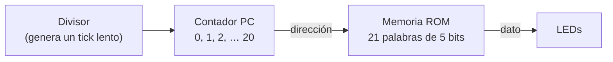
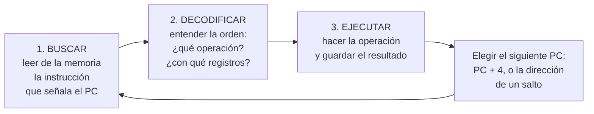
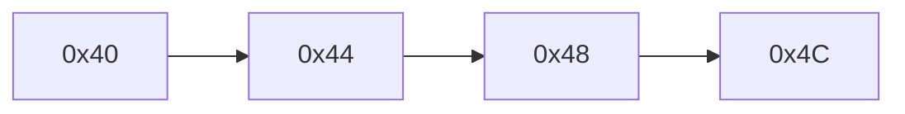
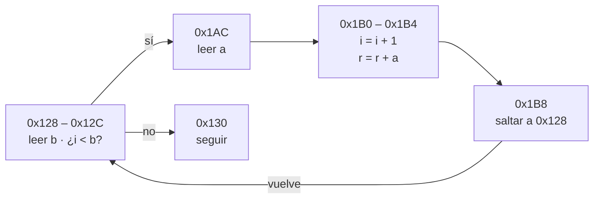
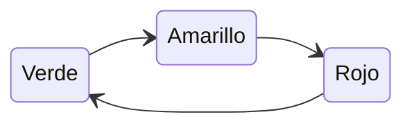
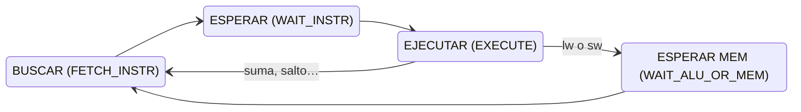
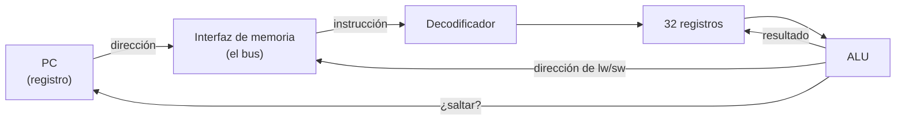

# Fundamentos 01 · Qué es un procesador y cómo funciona el FemtoRV

[← Volver a la guía](../README.md)

Este documento supone que **nunca han visto un procesador por dentro**. Parte de algo que ya saben hacer, un contador que recorre una memoria, y llega a una idea general de cómo funciona el FemtoRV.

**Lo que no se busca:** que diseñen un procesador ni que memoricen sus instrucciones. El procesador es una pieza que van a **usar**, como usarían un microcontrolador. Lo que sí deben entender es qué hace, a grandes rasgos, para poder conectarle sus propios circuitos (eso es [Fundamentos 02](02_Bus_y_perifericos.md)).

---

## Contenido

1. [Un procesador es un contador que lee una memoria](#1-un-procesador-es-un-contador-que-lee-una-memoria)
2. [RISC-V es un idioma; el FemtoRV es quien lo habla](#2-risc-v-es-un-idioma-el-femtorv-es-quien-lo-habla)
3. [Tres palabras clave: registro, palabra y memoria](#3-tres-palabras-clave-registro-palabra-y-memoria)
4. [Buscar, decodificar y ejecutar](#4-buscar-decodificar-y-ejecutar)
5. [Las pocas instrucciones que van a leer](#5-las-pocas-instrucciones-que-van-a-leer)
6. [La máquina de estados del FemtoRV](#6-la-máquina-de-estados-del-femtorv)
7. [Las partes del FemtoRV, vistas de lejos](#7-las-partes-del-femtorv-vistas-de-lejos)

---

## 1. Un procesador es un contador que lee una memoria

En la Semana 1 empiezan con el **blinker desde memoria** (`blinker/rtl/blinker.v`). Tiene tres bloques que ya conocen del laboratorio de periféricos:

El contador se llama **PC** (*program counter*, contador de programa). En cada paso, el PC apunta a una posición de la memoria y el contenido de esa posición sale a los LEDs.

Un procesador hace **lo mismo**: un PC recorre una memoria. Lo que cambia es qué hace con lo que lee:

| Blinker | Procesador |
|---|---|
| Lo que lee de la memoria va directo a los LEDs | Lo que lee es una **instrucción**, una orden como "suma estos dos números". La interpreta (**decodifica**) y la cumple (**ejecuta**) |
| El PC siempre avanza de 1 en 1 | El PC normalmente avanza a la siguiente instrucción, pero una instrucción de **salto** puede cambiarlo. Así se hacen los `if` y los bucles |
| No guarda resultados | Tiene **registros** donde guarda datos y una **ALU** que hace cuentas con ellos |
| Solo lee la memoria | También **escribe** en ella |

Esa es la idea completa. Todo lo demás son detalles de cómo se hace cada parte.

## 2. RISC-V es un idioma; el FemtoRV es quien lo habla

Hay dos cosas que se confunden con facilidad:

- **Un conjunto de instrucciones** (ISA, *Instruction Set Architecture*) es un **documento**: dice qué instrucciones existen, qué hace cada una y cómo se escribe en bits. Es como un idioma.
- **Una implementación** es un **circuito** concreto que ejecuta esas instrucciones. Es como una persona que habla ese idioma.

| El idioma | Quién lo habla |
|---|---|
| x86 | Los procesadores Intel y AMD de los computadores |
| ARM | Los procesadores de los celulares, los microcontroladores STM32 |
| **RISC-V** | **FemtoRV** (este laboratorio), ESP32-C3 y muchos más |

**RISC-V** es **abierto y libre**: cualquiera puede diseñar un procesador RISC-V y meterlo en una FPGA sin pagar licencias. Por eso encaja en un curso con herramientas abiertas.

El **FemtoRV** es una colección de procesadores RISC-V escritos por Bruno Levy para enseñar. Usamos el más sencillo, el **Quark**: un solo archivo Verilog, `soc/rtl/cpu/femtorv32_quark.v`.

## 3. Tres palabras clave: registro, palabra y memoria

**Un registro** es un grupo de flip-flops que guarda un número. Ya los usaron: en el blinker, `reg [4:0] PC` es un registro de 5 bits, y cambia de valor en el flanco del reloj. El procesador tiene **32 registros de 32 bits** para guardar los datos con los que está trabajando. En los listados del compilador aparecen con nombres como `a0`, `a5` o `sp`; no hace falta saber para qué se usa cada uno. Solo uno es especial: `zero`, que siempre vale 0.

**Una palabra** es el grupo de bits que la memoria entrega o guarda **de una sola vez**, en una posición. Su tamaño lo decide quien diseña el circuito: en el blinker cada palabra tiene 5 bits (uno por LED); en el FemtoRV, **32 bits**, porque cada instrucción y cada registro miden 32 bits.

**La memoria** es una fila de casilleros numerados. El número de cada casillero es su **dirección**; lo que hay dentro es una palabra. Cuando el procesador da una dirección, recibe la palabra completa de ese casillero.

| | Blinker | FemtoRV |
|---|---|---|
| Ancho de cada palabra | 5 bits (los LEDs) | 32 bits (una instrucción o un dato) |
| Cantidad de palabras | 21 | 8192 (32 KB) |
| Quién elige la dirección | El PC | El PC (para buscar instrucciones) o una instrucción `lw`/`sw` (para datos) |

En el FemtoRV las direcciones cuentan **bytes** (grupos de 8 bits), y una palabra ocupa 4 bytes. Por eso el PC avanza de 4 en 4: `0x00`, `0x04`, `0x08`…

> **La idea clave del laboratorio:** el procesador no sabe qué hay detrás de cada dirección. Si detrás hay memoria, el dato se guarda. Si detrás hay un periférico, el periférico hace algo con él: enciende LEDs, envía una letra. Eso es la **E/S mapeada en memoria**, el tema de [Fundamentos 02](02_Bus_y_perifericos.md).

## 4. Buscar, decodificar y ejecutar

Todo procesador repite tres pasos, sin parar, desde que se enciende:

**1. Buscar.** El procesador pone el PC en el bus de direcciones y lee la palabra que hay ahí. Es exactamente lo que hace el blinker.

**2. Decodificar.** La palabra de 32 bits es una orden escrita en código: algunos bits dicen qué operación es (sumar, leer la memoria, saltar…), otros dicen con qué registros. El **decodificador** es lógica combinacional que separa esos campos, como un decodificador de 7 segmentos convierte un número en los segmentos que hay que encender.

**3. Ejecutar.** Depende de la instrucción:

- **Una cuenta** (sumar, restar, comparar): la hace la **ALU** (*Arithmetic Logic Unit*, unidad aritmético-lógica), un bloque combinacional con sumadores, comparadores y compuertas, como los que ya diseñaron. El resultado se guarda en un registro.
- **Un acceso a memoria** (`lw` o `sw`): el procesador pone una dirección en el bus y lee o escribe un dato. **Así habla con los periféricos.**
- **Un salto**: cambia el PC.

**El siguiente PC.** Casi siempre es `PC + 4`, la instrucción de al lado. Un **salto** pone otra dirección.

Sin saltos, el PC avanza de 4 en 4:

Con un salto se arma un bucle:

Este dibujo es el bucle `for` de `hola.c` cuando se compila con `volatile`: una comparación que decide si entrar y un salto que vuelve al inicio.

## 5. Las pocas instrucciones que van a leer

En el laboratorio van a leer el listado que genera el compilador (`build/firmware.lst`), donde cada línea de C aparece con sus instrucciones. **No hay que memorizar nada**: basta con reconocer estas seis.

| Instrucción | Ejemplo | Qué hace | Equivalente en C |
|---|---|---|---|
| `lw` (*load word*) | `lw a4, 0(a5)` | **Lee** una palabra de la memoria: `a4 = MEM[a5 + 0]` | `x = *p;` |
| `sw` (*store word*) | `sw a3, 0(a4)` | **Escribe** una palabra en la memoria: `MEM[a4 + 0] = a3` | `*p = x;` |
| `addi` / `li` | `addi a0, a0, 4` · `li a4, 45` | Suma una constante · carga una constante | `x = x + 4;` · `x = 45;` |
| `lui` | `lui a4, 0x400` | Carga una constante grande en la mitad alta: `a4 = 0x0040_0000` | `x = 0x400000;` |
| `beq`, `bne`, `bltu`… | `bltu a5, a4, 1ac` | **Salto condicional**: si `a5 < a4`, salta a `0x1AC` | `if`, `while`, `for` |
| `j`, `jal` | `j 128` · `jal imprimir` | **Salto** siempre · llamar a una función | volver al inicio de un bucle · `imprimir();` |

Lo importante:

1. **Solo `lw` y `sw` tocan la memoria** y, por lo tanto, los periféricos. Las demás trabajan entre registros.
2. En `sw a3, 0(a4)` la dirección se calcula como **registro + desplazamiento**. Para llegar a la UART, el compilador primero arma la dirección con dos instrucciones, `lui a4, 0x400` y `addi a4, a4, 8`, y luego escribe con `sw a3, 0(a4)`: `MEM[0x0040_0008] = a3`, la letra.

## 6. La máquina de estados del FemtoRV

### Qué es una máquina de estados

Una **máquina de estados** es un circuito que recuerda **en qué paso de una tarea va** y, en cada flanco del reloj, decide **cuál es el siguiente paso**. Tiene dos partes:

- un **registro de estado**, que guarda el paso actual;
- **lógica combinacional** que, según el estado actual (y algunas entradas), calcula el siguiente estado y las salidas.

Un ejemplo cotidiano: un semáforo. Su estado es el color encendido (verde, amarillo, rojo). Cada cierto tiempo pasa al siguiente color, siempre en el mismo orden. En cada estado sus salidas son fijas: qué luces prender.

El PC del blinker ya era una máquina de estados muy simple: su estado es el número del PC, y el siguiente estado es "PC + 1, o 0 si llegó a 20".

### Los cuatro estados del FemtoRV

El FemtoRV no hace todo en un solo ciclo de reloj: reparte cada instrucción en pasos. Un registro llamado `state` (línea 307 de `femtorv32_quark.v`) recuerda en qué paso va:

| Estado | Nombre en el código | Valor de `state` en GTKWave | Qué pasa |
|---|---|---|---|
| Buscar | `FETCH_INSTR` | `0001` | Pone el PC en `mem_addr` y pide la instrucción a la memoria (`mem_rstrb = 1`) |
| Esperar | `WAIT_INSTR` | `0010` | Llega la instrucción y se guarda |
| Ejecutar | `EXECUTE` | `0100` | Hace la operación. Si es `lw` o `sw`, pone en el bus la dirección y el dato. Calcula el siguiente PC |
| Esperar memoria | `WAIT_ALU_OR_MEM` | `1000` | Un ciclo más, para que termine el acceso a memoria |

Cada estado tiene **un solo bit en 1** (esto se llama codificación *one-hot*). Es la misma idea de `cs` en Fundamentos 02.

### Cuántos ciclos tarda cada instrucción

De la máquina de estados sale cuánto tarda cada instrucción:

| Tipo de instrucción | Estados que recorre | Ciclos de reloj |
|---|---|---|
| Cuentas (`addi`, `add`, `lui`…) y saltos (`beq`, `bltu`, `j`, `jal`…) | Buscar → Esperar → Ejecutar | **3** |
| Acceso a memoria (`lw`, `sw`) | Buscar → Esperar → Ejecutar → Esperar memoria | **4** |

Con el listado del compilador y esta tabla pueden **predecir** cuánto tarda un trozo de programa. Lo verán en el experimento de la Semana 2.

> **Por qué hay un multiplicador como periférico:** el Quark no tiene instrucción de multiplicar. Si un programa en C usa `*`, el compilador lo reemplaza por una rutina de sumas y desplazamientos que tarda decenas o cientos de ciclos. Por eso el SoC trae un multiplicador hecho en hardware.

## 7. Las partes del FemtoRV, vistas de lejos

Si abren `soc/rtl/cpu/femtorv32_quark.v` van a ver muchos nombres nuevos. **No tienen que entender cada línea.** Basta con reconocer que adentro están las mismas piezas de las secciones anteriores:

Todo esto lo coordina la **máquina de estados** de la sección 6: en cada estado decide qué pieza trabaja.

| Parte | Qué hace | Para ubicarla en el código |
|---|---|---|
| **PC** | Guarda la dirección de la instrucción actual | `reg ... PC` (línea 196) y `PCplus4 = PC + 4` (línea 200) |
| **Máquina de estados** | Ordena los pasos: buscar, esperar, ejecutar, esperar memoria | Estados en las líneas 295 – 304; registro `state` en la 307; transiciones en las líneas 334 – 369 |
| **Interfaz de memoria** | Pone en el bus el PC (al buscar) o la dirección de `lw`/`sw` (al ejecutar) | `assign mem_addr = ...` (líneas 218 – 219) |
| **Decodificador** | Separa los campos de la instrucción | Señales `isLoad`, `isStore`, `isALU`… |
| **Registros** | Los 32 registros de 32 bits | `registerFile` (líneas 100 – 105) |
| **ALU** | Sumas, restas, comparaciones | `aluOut` |

Comparen con el blinker: el **PC** es su contador y la **interfaz de memoria** es su lectura de la ROM. El decodificador, los registros y la ALU son lo que el blinker no tiene.

[← Volver a la guía](../README.md)
