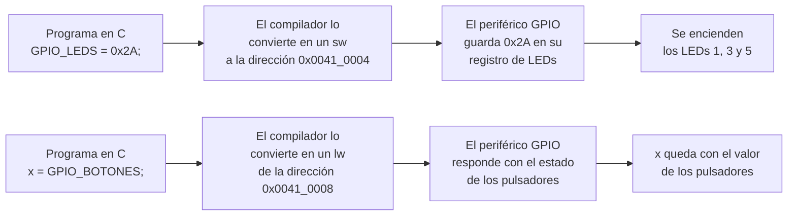
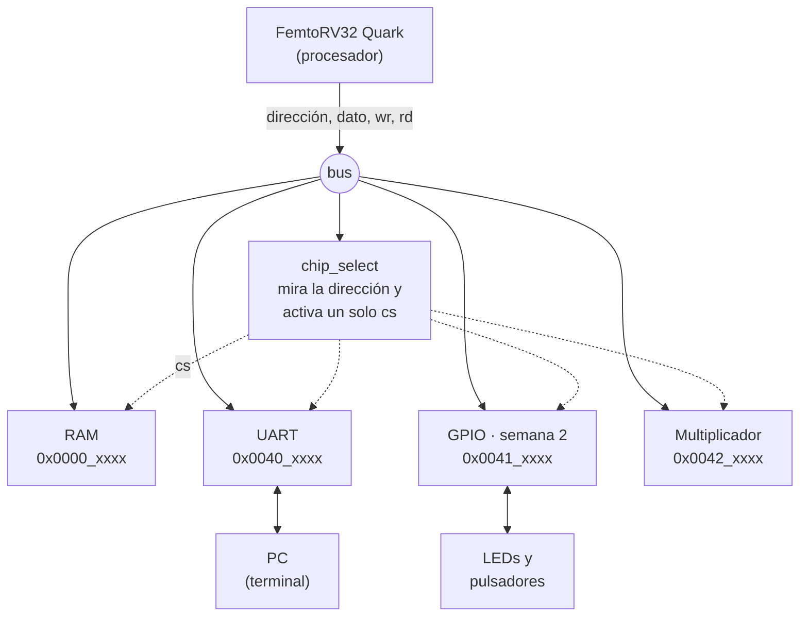
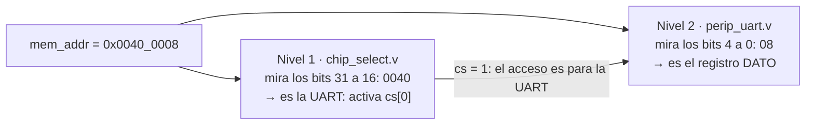
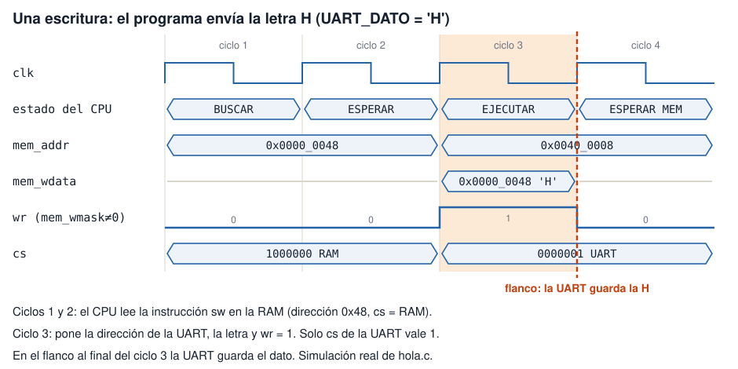
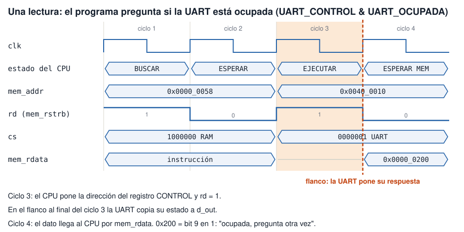
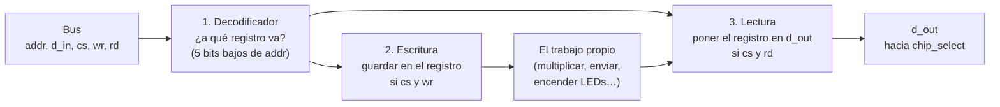

# Fundamentos 02 · El mapa de memoria y los periféricos

[← Volver a la guía](../README.md)

Este es el documento más importante del laboratorio. Al terminarlo deberían poder explicar tres ideas:

1. El procesador solo sabe **leer y escribir en direcciones**. Un periférico es un circuito que "vive" en algunas de esas direcciones.
2. El SoC decide, mirando la dirección, **qué bloque** atiende cada acceso y, dentro de él, **qué registro**.
3. Para que el procesador controle un circuito nuevo (el de ustedes), basta con **darle direcciones** en ese mapa. El procesador no se modifica: ustedes no lo diseñan, lo usan.

---

## Contenido

1. [La idea central: E/S mapeada en memoria](#1-la-idea-central-es-mapeada-en-memoria)
2. [El SoC y sus bloques](#2-el-soc-y-sus-bloques)
3. [El bus: los cables entre el procesador y los bloques](#3-el-bus-los-cables-entre-el-procesador-y-los-bloques)
4. [El mapa de memoria: cómo se elige el bloque y el registro](#4-el-mapa-de-memoria-cómo-se-elige-el-bloque-y-el-registro)
5. [Una escritura y una lectura, vistas en la simulación](#5-una-escritura-y-una-lectura-vistas-en-la-simulación)
6. [Cómo está hecho un periférico por dentro](#6-cómo-está-hecho-un-periférico-por-dentro)
7. [La tabla de registros: la especificación de un periférico](#7-la-tabla-de-registros-la-especificación-de-un-periférico)

---

## 1. La idea central: E/S mapeada en memoria

El procesador no tiene una instrucción "encender LED" ni "enviar por la UART". Solo tiene dos formas de comunicarse con el exterior:

- **escribir** un dato en una dirección (instrucción `sw`, *store word*);
- **leer** el dato de una dirección (instrucción `lw`, *load word*).

La solución es un acuerdo: **algunas direcciones no son memoria, son periféricos**. Un circuito está pendiente de su dirección; cuando el procesador escribe ahí, toma el dato y hace algo con él (por ejemplo, encender LEDs). Cuando el procesador lee ahí, el circuito responde con un dato propio (por ejemplo, el estado de unos pulsadores).



A esto se le llama **E/S mapeada en memoria** (*memory-mapped I/O*). Si alguna vez programaron un Arduino a nivel de registros (`PORTB = 0x01;`), ya lo usaron: `PORTB` es una dirección conectada a los pines.

**Una analogía: un edificio.** Cada dirección es una oficina con su número. La mayoría de los pisos son bodegas (la RAM): lo que se deja ahí, ahí se queda. Pero algunos pisos tienen oficinas especiales: si se deja una carta en la oficina de la UART, alguien la toma y la envía al PC.

**La ventaja:** para agregar un periférico nuevo basta con asignarle un piso libre del edificio. El procesador no cambia. Eso es exactamente lo que harán en la semana 2 con el GPIO y, después, con los periféricos de la consola.

## 2. El SoC y sus bloques

Un **SoC** (*System on Chip*, sistema en un chip) es el procesador junto con su memoria y sus periféricos, todo dentro de la FPGA. El de este laboratorio está descrito en `soc/rtl/SOC.v` y tiene estos bloques:

| Bloque | Qué es | Para qué está |
|---|---|---|
| **FemtoRV32 Quark** | El procesador | Ejecuta el programa en C, instrucción por instrucción |
| **RAM** | Memoria de 32 KB | Guarda el programa (las instrucciones) y sus variables |
| **UART** | Puerto serial: envía y recibe bytes, un bit tras otro, por un solo cable | Que el programa le escriba texto al PC (la terminal) |
| **Multiplicador** | Circuito que multiplica dos números de 16 bits | El procesador no tiene instrucción de multiplicar: se la delega a este periférico |
| **GPIO** (semana 2) | *General Purpose Input/Output*: un registro para LEDs y otro para pulsadores | Es el periférico que ustedes diseñan |
| **chip_select** | Decodificador de direcciones | Decide qué bloque atiende cada acceso |



Dos detalles del dibujo:

- La **dirección** y el **dato a escribir** llegan a **todos** los bloques al mismo tiempo (flechas continuas). Lo que decide cuál de ellos reacciona es su señal `cs` (*chip select*, flechas punteadas): solo uno la tiene en 1.
- Para las lecturas hay un camino de vuelta, que no está dibujado: todos los bloques tienen un **dato de salida**, pero `chip_select` deja pasar hacia el procesador **uno solo**, el del bloque elegido.

## 3. El bus: los cables entre el procesador y los bloques

El **bus** es el conjunto de cables que salen del procesador hacia el resto del SoC. Son cinco (están al inicio de `SOC.v`):

| Señal | Bits | Sentido | Qué lleva |
|---|---|---|---|
| `mem_addr` | 32 | CPU → bloques | La **dirección** que el procesador quiere leer o escribir |
| `mem_wdata` | 32 | CPU → bloques | El **dato a escribir** |
| `mem_wmask` | 4 | CPU → bloques | Qué bytes se escriben: `1111` = la palabra completa, `0000` = **no hay escritura** |
| `mem_rstrb` | 1 | CPU → bloques | Pulso de **lectura** (*read strobe*): vale 1 cuando el procesador pide un dato |
| `mem_rdata` | 32 | bloques → CPU | El **dato leído** que vuelve al procesador |

`SOC.v` (líneas 64 y 65) resume dos de ellas con nombres cortos, que son los que usan los periféricos:

```verilog
wire wr = |mem_wmask;  // 1 si el procesador está escribiendo
wire rd = mem_rstrb;   // 1 si el procesador está leyendo
```

El `|` delante de `mem_wmask` es un **OR de sus 4 bits**: `wr` vale 1 si alguno de ellos vale 1.

Dos cosas que van a ver en la simulación:

- El procesador usa el mismo bus para **buscar sus instrucciones** en la RAM. Por eso verán `rd = 1` muchísimas veces con direcciones bajas (`0x0000_00xx`): son lecturas de instrucciones.
- Mientras ejecuta una instrucción que no es `lw` ni `sw` (una suma, por ejemplo), `mem_addr` muestra un valor sin sentido. No pasa nada, porque `wr` y `rd` valen 0. Por eso **un periférico solo actúa si su `cs` vale 1 y además `wr` o `rd` valen 1**.

## 4. El mapa de memoria: cómo se elige el bloque y el registro

### La dirección en hexadecimal

Una dirección tiene 32 bits. Se escribe en hexadecimal porque **cada dígito hexadecimal equivale exactamente a 4 bits** (`0` = `0000` … `F` = `1111`), así que 32 bits son 8 dígitos. El guion bajo solo separa las dos mitades para leer más fácil:

| Dirección | 4 primeros dígitos (bits 31 a 16) | 4 últimos dígitos (bits 15 a 0) |
|---|---|---|
| `0x0040_0008` | `0040` → **¿qué bloque?** | `0008` → **¿qué registro dentro del bloque?** |

### Dos niveles de decisión

La misma dirección llega completa a dos lugares, y **cada uno mira una parte distinta**:



**Nivel 1, el bloque.** `soc/rtl/chip_select.v` compara los 16 bits altos con una lista y activa **una sola** línea de `cs`:

```verilog
case (mem_addr[31:16])
  16'h0040: cs = 7'b0000001;  // cs[0] → UART
  16'h0041: cs = 7'b0000010;  // cs[1] → libre (GPIO en la semana 2)
  16'h0042: cs = 7'b0000100;  // cs[2] → multiplicador
  ...
  default:  cs = 7'b1000000;  // cs[6] → RAM: cualquier otra dirección
endcase
```

(En el archivo real los valores tienen nombres, como `CHIP0ADDR` y `CHIP0CS`. En la [Tarea 3 de la Semana 1](../Semana1.md#tarea-3-el-mapa-de-memoria) los van a recorrer línea por línea.)

- La RAM es el caso `default`: **todo lo que no es un periférico, es RAM**. Así la lista solo tiene que reconocer a los periféricos.
- Como solo se miran 16 bits, cada periférico recibe un rango de 65 536 direcciones (de `0x0041_0000` a `0x0041_FFFF`), aunque use solo unas pocas. Es un piso entero del edificio con dos o tres oficinas ocupadas: sobra espacio y la comparación es muy sencilla.

**Nivel 2, el registro.** Dentro de cada periférico, un **decodificador interno** mira solo los **5 bits bajos** de la dirección para elegir el registro. Por ejemplo, la UART tiene dos: `+0x08` (DATO) y `+0x10` (CONTROL). Un periférico solo responde si su `cs` vale 1; si no, ignora el acceso aunque los bits bajos coincidan.

**El camino de vuelta.** La segunda parte de `chip_select.v` es un **multiplexor**: usa `cs` para escoger cuál de los datos de salida (`chip0_dout`, `chip1_dout`…) llega al procesador por `mem_rdata`. En los espacios libres no hay nada conectado (`32'b0` en `SOC.v`), así que leerlos siempre da 0.

### El mapa de memoria

La lista completa de "rango de direcciones → bloque → registros" es el **mapa de memoria** del SoC. En la Semana 1 lo construyen ustedes leyendo el código. Este es el formato:

| Rango de direcciones | Bloque | Señal `cs` | Dato que vuelve al CPU |
|---|---|---|---|
| `0x0000_0000` – `0x0000_7FFF` | RAM | `cs[6]` | `RAM_rdata` |
| `0x0040_0000` – `0x0040_FFFF` | ? | ? | ? |
| … | … | … | … |

## 5. Una escritura y una lectura, vistas en la simulación

Estos dos diagramas salen de la simulación real de `hola.c` (los mismos que van a buscar en GTKWave en la Tarea 5). Cada columna es un ciclo de reloj. Los nombres de los estados del procesador se explican en [Fundamentos 01, sección 6](01_RISC-V_y_FemtoRV.md#6-la-máquina-de-estados-del-femtorv); por ahora basta saber que primero **busca** la instrucción y luego la **ejecuta**.

### Una escritura

`uart_putc` hace `UART_DATO = 'H';`, que el compilador convierte en un `sw` a la dirección `0x0040_0008`:



1. **Ciclos 1 y 2:** el procesador lee la instrucción `sw` de la RAM. Por eso `cs` señala la RAM.
2. **Ciclo 3:** pone en el bus la dirección de la UART, la letra (`0x48` es la `H` en ASCII) y `wr = 1`. `chip_select` activa solo el `cs` de la UART.
3. **En el flanco de subida al final del ciclo 3**, la UART guarda la letra. Es el mismo principio de cualquier registro: se carga en el flanco del reloj.

> **Regla para escribir en un periférico:** en el flanco en que `cs = 1`, `wr = 1` y la dirección es la del registro, guardar el dato.

### Una lectura

Después, `uart_putc` espera a que la UART termine preguntando una y otra vez por el bit "ocupada" del registro CONTROL (`0x0040_0010`). Cada pregunta es un `lw`:



1. **Ciclo 3:** el procesador pone la dirección del registro y `rd = 1`.
2. **En el flanco al final del ciclo 3**, la UART copia su estado en su salida `d_out`.
3. **Ciclo 4:** ese dato llega al procesador por `mem_rdata`. Aquí vale `0x0000_0200`: el bit 9 está en 1, "todavía ocupada", así que el programa vuelve a preguntar.

> **Regla para leer de un periférico:** en el flanco en que `cs = 1` y `rd = 1`, poner en `d_out` el registro pedido. El procesador lo recoge en el ciclo siguiente.

Fíjense en que una escritura y una lectura tardan lo mismo: **4 ciclos de reloj** (160 ns a 25 MHz).

## 6. Cómo está hecho un periférico por dentro

Todos los periféricos de este SoC tienen las mismas tres partes. El suyo también las tendrá.



| Parte | En la UART (`perip_uart.v`) | En el multiplicador (`perip_mult.v`) | En su GPIO |
|---|---|---|---|
| **1. Decodificador** | Líneas 134 – 138: `08` → DATO, `10` → CONTROL | Líneas 31 – 38: `04` → A, `08` → B, `0C` → init, `10` → result, `14` → done | `04` → LEDS, `08` → BOTONES |
| **2. Escritura** | Líneas 157 – 163 | Líneas 52 – 56: `if (cs && wr)` guarda A, B, init | Guardar el registro LEDS |
| **3. Lectura** | Líneas 165 – 171 | Líneas 64 – 68: `if (cs && rd)` pone result o done en `d_out` | Poner LEDS o BOTONES en `d_out` |
| **Trabajo propio** | El transmisor y el receptor serial (`uart.v`) | El multiplicador (`mult.v`) | Ninguno: los registros van directo a los pines |

### Cómo leer el código de un periférico: seguir las señales

Al abrir un periférico aparecen señales como `wr`, `cs`, `d_in` o `sel`. **Cuando no sepan qué es una señal, búsquenla** (Ctrl+F en Lite XL; F3 salta a la siguiente coincidencia) hasta encontrar de dónde viene:

1. Si está en la cabecera del módulo como `input`, viene de afuera: búsquenla en `SOC.v`, donde se conecta el periférico.
2. Si no es una entrada, nace adentro: busquen dónde se le asigna un valor.

Estas son las señales que reciben todos los periféricos (los números de línea son de la conexión de la UART en `SOC.v`):

| Señal | Se conecta en `SOC.v` | Qué es |
|---|---|---|
| `cs` | `.cs(cs_uart)`, línea 125 | 1 si la dirección es de este periférico |
| `wr` | `.wr(wr)`, línea 128 | 1 si el procesador está escribiendo |
| `rd` | `.rd(rd)`, línea 127 | 1 si el procesador está leyendo |
| `addr` | `.addr(mem_addr)`, línea 126 | La dirección completa |
| `d_in` | `.d_in(mem_wdata)`, línea 124 | El dato que escribe el procesador |
| `d_out` | `.d_out(uart_dout)`, línea 129 | Lo que el periférico responde al leerlo; va a `chip_select` |

Abreviaturas que van a ver en casi cualquier diseño: `wr` = *write* (escribir) · `rd` = *read* (leer) · `d_in` / `d_out` = *data in* / *data out* · `sel` = *select* · `cs` = *chip select* · `tx` / `rx` = transmitir / recibir.

### Un detalle de Verilog: las llaves `{ }`

En la lectura de la UART (línea 168) aparece `{22'b0, tx_busy, rx_avail, rx_error, 7'b0}`. Las llaves **pegan bits uno al lado del otro**: lo que está más a la izquierda queda en los bits más altos. Para saber en qué bit queda cada señal, se cuenta **desde la derecha**, empezando en 0:

| Pedazo | Ocupa los bits |
|---|---|
| `7'b0` | 0 a 6 |
| `rx_error` | 7 |
| `rx_avail` | 8 |
| `tx_busy` | 9 |
| `22'b0` | 10 a 31 |

> **Una trampa del multiplicador:** cuando termina, `done` vale 1 solo unos 30 ciclos; después el circuito vuelve al inicio y **borra el resultado**. Si el programa no lee `RESULT` justo después de ver `DONE = 1`, lee 0. La función `mult_hw()` de `soc.h` lo hace bien. Es un buen ejemplo de por qué la tabla de registros debe decir **cuánto tiempo es válido** cada dato.

## 7. La tabla de registros: la especificación de un periférico

Antes de escribir Verilog, un periférico se **especifica** con una tabla: es la "caja negra" vista desde el programa. Dice todo lo que el software necesita saber, sin explicar cómo está hecho por dentro. Así se vería la del GPIO de la semana 2:

| Dirección | Nombre | Acceso | Bits | Significado | Valor tras reset |
|---|---|---|---|---|---|
| `0x0041_0004` | LEDS | Lectura y escritura | `[7:0]` | LEDs externos; 1 = encendido | `0x00` |
| `0x0041_0008` | BOTONES | Solo lectura | `[3:0]` | Pulsadores; 1 = presionado | — |

Con esta tabla:

- el **hardware** sabe qué decodificar, qué guardar y qué devolver;
- el **software** sabe qué direcciones usar (son los `#define` de `soc.h`);
- el **testbench** sabe qué comprobar: una prueba por cada fila.

En la consola, cada grupo entregará una tabla así para su periférico. **Cómo conectar y probar un periférico nuevo** se explica paso a paso en la [Semana 2](../Semana2.md).

[← Volver a la guía](../README.md)
