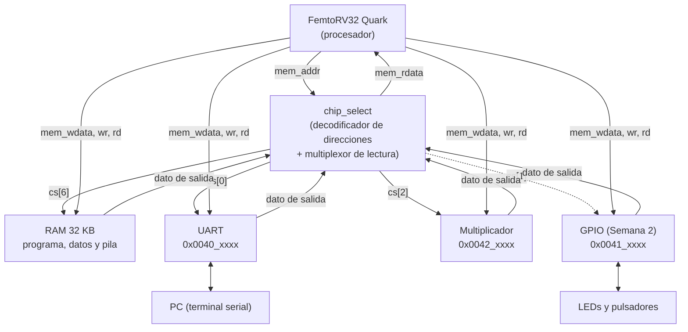
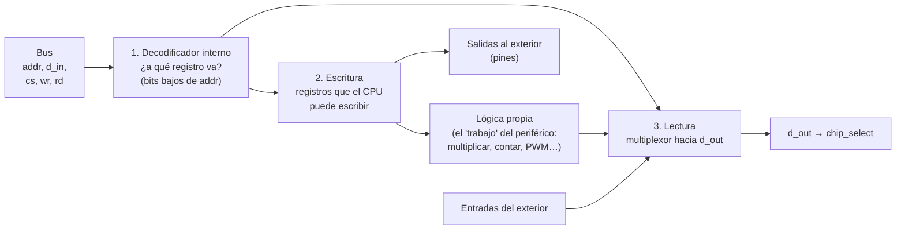

# Fundamentos 02 · El bus, el mapa de memoria y los periféricos

[← Volver a la guía](../README.md)

En [Fundamentos 01](01_RISC-V_y_FemtoRV.md) vimos que el procesador solo sabe hacer dos cosas con el exterior: **leer** y **escribir** direcciones de memoria. Este documento explica cómo, con solo eso, el procesador controla LEDs, envía caracteres por la UART o usa un multiplicador.

---

## Contenido

1. [E/S mapeada en memoria: la idea central](#1-es-mapeada-en-memoria-la-idea-central)
2. [El SoC: qué bloques tiene](#2-el-soc-qué-bloques-tiene)
3. [Las señales del bus](#3-las-señales-del-bus)
4. [El decodificador de direcciones y el mapa de memoria](#4-el-decodificador-de-direcciones-y-el-mapa-de-memoria)
5. [Una escritura, ciclo a ciclo](#5-una-escritura-ciclo-a-ciclo)
6. [Una lectura, ciclo a ciclo](#6-una-lectura-ciclo-a-ciclo)
7. [Anatomía de un periférico: las tres partes](#7-anatomía-de-un-periférico-las-tres-partes)
8. [La tabla de registros: la especificación de un periférico](#8-la-tabla-de-registros-la-especificación-de-un-periférico)
9. [Cómo se conecta un periférico nuevo al SoC](#9-cómo-se-conecta-un-periférico-nuevo-al-soc)
10. [Cómo se prueba un periférico](#10-cómo-se-prueba-un-periférico)
11. [Preguntas de autoevaluación](#11-preguntas-de-autoevaluación)

---

## 1. E/S mapeada en memoria: la idea central

El procesador tiene una sola forma de comunicarse: **escribir un dato en una dirección** (`sw`) o **leer el dato de una dirección** (`lw`). No existe una instrucción "encender LED" ni "enviar por la UART".

La solución es un acuerdo: **algunas direcciones no son memoria, son periféricos**. Un circuito "escucha" el bus y, cuando el procesador escribe en su dirección, toma el dato y hace algo con él. Cuando el procesador lee esa dirección, el circuito responde con un dato propio (por ejemplo, el estado de unos pulsadores).

```
  Programa en C                      Lo que hace el hardware
  ─────────────                      ───────────────────────
  REG(0x00410004) = 0x2A;    ──►     el periférico GPIO guarda 0x2A en su registro
                                     de LEDs: se encienden los LEDs 1, 3 y 5

  x = REG(0x00410008);       ──►     el periférico GPIO responde con el estado
                                     de los pulsadores
```

A esto se le llama **E/S mapeada en memoria** (*memory-mapped I/O*, MMIO). Si alguna vez programaron un Arduino a nivel de registros (`PORTB = 0x01;`), ya lo usaron: `PORTB` es una dirección de memoria conectada a los pines.

**Ventaja:** el procesador no necesita instrucciones especiales. Para agregar un periférico nuevo basta con asignarle direcciones; el procesador no cambia.

## 2. El SoC: qué bloques tiene

Un **SoC** (*System on Chip*, sistema en un chip) es el procesador junto con su memoria y sus periféricos, todo dentro de la FPGA. El de este laboratorio está en `soc/rtl/SOC.v`:



Fíjense en dos detalles:

- La **dirección** y el **dato a escribir** llegan a **todos** los bloques al mismo tiempo. Lo que decide cuál de ellos reacciona es su señal `cs` (*chip select*).
- Cada bloque tiene su **dato de salida**, pero al procesador solo le llega **uno**: el que elige el multiplexor de `chip_select.v`.

## 3. Las señales del bus

El **bus** es el conjunto de cables entre el procesador y el resto del SoC. El FemtoRV tiene estas señales (están al inicio de `SOC.v`):

| Señal | Bits | Dirección | Significado |
|---|---|---|---|
| `mem_addr` | 32 | CPU → SoC | Dirección que el procesador quiere leer o escribir |
| `mem_wdata` | 32 | CPU → SoC | Dato que el procesador quiere escribir |
| `mem_wmask` | 4 | CPU → SoC | Qué bytes de la palabra se escriben. `1111` = palabra completa, `0001` = solo el byte bajo, `0000` = **no hay escritura** |
| `mem_rstrb` | 1 | CPU → SoC | Pulso de lectura (*read strobe*): 1 durante el ciclo en que el procesador pide un dato |
| `mem_rdata` | 32 | SoC → CPU | Dato que el SoC le entrega al procesador |

En `SOC.v` se resumen dos de ellas para que los periféricos las usen más fácil:

```verilog
wire wr = |mem_wmask;  // 1 si hay escritura (algún bit de la máscara en 1)
wire rd = mem_rstrb;   // 1 si hay lectura
```

> **Ojo:** el procesador también usa el bus para **buscar sus instrucciones** en la RAM. Por eso en una simulación verán `rd = 1` muchísimas veces con direcciones bajas (`0x0000_0xxx`): son lecturas de instrucciones, no de datos.

## 4. El decodificador de direcciones y el mapa de memoria

`soc/rtl/chip_select.v` mira los **16 bits altos** de la dirección y activa **una sola** línea de `cs`:

```verilog
case (mem_addr[31:16])
  16'h0040: cs = 7'b0000001;  // cs[0] -> UART
  16'h0041: cs = 7'b0000010;  // cs[1] -> libre (GPIO en la semana 2)
  16'h0042: cs = 7'b0000100;  // cs[2] -> multiplicador
  ...
  default:  cs = 7'b1000000;  // cs[6] -> RAM
endcase
```

Como solo miran los 16 bits altos, cada periférico recibe un bloque de **64 KB** de direcciones (`0x0041_0000` a `0x0041_FFFF`). Dentro de ese bloque, el periférico usa los **bits bajos** para distinguir sus propios registros.

Eso define el **mapa de memoria**: la tabla de qué hay en cada dirección. En la Semana 1 ustedes lo construyen leyendo el código. Este es el formato:

| Rango de direcciones | Bloque | Señal `cs` | Registros (desplazamiento, nombre, L/E) |
|---|---|---|---|
| `0x0000_0000` – `0x0000_7FFF` | RAM | `cs[6]` | — |
| `0x0040_0000` – `0x0040_FFFF` | ? | ? | ? |
| … | … | … | … |

La segunda parte de `chip_select.v` es un **multiplexor**: usa `cs` para elegir cuál `chipX_dout` llega a `mem_rdata`. Si `cs[2]` está activo, el procesador recibe lo que diga el multiplicador.

## 5. Una escritura, ciclo a ciclo

Este es el trozo de `gpio.c` (Semana 2) y lo que generó el compilador:

```
GPIO_LEDS = 0x2A;          →      li  a5, 42          # a5 = 0x2A
                                  sw  a5, 4(s0)       # s0 = 0x0041_0000  →  MEM[0x0041_0004] = a5
```

Esto es lo que se ve en la simulación cuando se ejecuta el `sw` (cada columna es un ciclo de reloj):

```
Ciclo                 1             2            3           4
Estado del CPU    FETCH_INSTR   WAIT_INSTR    EXECUTE    WAIT_ALU_OR_MEM
mem_addr          0x0000_0108   0x0000_0108  0x0041_0004  0x0041_0004
mem_rstrb (rd)        1             0            0           0
mem_wmask           0000          0000         1111         0000      ← wr = 1 solo en EXECUTE
mem_wdata             —             —        0x0000_002A      —
cs[1]                 0             0            1           1
LEDS_EXT             0x00          0x00         0x00        0x2A      ← cambia en el flanco
                                                             ▲          al final del ciclo 3
```

1. **Ciclos 1 y 2:** el procesador busca la instrucción `sw` en la RAM (dirección `0x108`).
2. **Ciclo 3 (EXECUTE):** pone la dirección `0x0041_0004`, el dato `0x2A` y la máscara `1111`. El decodificador activa `cs[1]`. El periférico ve `cs = 1`, `wr = 1` y dirección `…04`: **en el flanco de subida al final de este ciclo** guarda `0x2A`.
3. **Ciclo 4:** los LEDs ya muestran `0x2A`. El procesador espera un ciclo (los `sw` tardan 4 ciclos) y pasa a la siguiente instrucción.

**Regla para el periférico:** se escribe en el flanco en que `cs && wr` y la dirección corresponde al registro.

## 6. Una lectura, ciclo a ciclo

```
x = GPIO_LEDS;             →      lw  a0, 4(s0)       # a0 = MEM[0x0041_0004]
```

```
Ciclo                 1             2            3              4
Estado del CPU    FETCH_INSTR   WAIT_INSTR    EXECUTE      WAIT_ALU_OR_MEM
mem_addr          0x0000_0114   0x0000_0114  0x0041_0004    0x0041_0004
mem_rstrb (rd)        1             0            1              0       ← rd = 1 en EXECUTE
cs[1]                 0             0            1              1
gpio_dout (d_out)     —             —            —          0x0000_002A ← el periférico responde
mem_rdata             —             —            —          0x0000_002A    en el flanco
registro a0         (viejo)       (viejo)      (viejo)       (viejo) → 0x2A al final del ciclo 4
```

1. **Ciclo 3 (EXECUTE):** el procesador pone la dirección y activa `rd`. El periférico ve `cs && rd` y dirección `…04`: **en el flanco** copia el valor de sus LEDs a `d_out`.
2. **Ciclo 4:** `d_out` ya tiene el dato; el multiplexor de `chip_select` lo pasa a `mem_rdata` porque `cs[1]` sigue activo; el procesador lo guarda en `a0` al final del ciclo.

**Regla para el periférico:** en el flanco en que `cs && rd`, poner en `d_out` el registro pedido. El procesador lo recoge en el ciclo siguiente.

## 7. Anatomía de un periférico: las tres partes

Todo periférico de este SoC tiene la misma estructura. Usen `soc/rtl/mult/perip_mult.v` como ejemplo; tiene estas tres partes:



| Parte | En `perip_mult.v` | En su GPIO |
|---|---|---|
| **1. Decodificador interno** | `case (addr[4:0])`: `0x04` → A, `0x08` → B, `0x0C` → init, `0x10` → result, `0x14` → done | `0x04` → LEDS, `0x08` → BOTONES |
| **2. Escritura** | `if (cs && wr)` guarda A, B, init | `if (cs && wr)` guarda el registro LEDS |
| **3. Lectura** | `if (cs && rd)` pone result o done en `d_out` | `if (cs && rd)` pone LEDS o BOTONES en `d_out` |
| Lógica propia | el multiplicador `mult.v` (una máquina de estados) | ninguna: los registros van directo a los pines |

> **Una trampa del multiplicador:** cuando termina, `done` queda en 1 solo unos 30 ciclos; después la máquina de estados vuelve al inicio y **borra el resultado**. Si el programa no lee `RESULT` justo después de ver `DONE = 1`, lee 0. `mult_hw()` en `soc.h` lo hace bien. Es un buen ejemplo de por qué la tabla de registros debe decir **cuánto tiempo es válido** cada dato.

## 8. La tabla de registros: la especificación de un periférico

Antes de escribir Verilog, un periférico se **especifica** con una tabla. Es la "caja negra" vista desde el programa: dice todo lo que el software necesita saber, sin explicar cómo está hecho por dentro.

| Desplazamiento | Nombre | Acceso | Bits | Significado | Valor tras reset |
|---|---|---|---|---|---|
| `+0x04` | LEDS | Lectura/Escritura | `[7:0]` | LEDs externos; 1 = encendido | `0x00` |
| `+0x08` | BOTONES | Solo lectura | `[3:0]` | Pulsadores; 1 = presionado | — |

Con esta tabla:

- el **hardware** sabe qué decodificar, qué guardar y qué devolver;
- el **software** sabe qué direcciones usar;
- el **testbench** sabe qué comprobar: una prueba por cada fila y cada columna.

En la consola, cada grupo entregará una tabla así para su periférico.

## 9. Cómo se conecta un periférico nuevo al SoC

Son cuatro cambios, todos en `soc/rtl/SOC.v` más el archivo nuevo del periférico:

1. **Crear el periférico** en `soc/rtl/perip_gpio.v`. El `Makefile` agrega solo cualquier archivo `rtl/perip_*.v`.
2. **Declarar el cable de su dato de salida**: `wire [31:0] gpio_dout;`
3. **Conectar ese cable al multiplexor**, en la entrada del `chip_select` que corresponde a su dirección: `.chip1_dout(gpio_dout)`.
4. **Instanciar el periférico** con las señales del bus (`mem_wdata`, `mem_addr`, `rd`, `wr`, su `cs`) y con sus pines hacia el exterior (`BOTONES`, `LEDS_EXT`), quitando la línea `assign LEDS_EXT = 8'b0;`.

Las tarjetas (`soc/boards/`) ya llevan `BOTONES` y `LEDS_EXT` a pines físicos: no hay que tocarlas.

## 10. Cómo se prueba un periférico

La regla de oro: **probar el periférico solo antes de probarlo con el procesador.**

Si se prueba directamente con el procesador y algo falla, el error puede estar en el periférico, en `SOC.v`, en la dirección, en el programa en C… Si el periférico ya pasó su propio testbench, el error **no está en él**.

La plantilla `plantillas/tb_perip_gpio.v` trae dos tareas que imitan exactamente lo que hace el procesador en las secciones 5 y 6:

```verilog
escribir(32'h0041_0004, 32'hA5);   // como un sw
leer(32'h0041_0008, valor);        // como un lw
comprobar("leer BOTONES", valor, 32'h0000_0009);
```

Escriban **una prueba por cada fila de su tabla de registros**, y también pruebas de lo que **no** debe pasar: escribir en un registro de solo lectura, escribir con `cs = 0` (otro periférico) o leer una dirección sin registro.

## 11. Preguntas de autoevaluación

1. El procesador escribe `0x55` en `0x0042_0004`. ¿Qué bloques reciben el dato? ¿Cuál lo guarda y por qué?
2. ¿Por qué cada periférico ocupa 64 KB de direcciones si solo tiene unos pocos registros?
3. En la lectura de la sección 6, ¿por qué el dato llega al procesador un ciclo **después** de que activa `rd`?
4. ¿Qué pasaría si dos periféricos usaran la misma entrada `chipX_dout` del multiplexor?
5. ¿Qué devuelve una lectura a `0x0043_0000`, donde no hay ningún periférico? Búsquenlo en el código.
6. Un compañero dice que su periférico "no funciona" con el procesador. ¿Qué le preguntarían primero?

[← Volver a la guía](../README.md)
