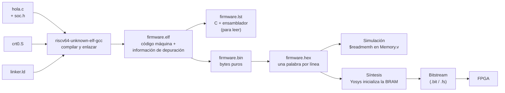

# Fundamentos 03 · De un programa en C a la FPGA

[← Volver a la guía](../README.md)

Este documento sigue el camino completo de un programa: desde `hola.c` hasta que el FemtoRV lo ejecuta dentro de la FPGA. Cada paso lo hace el `Makefile` de `soc/`; aquí se explica **qué hace y por qué**.

---

## Contenido

1. [El camino completo](#1-el-camino-completo)
2. [El compilador cruzado](#2-el-compilador-cruzado)
3. [Lo que pasa antes de main(): crt0.S](#3-lo-que-pasa-antes-de-main-crt0s)
4. [Dónde queda cada cosa: linker.ld](#4-dónde-queda-cada-cosa-linkerld)
5. [De binario a firmware.hex](#5-de-binario-a-firmwarehex)
6. [Cómo llega el programa a la FPGA](#6-cómo-llega-el-programa-a-la-fpga)
7. [Acceder a un periférico desde C: REG y volatile](#7-acceder-a-un-periférico-desde-c-reg-y-volatile)
8. [Cómo leer firmware.lst](#8-cómo-leer-firmwarelst)
9. [El compilador es más listo de lo que parece](#9-el-compilador-es-más-listo-de-lo-que-parece)
10. [Preguntas de autoevaluación](#10-preguntas-de-autoevaluación)

---

## 1. El camino completo



Todo eso lo hace `make firmware` (o `make sim`, que lo incluye). Los archivos generados quedan en `soc/build/` y `soc/firmware.hex`.

## 2. El compilador cruzado

Un compilador normal (`gcc`) genera código para el procesador del computador donde corre (x86). Un **compilador cruzado** corre en el computador pero genera código para **otro** procesador: `riscv64-unknown-elf-gcc` genera código RISC-V.

Las opciones que usa el `Makefile` y por qué:

| Opción | Significado |
|---|---|
| `-march=rv32i` | Generar solo instrucciones RV32I: el Quark no tiene multiplicación (M) ni comprimidas (C) |
| `-mabi=ilp32` | Enteros, `long` y punteros de 32 bits |
| `-Os` | Optimizar para que el programa ocupe poco (la RAM es de 32 KB) |
| `-g` | Guardar información para que `firmware.lst` muestre el C junto al ensamblador |
| `-ffreestanding -nostdlib` | No hay sistema operativo ni biblioteca estándar: no existe `printf`, ni `malloc`, ni archivos |
| `-T firmware/linker.ld` | Usar nuestro mapa de memoria (sección 4) |
| `-lgcc` | Incluir las rutinas de software para `/`, `%` y `*` (el Quark no tiene esas instrucciones) |

> **Sin sistema operativo** significa que el programa es lo único que corre. `main()` nunca debe terminar: por eso todos los programas acaban en `while (1)`.

## 3. Lo que pasa antes de main(): crt0.S

Cuando se suelta el reset, el PC vale `0x0000_0000`. Lo primero que hay ahí no es `main()` sino `crt0.S` (*C runtime zero*), un programa corto en ensamblador:

```asm
_start:
  la sp, _stack_top      # 1. preparar la pila: C la necesita para variables locales y llamadas
  la a0, __bss_start     # 2. poner en cero la zona .bss (variables globales sin valor inicial),
  la a1, __bss_end       #    porque C garantiza que empiezan en 0
  li a2, 0
zero_bss:
  bgeu a0, a1, bss_done
  sw a2, 0(a0)
  addi a0, a0, 4
  j zero_bss
bss_done:
  call main              # 3. llamar a main()
hang:
  j hang                 # 4. si main() terminara, quedarse aquí para siempre
```

## 4. Dónde queda cada cosa: linker.ld

El **enlazador** (*linker*) decide en qué dirección queda cada parte del programa. `linker.ld` le dice que hay una sola memoria de 32 KB que empieza en 0:

```
MEMORY { BRAM (RWX) : ORIGIN = 0x0000, LENGTH = 0x8000 }
```

y el orden de las **secciones**:

| Sección | Contenido | Dónde |
|---|---|---|
| `.text` | Las instrucciones. Empieza con `_start` de `crt0.S` | desde `0x0000` |
| `.rodata` | Constantes, por ejemplo los textos `"Hola desde el FemtoRV"` | después de `.text` |
| `.data` | Variables globales con valor inicial | después |
| `.bss` | Variables globales sin valor inicial (`crt0.S` las pone en 0) | después |
| pila | 1 KB para variables locales y llamadas a funciones | al final del programa |

El archivo `build/firmware.map` muestra la dirección de cada función y variable.

Importante: `linker.ld` dice **32 KB** y `Memory.v` tiene **8192 palabras × 4 bytes = 32 KB**. Si no coincidieran, el programa podría quedar en direcciones que no existen.

## 5. De binario a firmware.hex

`objcopy -O binary` saca los **bytes puros** del programa, empezando en la dirección 0. Después `firmware/tools/bin2hex.py` los agrupa de a 4 en **palabras de 32 bits**, una por línea, que es el formato que lee `$readmemh`:

```
6c800113   ← palabra en la dirección 0x00: li sp, 1736   (primera instrucción de crt0.S)
2c800513   ← palabra en la dirección 0x04: li a0, 712
...
```

RISC-V es **little endian**: en `firmware.bin` los bytes aparecen en el orden `13 01 80 6c`, y forman la palabra `0x6c800113`. El script también completa con ceros hasta 8192 palabras y avisa cuánto ocupa el programa:

```
firmware.hex: 178 de 8192 palabras usadas (2.2 %)
```

## 6. Cómo llega el programa a la FPGA

`Memory.v` tiene:

```verilog
initial begin
  $readmemh("firmware.hex", MEM);
end
```

- En **simulación**, Icarus lee `firmware.hex` al empezar.
- En **síntesis**, Yosys también lo lee y usa esos valores como **contenido inicial de la memoria de bloque (BRAM)**. El programa queda **dentro del bitstream**.

Consecuencia práctica: **cada vez que cambian el programa en C hay que volver a sintetizar** (`make syn`) y configurar (`make config`). El `Makefile` lo detecta solo, porque el bitstream depende de `firmware.hex`.

## 7. Acceder a un periférico desde C: REG y volatile

En `soc/firmware/soc.h`:

```c
#define REG(dir) (*(volatile uint32_t *)(dir))
#define UART_DATO  REG(UART_BASE + 0x08)
```

Leído de adentro hacia afuera:

1. `(volatile uint32_t *)(dir)`: convierte el número `dir` en un **puntero** a un entero de 32 bits.
2. `*( ... )`: **desreferencia** el puntero, es decir, "la variable que vive en esa dirección".

Así `UART_DATO = 'A';` se compila como un `sw` a la dirección `0x0040_0008`, y `x = UART_DATO;` como un `lw`.

### ¿Por qué `volatile`?

El compilador optimiza suponiendo que **solo el programa** cambia la memoria. Con un periférico eso es falso: el hardware cambia los valores (un pulsador, un bit de "ocupado") y las escrituras tienen efectos (encender un LED). `volatile` le dice al compilador: **haz cada lectura y cada escritura exactamente como están escritas**.

Este es el código real que genera el compilador **sin** `volatile` y **con** `volatile`:

```c
while (1) { LEDS = 1; LEDS = 0; }
```

```asm
# SIN volatile: el compilador ve que nadie lee LEDS y BORRA las dos escrituras
sin_volatile:
   0:  j  0                       # bucle vacío: el LED nunca cambia

# CON volatile: las dos escrituras se hacen siempre
con_volatile:
  28:  sw  a4, 0(a5)              # LEDS = 1
  2c:  sw  zero, 0(a5)            # LEDS = 0
  30:  j   28
```

Y una espera:

```c
while (!MULT_DONE) {}
```

```asm
# SIN volatile: lee el registro UNA vez; si era 0, se queda en un bucle infinito
   c:  lw    a5, 0(a5)
  10:  bnez  a5, 18
  14:  j     14                   # ← nunca vuelve a leer el periférico
```

**Regla:** todo acceso a un periférico va con `volatile`. La macro `REG()` ya lo incluye.

## 8. Cómo leer firmware.lst

`build/firmware.lst` muestra cada línea de C seguida de las instrucciones que generó. Cada instrucción tiene tres columnas:

```
dirección:  código máquina    instrucción
      48:   00d72023          sw  a3,0(a4)
```

Este es un trozo real de la función `imprimir` de `hola.c` (`uart_putc` quedó metida dentro de `imprimir`; el compilador hace eso con funciones cortas):

```
00000028 <imprimir>:
  28:  00400737   lui   a4,0x400        # a4 = 0x400 << 12      = 0x0040_0000
  2c:  004007b7   lui   a5,0x400        # a5 = 0x0040_0000
  30:  00870713   addi  a4,a4,8         # a4 = 0x0040_0008  → UART_DATO
  34:  01078793   addi  a5,a5,16        # a5 = 0x0040_0010  → UART_CONTROL
  38:  00100613   li    a2,1
  3c:  00054683   lbu   a3,0(a0)        # a3 = siguiente carácter del texto
  40:  00069463   bnez  a3,48           # si no es '\0', ir a enviarlo
  44:  00008067   ret                   # fin del texto: volver
  48:  00d72023   sw    a3,0(a4)        # UART_DATO = carácter
  4c:  00c7a023   sw    a2,0(a5)        # UART_CONTROL = 1  (transmitir)
  ...
```

Así se construye una dirección de 32 bits en RISC-V: una instrucción no puede llevar una constante de 32 bits, así que se usa **`lui`** para los 20 bits altos y **`addi`** para los 12 bajos.

**Para la bitácora (Semana 1):** encuentren en su listado el `sw` que escribe un carácter en la UART, digan en qué registro está la dirección y cómo se calculó, y decodifiquen a mano su código máquina (ver [Fundamentos 01, sección 5](01_RISC-V_y_FemtoRV.md#5-cómo-se-codifica-una-instrucción-en-32-bits)).

## 9. El compilador es más listo de lo que parece

En `hola.c`, el producto "por software" se calcula con un bucle de 45 sumas:

```c
uint32_t r_sw = 0;
for (uint32_t i = 0; i < b; i++) r_sw = r_sw + a;
imprimir_dec(r_sw);
```

Pero en `firmware.lst` **no hay ningún bucle**:

```
  imprimir_dec(r_sw);
 110:  00001537   lui   a0,0x1          # a0 = 0x1000
 114:  59f50513   addi  a0,a0,1439      # a0 = 0x1000 + 1439 = 0x159F = 5535
 118:  f51ff0ef   jal   68 <imprimir_dec>
```

Como `a` y `b` son constantes conocidas al compilar, el compilador **hizo la cuenta él mismo** (123 × 45 = 5535) y dejó solo el resultado. Esto se llama *constant folding*.

Lección para los experimentos: **un programa en C no siempre hace lo que parece**. Antes de medir el tiempo de algo, revisen en el listado qué instrucciones se ejecutan de verdad.

## 10. Preguntas de autoevaluación

1. ¿Por qué se necesita un compilador "cruzado"?
2. ¿Qué pasaría si `crt0.S` no preparara el puntero de pila antes de llamar a `main()`?
3. Si el programa crece a 40 KB, ¿qué archivo da el error y por qué?
4. ¿Por qué cambiar una línea de C obliga a volver a sintetizar?
5. Escriban la pareja `lui`/`addi` que pone `0x0041_0008` en el registro `a5`.
6. ¿Qué haría el compilador con `while (!(GPIO_BOTONES & 1)) {}` si `GPIO_BOTONES` no fuera `volatile`?

[← Volver a la guía](../README.md)
