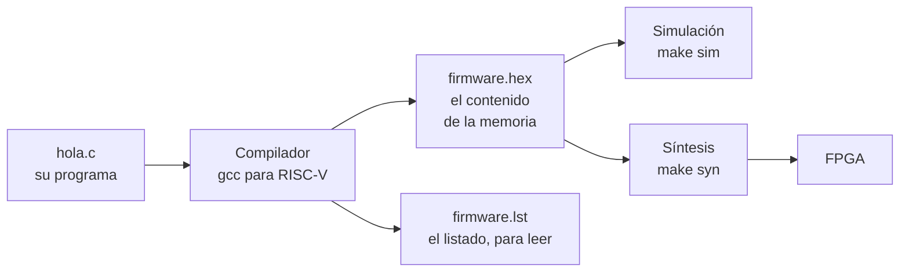

# Fundamentos 03 · De un programa en C a la FPGA

[← Volver a la guía](../README.md)

Este documento da una **visión general** del camino de un programa: desde `hola.c` hasta que el FemtoRV lo ejecuta dentro de la FPGA. Todo el camino lo recorre el `Makefile` con un solo comando (`make sim` o `make syn`); aquí se explica qué pasa en cada paso, sin entrar en los detalles del compilador.

---

## Contenido

1. [El camino completo](#1-el-camino-completo)
2. [Cómo llega el programa a la FPGA](#2-cómo-llega-el-programa-a-la-fpga)
3. [Acceder a un periférico desde C: REG y volatile](#3-acceder-a-un-periférico-desde-c-reg-y-volatile)
4. [Cómo leer firmware.lst](#4-cómo-leer-firmwarelst)
5. [El compilador es más listo de lo que parece](#5-el-compilador-es-más-listo-de-lo-que-parece)

---

## 1. El camino completo



1. **El compilador** traduce el programa en C a instrucciones RISC-V. Se llama *compilador cruzado* porque corre en el PC (que es x86) pero genera instrucciones para **otro** procesador: el FemtoRV.
2. El resultado se guarda en **`firmware.hex`**: las instrucciones como palabras de 32 bits, **una por línea**. Es el contenido de la memoria del SoC, igual que el bloque `initial` del blinker llenaba su ROM, pero generado por el compilador.
3. También se genera **`build/firmware.lst`**: cada línea de C con las instrucciones que produjo. Sirve para leer qué hace de verdad el procesador.

Los archivos que intervienen:

| Archivo | Qué es | ¿Lo modifican? |
|---|---|---|
| `firmware/hola.c` (y los demás `.c`) | Su programa | Sí |
| `firmware/soc.h` | Las direcciones de los periféricos y funciones para usarlos (`imprimir`, `mult_hw`…) | En la semana 2, para agregar las de su periférico |
| `firmware/crt0.S` | Lo primero que ejecuta el procesador al arrancar: prepara lo necesario y llama a `main()` | No |
| `firmware/linker.ld` | Le dice al compilador que la memoria es de 32 KB y empieza en la dirección 0 | No |
| `firmware.hex` | El contenido de la memoria (lo genera el `Makefile`) | No |
| `build/firmware.lst` | El listado para leer (lo genera el `Makefile`) | No |

> **Sin sistema operativo.** El programa es lo único que corre en el procesador; no hay Windows ni Linux al cual volver. Por eso `main()` nunca termina: todos los programas acaban en `while (1)`.

## 2. Cómo llega el programa a la FPGA

La memoria del SoC (`soc/rtl/memory/Memory.v`, línea 24) se llena al arrancar con:

```verilog
$readmemh("firmware.hex", MEM);
```

- En **simulación**, Icarus lee `firmware.hex` al empezar.
- En **síntesis**, Yosys también lo lee y lo usa como **contenido inicial de la memoria de la FPGA**. El programa queda **dentro del bitstream**.

Consecuencia práctica: **cada vez que cambian el programa en C hay que volver a sintetizar** (`make syn`) y configurar la FPGA (`make config`). El `Makefile` lo detecta solo.

## 3. Acceder a un periférico desde C: REG y volatile

En `soc/firmware/soc.h`:

```c
#define REG(dir) (*(volatile uint32_t *)(dir))
#define UART_DATO  REG(0x00400000 + 0x08)
```

`REG(dir)` significa "**la variable que vive en la dirección `dir`**". Con eso, en el programa se escribe:

```c
UART_DATO = 'H';      // el compilador lo convierte en un sw a la dirección 0x0040_0008
x = UART_DATO;        // y esto, en un lw de esa dirección
```

Para el programa, un registro de un periférico parece una variable más. Es la E/S mapeada en memoria de [Fundamentos 02](02_Bus_y_perifericos.md) vista desde C.

### ¿Por qué `volatile`?

El compilador intenta ahorrar trabajo: si cree que una lectura o una escritura no sirve para nada, **la borra**. Con un periférico eso es un error, porque el hardware cambia los valores por su cuenta (un pulsador, un bit de "ocupado") y las escrituras tienen efectos (encender un LED).

`volatile` le dice al compilador: **haz cada lectura y cada escritura exactamente como están escritas**. Por ejemplo:

```c
while (1) { LEDS = 1; LEDS = 0; }
```

- **Sin `volatile`**, el compilador ve que nadie lee `LEDS` y borra las dos escrituras: el LED nunca cambia.
- **Con `volatile`**, hace las dos escrituras en cada vuelta: el LED parpadea.

**Regla:** todo acceso a un periférico va con `volatile`. La macro `REG()` ya lo incluye.

## 4. Cómo leer firmware.lst

`build/firmware.lst` muestra cada línea de C seguida de las instrucciones que generó. Cada instrucción tiene tres columnas:

```
dirección:  código máquina    instrucción
      48:   00d72023          sw  a3,0(a4)
```

- **dirección**: dónde está la instrucción en la memoria (el valor del PC cuando se ejecuta);
- **código máquina**: la palabra de 32 bits que está en `firmware.hex`;
- **instrucción**: la misma palabra, escrita para que la lea una persona.

Este es un trozo real de la función `imprimir` de `hola.c`, que envía un texto letra por letra:

```
00000028 <imprimir>:
  28:  00400737   lui   a4,0x400        # a4 = 0x0040_0000
  2c:  004007b7   lui   a5,0x400        # a5 = 0x0040_0000
  30:  00870713   addi  a4,a4,8         # a4 = 0x0040_0008  → UART_DATO
  34:  01078793   addi  a5,a5,16        # a5 = 0x0040_0010  → UART_CONTROL
  38:  00100613   li    a2,1            # a2 = 1
  3c:  00054683   lbu   a3,0(a0)        # a3 = siguiente letra del texto
  40:  00069463   bnez  a3,48           # si no es el final del texto, ir a enviarla
  44:  00008067   ret                   # fin del texto: volver
  48:  00d72023   sw    a3,0(a4)        # UART_DATO = letra
  4c:  00c7a023   sw    a2,0(a5)        # UART_CONTROL = 1  (enviar)
  50:  00150513   addi  a0,a0,1         # pasar a la siguiente letra
  54:  0007a023   sw    zero,0(a5)      # UART_CONTROL = 0
  58:  0007a683   lw    a3,0(a5)        # leer UART_CONTROL
  5c:  2006f693   andi  a3,a3,512       # quedarse con el bit 9 (512 = 0x200): ¿ocupada?
  ...
```

No hace falta entender cada línea. Lo importante es ver **cómo una línea de C se vuelve un `sw` o un `lw` a la dirección de un periférico**:

- Las direcciones de 32 bits se arman en dos pasos: `lui` pone la parte alta (`0x0040_0000`) y `addi` suma la baja (`+8`).
- `sw a3,0(a4)` en la dirección `0x48` es el que envía la letra. Es el `sw` que vieron en GTKWave con la `H` (el procesador lo busca en la dirección `0x48` de la RAM).
- `lw a3,0(a5)` en `0x58` es la pregunta "¿sigue ocupada?" del `while` de `uart_putc`.

## 5. El compilador es más listo de lo que parece

En `hola.c`, el producto "por software" se calcula con un bucle de 45 sumas:

```c
uint32_t r_sw = 0;
for (uint32_t i = 0; i < b; i++) r_sw = r_sw + a;
imprimir_dec(r_sw);
```

Pero en `firmware.lst` **no hay ningún bucle**:

```
  imprimir_dec(r_sw);
 110:  00001537   lui   a0,0x1          # a0 = 0x1000
 114:  59f50513   addi  a0,a0,1439      # a0 = 0x1000 + 1439 = 0x159F = 5535
 118:  f51ff0ef   jal   68 <imprimir_dec>
```

Como `a` y `b` son constantes conocidas al compilar, el compilador **hizo la cuenta él mismo** (123 × 45 = 5535) y dejó solo el resultado. Esto se llama *constant folding*. Si se declaran `volatile`, el compilador ya no puede suponer sus valores y el bucle aparece (Semana 1, Tarea 5.3).

Lección para los experimentos: **un programa en C no siempre hace lo que parece**. Antes de medir cuánto tarda algo, revisen en el listado qué instrucciones se ejecutan de verdad.

[← Volver a la guía](../README.md)
