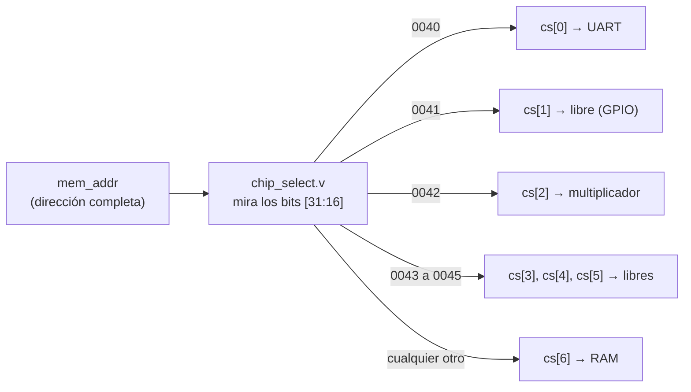
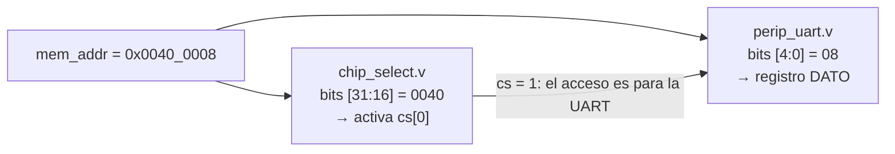

# Semana 1 · Del contador al procesador

[← Volver a la guía](README.md)

**Objetivo de la semana:** entender qué es un procesador, ejecutar un programa en C en el FemtoRV (simulado y en la tarjeta) y construir el mapa de memoria del SoC.

**Antes de empezar:** lean [Fundamentos 01](Fundamentos/01_RISC-V_y_FemtoRV.md), [Fundamentos 03](Fundamentos/03_De_C_a_la_FPGA.md) y [Fundamentos 02](Fundamentos/02_Bus_y_perifericos.md) completos. Activen el entorno en cada terminal: `source digital-logic-design activate`.

**Regla de trabajo:** en cada tarea que lo pida, **escriban la predicción en la bitácora antes de ejecutar el comando**. La predicción equivocada que se explica vale más que el resultado correcto copiado.

| Tarea | Qué hacen | Tiempo estimado |
|---|---|---|
| [1](#tarea-1-el-blinker-desde-memoria) | Blinker desde memoria: predecir, simular, llevar a la tarjeta | 1 h |
| [2](#tarea-2-el-primer-programa-en-el-femtorv) | Primer programa en el FemtoRV: simulación y tarjeta | 1 h |
| [3](#tarea-3-el-mapa-de-memoria) | Mapa de memoria del SoC | 1 h 15 min |
| [4](#tarea-4-el-femtorv-por-dentro-visto-de-lejos) | Reconocer el PC, la máquina de estados y el bus en el código del FemtoRV | 30 min |
| [5](#tarea-5-de-una-línea-de-c-al-bus) | De una línea de C a una instrucción y al bus | 1 h |
| [✓](#punto-de-control) | Punto de control al inicio de la semana 2 | 5 min |

---

## Tarea 1. El blinker desde memoria

Carpeta: `blinker/`. Archivo principal: `blinker/rtl/blinker.v`.

### 1.1 Leer y predecir

Lean `blinker.v` y respondan en la bitácora **antes de simular**:

1. Dibujen el diagrama de bloques del circuito: divisor, PC, ROM y LEDs, con el ancho en bits de cada señal.
2. Completen la tabla para las primeras 8 posiciones:

   | PC | LEDS (predicción) | LEDS (simulación) |
   |---|---|---|
   | 0 | | |
   | 1 | | |
   | … | | |
   | 7 | | |

3. El testbench usa `DIV_BITS = 3` y un reloj de 25 MHz (periodo 40 ns). ¿Cada cuántos **ciclos** y cada cuántos **nanosegundos** avanza el PC?
4. En la tarjeta, `DIV_BITS = 22`. ¿Cuánto dura cada paso en la Colorlight (25 MHz) y en la Tang Nano (27 MHz)? ¿Cuánto dura la secuencia completa de 21 pasos?
5. La ROM se lee en un `always @(posedge clk)`. ¿Los LEDs cambian en el **mismo** ciclo que el PC o en el **siguiente**? ¿Por qué?

### 1.2 Simular

```bash
cd blinker
make sim
```

La terminal muestra una línea por cada cambio de los LEDs, por ejemplo:

```
t =    380 ns   PC =  1   LEDS = 00001
t =    700 ns   PC =  2   LEDS = 00010
```

Completen la columna "simulación" de la tabla y comprueben las respuestas 3 y 5. Abran las formas de onda con `make wave`, agreguen `clk`, `PC`, `tick` y `leds` (dentro de `uut`) y hagan una captura donde se vea **un** cambio del PC y el cambio de los LEDs un ciclo después.

### 1.3 Llevar a la tarjeta

Conecten los LEDs según [Tarjetas.md](Tarjetas.md) (en la Tang Nano se usan los de la tarjeta).

```bash
make syn BOARD=colorlight        # o BOARD=tangnano9k
make config BOARD=colorlight
```

Midan con un cronómetro cuánto tarda la secuencia completa (tomen el tiempo de 5 vueltas y dividan) y compárenlo con su respuesta 4.

### 1.4 Preguntas para la bitácora

1. ¿Qué tendría que **agregarse** a este circuito para que fuera un procesador? Usen la tabla de la sección 1 de [Fundamentos 01](Fundamentos/01_RISC-V_y_FemtoRV.md#1-un-procesador-es-un-contador-que-lee-una-memoria).
2. Si el contenido de la ROM fueran instrucciones y no patrones de LEDs, ¿qué bloque las interpretaría?

---

## Tarea 2. El primer programa en el FemtoRV

Carpeta: `soc/`. Programa: `soc/firmware/hola.c`.

### 2.1 Simular el programa tal como está

```bash
cd soc
make sim
```

El `Makefile` hace cuatro cosas, en este orden (miren la terminal):

1. Compila `firmware/hola.c` con `riscv64-unknown-elf-gcc`.
2. Genera `build/firmware.lst` (el listado) y `firmware.hex` (el programa para la memoria).
3. Compila el SoC y el testbench con Icarus Verilog.
4. Simula: el testbench escucha la UART y muestra lo que el programa envía.

Resultado esperado:

```
=== Simulacion del SoC: salida de la UART ===
Hola desde el FemtoRV
Por software (sumas repetidas): 5535
Por hardware (periferico MULT): 5535
Fin. El programa queda en un bucle infinito.

=== Fin: 155708 ciclos simulados, 145 caracteres recibidos, LEDS_EXT = 00000000 ===
```

Anoten en la bitácora: cuántas palabras de la RAM ocupa el programa (línea `firmware.hex: … palabras usadas`) y cuántos ciclos se simularon.

### 2.2 Modificar el programa

Editen `firmware/hola.c` para que, además, imprima el número del grupo y los nombres de sus integrantes. Vuelvan a ejecutar `make sim`. Copien la salida en la bitácora.

### 2.3 Llevar el programa a la tarjeta

Conecten la UART según [Tarjetas.md](Tarjetas.md) (en la Colorlight hace falta un adaptador USB-serial; en la Tang Nano basta el cable USB).

```bash
make syn BOARD=colorlight         # tarda 1 a 2 minutos
make config BOARD=colorlight
make terminal BOARD=colorlight    # salir: Ctrl-a y luego Ctrl-x
```

Con la terminal abierta, presionen el botón de reset de la tarjeta: el mensaje debe aparecer de nuevo.

Al final de `make syn` aparece una tabla de recursos. **Guárdenla en la bitácora**: la van a comparar en la semana 2 con el SoC que tenga su periférico.

### 2.4 Preguntas para la bitácora

1. ¿Por qué el mismo programa produce la misma salida en la simulación y en la tarjeta, si en la simulación la UART es mucho más rápida? (Pista: lean el encabezado de `sim/tb_soc.v` y la función `uart_putc` en `firmware/soc.h`).
2. ¿Por qué cada cambio en `hola.c` obliga a ejecutar `make syn` otra vez? ([Fundamentos 03, sección 2](Fundamentos/03_De_C_a_la_FPGA.md#2-cómo-llega-el-programa-a-la-fpga)).

---

## Tarea 3. El mapa de memoria

**Idea central de esta tarea:** el procesador no sabe qué es una UART ni un multiplicador. Solo sabe **leer y escribir en direcciones**. El SoC decide, según la dirección, **qué bloque** atiende cada acceso. Esa lista de "dirección → bloque" es el **mapa de memoria**. En la semana 2 su propio periférico entrará en este mapa, y el programa en C lo controlará escribiendo en sus direcciones.

Van a construir el mapa **leyendo el Verilog**, que es la fuente de verdad (`soc.h` es solo su traducción a C).

### 3.0 Los bloques del SoC

| Bloque | Qué es | Para qué está en el SoC |
|---|---|---|
| **RAM** | Memoria de 32 KB | Guarda el programa (las instrucciones) y sus variables |
| **UART** | Puerto serial: envía y recibe bytes, un bit tras otro, por un solo cable | Que el programa le escriba texto al PC (la terminal) |
| **Multiplicador** | Circuito que multiplica dos números de 16 bits | El FemtoRV no tiene instrucción de multiplicar: se la delega a este periférico |
| **Libres** | Espacios reservados, sin nada conectado | En la semana 2, aquí va su periférico GPIO (LEDs y pulsadores) |

### 3.1 Tabla de bloques: ¿qué bloque atiende cada dirección?

**Archivos:** `soc/rtl/chip_select.v` y `soc/rtl/SOC.v`.

Una dirección tiene 32 bits, que en hexadecimal son 8 dígitos (cada dígito hexadecimal = 4 bits). `chip_select.v` mira **solo los 4 primeros dígitos** (los 16 bits altos) para decidir el bloque:

```
0x0042_0008
  ────┬──── ────┬────
  bits [31:16]  bits [15:0]
  = 0042        = 0008
  ¿QUÉ BLOQUE?  ¿QUÉ REGISTRO dentro del bloque? (eso es la tabla 3.2)
```



`cs` (*chip select*) tiene 7 bits y **solo uno vale 1 a la vez**: el del bloque elegido. Los demás bloques ven su `cs` en 0 e ignoran el acceso.

**Dónde mirar:**

| Archivo | Líneas | Qué encuentran |
|---|---|---|
| `chip_select.v` | 24 – 29 | `CHIPxADDR`: los 4 primeros dígitos de cada bloque. **Aquí revisan el rango de cada bloque.** |
| `chip_select.v` | 31 – 37 | `CHIPxCS`: qué bit de `cs` corresponde a cada bloque (el bit que vale 1, contando desde la derecha y empezando en 0) |
| `chip_select.v` | 40 – 50 | El `case`: "si los bits altos valen `CHIPxADDR`, entonces `cs = CHIPxCS`". `default` = si no coincide ninguno |
| `SOC.v` | 73 – 79 | El nombre de cada línea de `cs` y a qué bloque va (`cs_uart`, `cs_mult`, `cs_ram`…) |
| `SOC.v` | 85 – 93 | Qué dato vuelve al procesador cuando **lee** de cada bloque (`chipX_dout`). `32'b0` = nada conectado: siempre se lee 0 |

**Ejemplo resuelto: el multiplicador, `0x0042_xxxx`**

1. Los 4 primeros dígitos son `0042`. En `chip_select.v`, **línea 26**: `CHIP2ADDR = 16'h0042` → es el bloque 2.
2. **Línea 44** del `case`: `CHIP2ADDR: cs = CHIP2CS`.
3. **Línea 33**: `CHIP2CS = 7'b0000100` → el 1 está en el bit 2 → **`cs[2]`**.
4. En `SOC.v`, **línea 75**: `wire cs_mult = cs[2]` → va al **multiplicador**.
5. En `SOC.v`, **línea 89**: `.chip2_dout(mult_dout)` → al leer, vuelve **`mult_dout`**.

Completen la tabla siguiendo los mismos cinco pasos:

| Rango de direcciones | Bloque | Señal `cs` | Dato que vuelve al CPU (`chipX_dout`) |
|---|---|---|---|
| `0x0000_0000` – `0x0000_7FFF` | | | |
| `0x0040_0000` – `0x0040_FFFF` | | | |
| `0x0041_0000` – `0x0041_FFFF` | | | |
| `0x0042_0000` – `0x0042_FFFF` | Multiplicador | `cs[2]` = `0000100` | `mult_dout` |
| `0x0043_0000` – `0x0045_FFFF` | | | |

> **Pista para la RAM:** `0000` no aparece en las líneas 24 a 29. ¿Qué línea del `case` se usa entonces? El límite `7FFF` no sale de `chip_select.v` sino del tamaño de la RAM: 8192 palabras × 4 bytes = 32 768 bytes = `0x8000` direcciones (de `0x0000` a `0x7FFF`).

### 3.2 Tabla de registros: ¿qué hace cada dirección dentro de un bloque?

**Archivos:** `soc/rtl/uart/perip_uart.v` y `soc/rtl/mult/perip_mult.v`.

La misma dirección llega completa a dos lugares, y **cada uno mira una parte distinta**:



Un periférico solo responde si su `cs` vale 1. Dentro de él, un **decodificador interno** mira los bits bajos de la dirección para elegir el **registro**.

#### Cómo leer un periférico: seguir las señales

Al abrir `perip_uart.v` aparecen señales como `wr`, `cs`, `d_in` o `sel`. **Cuando no sepan qué es una señal, búsquenla** (Ctrl+F en Lite XL; F3 salta a la siguiente coincidencia) hasta encontrar de dónde viene:

1. Si está en la cabecera del módulo como `input`, viene de afuera: búsquenla en `SOC.v`, donde se conecta el periférico.
2. Si no es una entrada, nace adentro: busquen dónde se le asigna un valor.

Ejemplo con `wr`: en `perip_uart.v` es `input wr` (línea 11) → en `SOC.v` la UART se conecta con `.wr(wr)` (línea 128) → y `wr` nace en `SOC.v` línea 64: `wire wr = |mem_wmask;` (el `|` es un OR de los 4 bits: vale 1 si hay escritura).

| Señal en el periférico | De dónde viene (en `SOC.v`) | Qué es |
|---|---|---|
| `cs` | `.cs(cs_uart)`, línea 125 → línea 73 | 1 si la dirección es de este periférico |
| `wr` | `.wr(wr)`, línea 128 → línea 64 | 1 si el procesador está **escribiendo** |
| `rd` | `.rd(rd)`, línea 127 → línea 65 | 1 si el procesador está **leyendo** |
| `addr` | `.addr(mem_addr)`, línea 126 | La dirección completa |
| `d_in` | `.d_in(mem_wdata)`, línea 124 | El dato que escribe el procesador |
| `d_out` | `.d_out(uart_dout)`, línea 129 → va a `chip_select` | Lo que el periférico responde cuando se le lee |
| `sel` | Nace dentro de `perip_uart.v` (decodificador, líneas 128 – 140) | Qué registro se eligió |

Abreviaturas que van a ver en casi cualquier diseño: `wr` = *write* (escribir) · `rd` = *read* (leer) · `d_in` / `d_out` = *data in* / *data out* · `sel` = *select* · `cs` = *chip select* · `tx` / `rx` = transmitir / recibir.

#### Las zonas de `perip_uart.v`

| Líneas | Zona | Qué hace |
|---|---|---|
| 26 | Corte de la dirección | `.addr(addr[4:0])`: el decodificador recibe solo los **5 bits bajos** |
| 134 – 138 | Decodificador | `5'h08` → `sel = 01` (registro en `+0x08`); `5'h10` → `sel = 10` (registro en `+0x10`). Solo si `cs = 1` |
| 157 – 163 | Escritura | `if (sel[0] && wr)` guarda el byte a enviar; `if (sel[1] && wr)` guarda `uart_ctrl`. Para saber qué hace cada bit de `uart_ctrl`, busquen `uart_ctrl[` (líneas 61, 63 y 162) |
| 165 – 171 | Lectura | Qué se pone en `d_out` según `sel` |

En la línea 168 aparecen llaves: `{22'b0, tx_busy, rx_avail, rx_error, 7'b0}`. Las llaves **pegan bits uno al lado del otro**; lo que está más a la izquierda queda en los bits más altos. Para saber en qué bit queda cada señal, **cuenten desde la derecha**: `7'b0` ocupa los bits 0 a 6, así que `rx_error` queda en el bit 7, y así sucesivamente.

**Ejemplo resuelto: el registro de dato de la UART**

- **Dirección completa:** base del bloque `0x0040_0000` + `0x08` (línea 135) = `0x0040_0008`.
- **Al escribir** (línea 158): guarda `d_in[7:0]`, los 8 bits bajos, en `d_in_uart`, que va al transmisor como `tx_data` (línea 62): **el byte a enviar**.
- **Al leer** (línea 167): devuelve `{24'b0, rx_data}`: **el último byte recibido**, en los bits [7:0].

Completen la tabla. La UART tiene 2 registros y el multiplicador 5 (`perip_mult.v`: decodificador en las líneas 31 – 38, escritura en 52 – 56, lectura en 64 – 68):

| Dirección completa | Periférico | Nombre | Lectura / Escritura | Qué significan sus bits |
|---|---|---|---|---|
| `0x0040_0008` | UART | DATO | Las dos | **Escribir:** bits [7:0] = byte a enviar. **Leer:** bits [7:0] = último byte recibido |
| | UART | CONTROL | | |
| | MULT | | | |
| … | | | | |

Comprueben al final que sus direcciones coinciden con los `#define` de `soc/firmware/soc.h`.

### 3.3 Preguntas

1. ¿Cuántos bits de la dirección mira `chip_select.v` y cuántos mira cada periférico para elegir sus registros?
2. ¿Por qué la RAM es el caso `default` del `case` y no tiene un valor propio?
3. Si el programa escribe en `0x0043_0000`, ¿qué bloque recibe la escritura? ¿Y qué obtiene si lee de esa dirección?
4. El multiplicador borra su resultado unos 30 ciclos después de `DONE` (estado `END` de `soc/rtl/mult/mult.v`). ¿Cómo debería decirlo su tabla de registros? ¿Por qué `mult_hw()` en `soc.h` sí funciona?

---

## Tarea 4. El FemtoRV por dentro, visto de lejos

No van a diseñar el procesador ni a entender cada línea: solo a **reconocer** en su código tres piezas que ya conocen. Abran `soc/rtl/cpu/femtorv32_quark.v` y las secciones 6 y 7 de [Fundamentos 01](Fundamentos/01_RISC-V_y_FemtoRV.md#6-la-máquina-de-estados-del-femtorv).

### 4.1 Ubicar

Usen Ctrl+F para encontrar cada pieza y completen la tabla:

| Pieza | Qué buscar | Líneas | Qué hace (una frase con sus palabras) |
|---|---|---|---|
| El PC | `PC;` y `PCplus4` | | |
| La máquina de estados | `localparam FETCH_INSTR`, `reg [NB_STATES-1:0] state` y el `case` que cambia `state` | | |
| La interfaz de memoria | `assign mem_addr` | | |

### 4.2 Preguntas

1. En el estado `EXECUTE` (líneas 353 – 358), ¿entre qué valores escoge el siguiente PC? ¿Cuándo es `PC + 4` y cuándo es otro?
2. Con el diagrama de estados de Fundamentos 01, expliquen por qué un `sw` tarda 4 ciclos y un `addi` tarda 3. (Pista: la línea 357 decide si pasa por `WAIT_ALU_OR_MEM`).
3. Según la línea 218, ¿qué pone el procesador en `mem_addr` cuando está buscando una instrucción y qué pone cuando está ejecutando un `lw` o un `sw`?
4. Comparen con el blinker de la tarea 1: ¿qué pieza del FemtoRV equivale a su contador y cuál a su lectura de la ROM?

---

## Tarea 5. De una línea de C al bus

### 5.1 Encontrar la instrucción

Abran `soc/build/firmware.lst` y busquen la función `imprimir`. Guíense por la sección 4 de [Fundamentos 03](Fundamentos/03_De_C_a_la_FPGA.md#4-cómo-leer-firmwarelst):

1. Encuentren el `sw` que escribe una letra en el registro DATO de la UART. Anoten su **dirección** en el listado y su **código máquina**.
2. ¿En qué registro del procesador está la dirección `0x0040_0008`? ¿Qué dos instrucciones la calcularon?
3. Un poco más abajo hay un `lw` seguido de un `andi ...,512`. ¿Qué registro de la UART lee? ¿Por qué 512? (Pista: `UART_OCUPADA` en `soc.h`).

### 5.2 Verlo en las formas de onda

```bash
make sim ARGS=+vcd     # guarda los primeros 20 000 ciclos
make wave
```

En GTKWave, dentro de `tb_soc` → `uut`, agreguen: `clk`, `mem_addr`, `mem_wdata`, `mem_wmask`, `mem_rstrb`, `cs` y, dentro de `CPU`, `state`.

Tres ajustes para leer mejor las ondas:

- Pongan `mem_addr` y `mem_wdata` en hexadecimal, y `cs` en binario: clic derecho sobre la señal → *Data Format* → *Hex* o *Binary*.
- Si `clk` se ve como una línea plana, están demasiado cerca: alejen la vista con la lupa con signo menos hasta ver unos 200 ns.
- `state` muestra `1`, `2`, `4` u `8`: son los estados BUSCAR, ESPERAR, EJECUTAR y ESPERAR MEMORIA de [Fundamentos 01](Fundamentos/01_RISC-V_y_FemtoRV.md#6-la-máquina-de-estados-del-femtorv).

**Antes de buscar, escriban su predicción** de los valores de `mem_wdata`, `mem_wmask`, `cs` y `state` en el ciclo en que el procesador escribe la primera letra. Luego:

1. Busquen el **primer** ciclo en que `mem_addr = 00400008` y `mem_wmask = 1111` (puede aparecer como `F`). ¿Qué valor tiene `mem_wdata`? ¿A qué carácter ASCII corresponde?
2. En ese ciclo, ¿qué vale `cs`? ¿Coincide con su mapa de memoria?
3. ¿En qué estado está el CPU? ¿Cuántos ciclos después vuelve a `FETCH_INSTR`?
4. Unos ciclos antes verán `mem_addr = 00000048` con `cs` en la RAM. ¿Qué está haciendo el procesador en ese momento? (No es la letra: comparen con la dirección del `sw` de la tarea 5.1).
5. Hagan una captura de pantalla con el cursor en el ciclo de la escritura y explíquenla en la bitácora, señal por señal. Comparen con el diagrama de la sección 5 de [Fundamentos 02](Fundamentos/02_Bus_y_perifericos.md#5-una-escritura-y-una-lectura-vistas-en-la-simulación).

### 5.3 ¿Dónde está el bucle?

En `hola.c` el producto "por software" se calcula con un bucle `for` de 45 sumas. Búsquenlo en `firmware.lst` dentro de `main`.

1. ¿Encuentran el bucle? ¿Qué encuentran en su lugar?
2. Expliquen qué hizo el compilador ([Fundamentos 03, sección 5](Fundamentos/03_De_C_a_la_FPGA.md#5-el-compilador-es-más-listo-de-lo-que-parece)).
3. ¿Por qué eso importa cuando se quiere **medir** cuánto tarda algo?

Ahora impidan que el compilador haga la cuenta:

4. En `hola.c` cambien `uint32_t a = 123, b = 45;` por `volatile uint32_t a = 123, b = 45;` y ejecuten `make sim`. Vuelvan a buscar el bucle en `firmware.lst`. ¿Cuántas palabras ocupa ahora el programa? ¿Qué instrucciones forman **una vuelta** del bucle y cuál de ellas es el salto que lo cierra?
5. Con la tabla de ciclos del Quark ([Fundamentos 01, sección 6](Fundamentos/01_RISC-V_y_FemtoRV.md#cuántos-ciclos-tarda-cada-instrucción)): 3 ciclos para ALU y saltos, 4 para `lw`/`sw`, estimen cuántos ciclos tarda la multiplicación por software (45 vueltas).
6. Comparen los **ciclos simulados** de la última línea de `make sim` con y sin `volatile`. ¿La diferencia coincide con su estimación?

Al terminar, dejen `hola.c` como estaba: `git restore firmware/hola.c`.

---

## Punto de control

Al inicio de la semana 2, cada grupo muestra en 5 minutos:

- [ ] `make sim` funcionando, con el mensaje de su grupo.
- [ ] El mapa de memoria completo (tareas 3.1 y 3.2).
- [ ] Una respuesta oral: el profesor señala una dirección y el grupo dice qué bloque la atiende y qué pasa al escribirla.

Si algo no funciona, revisen [Errores_frecuentes.md](Errores_frecuentes.md) y lleguen con la pregunta concreta.

## Lo que va a la bitácora esta semana

- Tarea 1: diagrama, tabla de predicción frente a simulación, respuestas, captura de GTKWave, tiempo medido.
- Tarea 2: salida de la simulación con su mensaje, tabla de recursos de la síntesis, respuestas.
- Tarea 3: las dos tablas y las respuestas.
- Tarea 4: la tabla de las tres piezas y las respuestas.
- Tarea 5: el `sw` y el `lw` de `imprimir`, captura de GTKWave explicada, respuestas.

[← Volver a la guía](README.md) · [Semana 2 →](Semana2.md)
