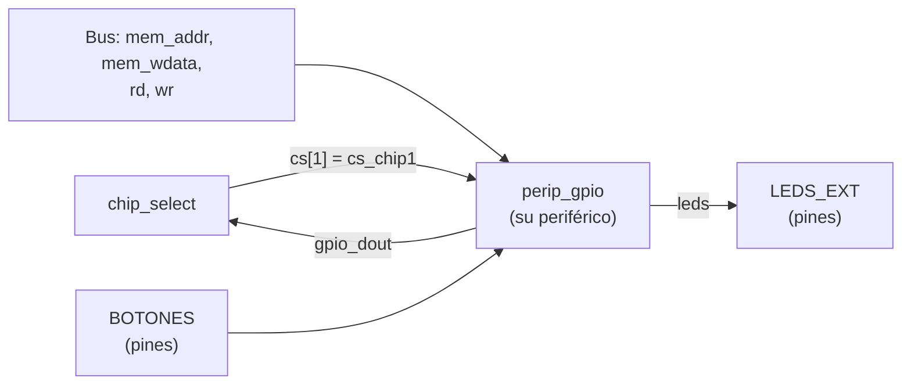

# Semana 2 · Del procesador al periférico

[← Volver a la guía](README.md)

**Objetivo de la semana:** diseñar un periférico mapeado en memoria, conectarlo al SoC, controlarlo desde C y medir cuánto cuesta hacer una tarea por software.

**Antes de empezar:** repasen las secciones 4 a 7 de [Fundamentos 02](Fundamentos/02_Bus_y_perifericos.md): cómo se elige el bloque y el registro, una escritura y una lectura en el bus, cómo está hecho un periférico por dentro y la tabla de registros.

**El periférico:** un **GPIO** (*General Purpose Input/Output*, entradas y salidas de propósito general) con un registro de LEDs y uno de pulsadores, en la dirección base `0x0041_0000` (`cs[1]`, que hoy está libre). Es el periférico más sencillo posible, a propósito: el reto es la conexión con el procesador, no la lógica.

| Tarea | Qué hacen |
|---|---|
| [1](#tarea-1-especificar-el-periférico) | Especificar: tabla de registros y caja negra |
| [2](#tarea-2-describir-el-periférico-en-verilog) | Describir el periférico en Verilog |
| [3](#tarea-3-probar-el-periférico-solo) | Probarlo solo, con un testbench de bus |
| [4](#tarea-4-conectarlo-al-soc) | Conectarlo al SoC |
| [5](#tarea-5-el-programa-en-c) | Programa en C: simulación |
| [6](#tarea-6-en-la-tarjeta) | En la tarjeta |
| [7](#tarea-7-experimento-cuánto-cuesta-una-tarea-hecha-por-software) | Experimento: cuánto cuesta una tarea hecha por software |

---

## Tarea 1. Especificar el periférico

### 1.1 Tabla de registros

Completen la tabla. Las dos primeras columnas ya están decididas; el resto lo deciden y justifican ustedes:

| Dirección completa | Desplazamiento | Nombre | Acceso | Bits usados | Significado de los bits | Valor tras reset | Qué pasa si se escribe | Qué pasa si se lee |
|---|---|---|---|---|---|---|---|---|
| `0x0041_0004` | `+0x04` | LEDS | | | | | | |
| `0x0041_0008` | `+0x08` | BOTONES | | | | | | |
| cualquier otra `0x0041_xxxx` | — | — | | | | | | |

> **Si un dato solo es válido un tiempo, la tabla debe decirlo.** Ejemplo: el registro RESULT del multiplicador se borra unos 30 ciclos después de que DONE vale 1; por eso `mult_hw()` en `soc.h` lo lee apenas termina la espera. En su GPIO, ¿algún registro tiene una condición así?

### 1.2 Caja negra

Dibujen el periférico como una caja con todas sus entradas y salidas, el ancho en bits de cada una y de dónde viene o a dónde va (del CPU, del `chip_select`, de los pines). Los puertos son los de `plantillas/perip_gpio.v`.

### 1.3 Predicción de hardware

Antes de escribir código, predigan:

1. ¿Cuántos **flip-flops** necesita el periférico? Piensen qué hay que **recordar** entre un ciclo y otro: el registro de LEDs y el dato de salida `d_out`. ¿Todos los 32 bits de `d_out` pueden cambiar, o algunos valen siempre 0?
2. ¿Qué bloques combinacionales hay? (comparadores de dirección, multiplexor de lectura…)

Van a comparar esta predicción con la síntesis en la tarea 6.

---

## Tarea 2. Describir el periférico en Verilog

```bash
cd soc
cp ../plantillas/perip_gpio.v rtl/perip_gpio.v
```

Completen las partes marcadas `/* COMPLETAR */`. Mientras quede alguna, el archivo no compila (es intencional). Guíense por `rtl/mult/perip_mult.v` y por la sección 6 de [Fundamentos 02](Fundamentos/02_Bus_y_perifericos.md#6-cómo-está-hecho-un-periférico-por-dentro): su periférico tiene las mismas tres partes (decodificador, escritura y lectura).

Tres reglas que salen de la sección 5 de Fundamentos 02:

1. **Escribir** solo en el flanco en que `cs && wr` y la dirección es la del registro.
2. **Leer**: en el flanco en que `cs && rd`, poner el registro pedido en `d_out`.
3. Los bits que no se usan se devuelven en **0**.

Comprueben que compila:

```bash
iverilog -g2012 -o build/gpio_check.vvp rtl/perip_gpio.v && echo "Compila"
```

---

## Tarea 3. Probar el periférico solo

```bash
cp ../plantillas/tb_perip_gpio.v sim/tb_perip_gpio.v
```

**¿Por qué probarlo solo?** Si lo prueban directamente con el procesador y algo falla, el error puede estar en el periférico, en `SOC.v`, en la dirección, en el programa en C… Si el periférico ya pasó su propio testbench, **el error no está en él**. Es la regla de oro de cualquier diseño con bus: probar cada bloque por separado antes de juntarlos.

El testbench trae las tareas `escribir()`, `leer()` y `comprobar()`, que imitan lo que hace el procesador en el bus (un `sw` y un `lw`, como en la sección 5 de Fundamentos 02), y una prueba de ejemplo:

```verilog
escribir(32'h0041_0004, 32'hA5);       // como un sw: escribe 0xA5 en LEDS
comprobar("salida leds", leds, 8'hA5); // ¿los LEDs muestran 0xA5?
```

**Agreguen una prueba por cada fila y columna de su tabla de registros** (la lista está en el comentario `COMPLETAR` del archivo). Prueben también lo que **no** debe pasar: escribir en BOTONES (solo lectura), escribir con `cs = 0` (un acceso para otro periférico) y leer una dirección sin registro.

```bash
iverilog -g2012 -o build/tb_gpio.vvp sim/tb_perip_gpio.v rtl/perip_gpio.v
vvp -n build/tb_gpio.vvp
gtkwave build/tb_perip_gpio.vcd &
```

Cada prueba imprime `OK` o `ERROR`. El final debe decir `--- 0 errores ---`.

**Para la bitácora:** la lista de pruebas (qué especificación verifica cada una), la salida de la terminal y una captura de GTKWave de **una escritura** y **una lectura**, con `clk`, `cs`, `wr`, `rd`, `addr`, `d_in`, `d_out` y `leds`. Señalen en la captura en qué flanco se guarda el dato.

> **No sigan a la tarea 4 hasta tener 0 errores.** Si el periférico falla con el procesador y pasó este testbench, el error está en la conexión o en el programa, no en el periférico.

---

## Tarea 4. Conectarlo al SoC

Hoy la dirección `0x0041_xxxx` ya activa `cs[1]`, pero no hay nada conectado: lo que se escribe se pierde y lo que se lee vale 0. Conectar el periférico es **llenar ese hueco**, y se hace solo en `rtl/SOC.v`. El procesador y `chip_select.v` no se tocan.



El periférico se agrega en el `Makefile` automáticamente: cualquier archivo `rtl/perip_*.v` se compila solo. Las tarjetas (`boards/`) ya llevan `BOTONES` y `LEDS_EXT` a pines físicos: tampoco hay que tocarlas.

Los cuatro cambios en `rtl/SOC.v`:

**1. Declarar el cable del dato de salida.** Junto a los de los otros periféricos (línea 83, después de `wire [31:0] RAM_rdata;`):

```verilog
wire [31:0] gpio_dout;
```

**2. Llevar ese cable al multiplexor de lectura.** En la conexión de `chip_select`, línea 88, cambien `32'b0` por el cable nuevo:

```verilog
.chip1_dout(gpio_dout),    // antes: .chip1_dout(32'b0),
```

Sin este cambio, el procesador puede escribir en el periférico pero siempre lee 0.

**3. Borrar la línea que apaga los LEDs** (línea 160):

```verilog
assign LEDS_EXT = 8'b0;    // ← borrarla
```

**4. Conectar el periférico en ese mismo lugar.** Usen como modelo la conexión del multiplicador (líneas 144 – 153): mismas señales del bus, otro `cs` y otro cable de salida, más los pines.

```verilog
perip_gpio gpio (
    .clk    (clk),
    .reset  (!resetn),     // el periférico usa reset activo en alto
    .d_in   (mem_wdata),
    .cs     (cs_chip1),
    .addr   (mem_addr),
    .rd     (rd),
    .wr     (wr),
    .d_out  (gpio_dout),
    .botones(BOTONES),
    .leds   (LEDS_EXT)
);
```

Comprueben que el SoC sigue funcionando con el programa de la semana 1:

```bash
make sim
```

Debe imprimir lo mismo que antes. Si no compila, el error de Icarus dice el archivo y la línea.

---

## Tarea 5. El programa en C

Abran `firmware/gpio.c`. Completen las direcciones de los registros **según su tabla** y los patrones de LEDs del bucle principal.

### 5.1 Simular con distintos pulsadores

El testbench del SoC permite fijar el valor de los pulsadores con `+botones=N`:

```bash
make sim PROG=gpio
make sim PROG=gpio ARGS="+botones=1 +ciclos=200000"
make sim PROG=gpio ARGS="+botones=2 +ciclos=200000"
```

La última línea de cada simulación muestra el valor final de `LEDS_EXT`. Completen:

| `+botones=` | LEDS esperado | `LEDS_EXT` en la simulación | ¿Coincide? |
|---|---|---|---|
| 0 | | | |
| 1 | | | |
| 2 | | | |

### 5.2 Preguntas

1. El programa imprime `LEDS = 0x0000002A` después de escribir `0x2A`. ¿Qué parte de su periférico hace posible esa lectura?
2. Busquen en `build/firmware.lst` el `lw` que lee los pulsadores dentro del `while (1)`. ¿Qué dirección usa y cómo se calculó?
3. ¿Qué pasaría si quitaran `volatile` de la macro `REG()`? ([Fundamentos 03, sección 3](Fundamentos/03_De_C_a_la_FPGA.md#3-acceder-a-un-periférico-desde-c-reg-y-volatile)).
4. El programa pregunta por los pulsadores una y otra vez (*polling*). ¿Por qué no hay otra opción en el Quark?

---

## Tarea 6. En la tarjeta

Conecten LEDs y pulsadores según [Tarjetas.md](Tarjetas.md).

```bash
make syn PROG=gpio BOARD=colorlight      # o BOARD=tangnano9k
make config BOARD=colorlight
make terminal BOARD=colorlight           # opcional: ver los mensajes
```

1. Comprueben cada fila de la tabla de la tarea 5.1 presionando los pulsadores.
2. **Predicción frente a síntesis.** Comparen la tabla de recursos de este `make syn` con la que guardaron en la semana 1 (SoC sin su periférico). ¿Cuántos flip-flops (`TRELLIS_FF` en la Colorlight, `DFF` en la Tang Nano) aumentaron? ¿Coincide con su predicción de la tarea 1.3? Si no, expliquen qué optimizó Yosys.

---

## Tarea 7. Experimento: ¿cuánto cuesta una tarea hecha por software?

El programa `firmware/parpadeo.c` enciende y apaga el LED 0 lo más rápido que puede. Completen la dirección del registro LEDS.

### 7.1 Predicción

```bash
make firmware PROG=parpadeo
```

En `build/firmware.lst`, dentro de `main`, encuentren las instrucciones del `while (1)`. Con la tabla de ciclos por instrucción ([Fundamentos 01, sección 6](Fundamentos/01_RISC-V_y_FemtoRV.md#cuántos-ciclos-tarda-cada-instrucción)):

| Instrucción del bucle | Tipo | Ciclos |
|---|---|---|
| | | |
| | | |
| | | |
| **Total por vuelta** | | |

Calculen para su tarjeta (25 MHz o 27 MHz):

1. El **periodo** y la **frecuencia** de la señal del LED 0.
2. El **ciclo útil**: ¿cuántos de esos ciclos está el LED encendido? Fíjense en qué ciclo de cada `sw` cambia el LED ([sección 5 de Fundamentos 02](Fundamentos/02_Bus_y_perifericos.md#5-una-escritura-y-una-lectura-vistas-en-la-simulación)).

### 7.2 Simulación

```bash
make sim PROG=parpadeo ARGS="+vcd +ciclos=2000"
make wave
```

En GTKWave midan con dos cursores el periodo de `LEDS_EXT[0]` en ciclos de reloj. ¿Coincide con la predicción?

### 7.3 Medición en la tarjeta

```bash
make syn PROG=parpadeo BOARD=...
make config BOARD=...
```

Midan frecuencia y ciclo útil con el osciloscopio o el analizador lógico. En la Colorlight midan en el pin del LED 0 del conector J2. En la Tang Nano, vean la sección "Medir una señal" de [Tarjetas.md](Tarjetas.md).

### 7.4 Análisis

1. Comparen predicción, simulación y medición. Expliquen cualquier diferencia.
2. Un contador en hardware puede cambiar el LED **en cada ciclo de reloj**. ¿Cuántas veces más rápida sería esa señal que la de software?
3. La pantalla de 4.3" de la consola necesita un dato de píxel nuevo unas **9 millones de veces por segundo**. Con su resultado, ¿podría el FemtoRV generar esa señal por software? ¿Qué conclusión sacan sobre qué tareas de la consola deben ir en hardware?

---

## Lo que va a la bitácora esta semana

- Tarea 1: tabla de registros, caja negra, predicción de hardware.
- Tarea 3: lista de pruebas, salida con 0 errores, captura explicada.
- Tarea 4: el fragmento de `SOC.v` que agregaron, explicado.
- Tarea 5: tabla de simulación y respuestas.
- Tarea 6: comprobación en la tarjeta (foto o video corto) y comparación de recursos.
- Tarea 7: tablas de predicción, captura de simulación, captura del osciloscopio y análisis.

## Valor agregado

Integren como periférico mapeado en memoria el controlador del **laboratorio de periféricos** (servo, generador de tonos, ultrasonido, puente H, motor paso a paso o displays):

1. Diseñen su tabla de registros (por ejemplo, para el servo: un registro de posición; para el ultrasonido: uno de "iniciar medición" y uno de "distancia medida").
2. Envuelvan su controlador con las tres partes de un periférico, en otra dirección libre (`0x0043_0000`, `cs[3]`).
3. Pruébenlo con un testbench de bus y contrólenlo desde un programa en C.

[← Semana 1](Semana1.md) · [Volver a la guía](README.md)
