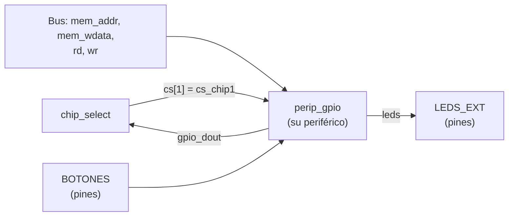

# Semana 2 · Del procesador al periférico

[← Volver a la guía](README.md)

**Objetivo de la semana:** diseñar un periférico mapeado en memoria, conectarlo al SoC, controlarlo desde C y medir cuánto cuesta hacer una tarea por software.

**Antes de empezar:** repasen las secciones 4 a 7 de [Fundamentos 02](Fundamentos/02_Bus_y_perifericos.md): cómo se elige el bloque y el registro, una escritura y una lectura en el bus, cómo está hecho un periférico por dentro y la tabla de registros.

**El periférico:** un **GPIO** (*General Purpose Input/Output*, entradas y salidas de propósito general) con un registro de LEDs y uno de pulsadores, en la dirección base `0x0041_0000` (`cs[1]`, que hoy está libre). Es el periférico más sencillo posible, a propósito: el reto es la conexión con el procesador, no la lógica.

| Tarea | Qué hacen |
|---|---|
| [1](#tarea-1-especificar-el-periférico) | Especificar: tabla de registros y caja negra |
| [2](#tarea-2-describir-el-periférico-en-verilog) | Describir el periférico en Verilog |
| [3](#tarea-3-probar-el-periférico-solo) | Probarlo solo, con un testbench de bus |
| [4](#tarea-4-conectarlo-al-soc) | Conectarlo al SoC |
| [5](#tarea-5-el-programa-en-c) | Programa en C: simulación |
| [6](#tarea-6-en-la-tarjeta) | En la tarjeta |
| [7](#tarea-7-experimento-cuánto-cuesta-una-tarea-hecha-por-software) | Experimento: cuánto cuesta una tarea hecha por software |

---

## Tarea 1. Especificar el periférico

### 1.1 Tabla de registros

Antes de escribir código, se decide qué ve el procesador. Abran `plantillas/perip_gpio.v`: su encabezado ya dice qué registro es de lectura o escritura y qué bits usa. Con eso completen la tabla:

| Dirección | Nombre | Acceso (L, E o L/E) | Bits usados | Valor tras reset | Si se escribe… | Si se lee… |
|---|---|---|---|---|---|---|
| `0x0041_0004` | LEDS | | | | | |
| `0x0041_0008` | BOTONES | | | | | |
| otra `0x0041_xxxx` | — | | | | | |

Es la misma tabla que hicieron en la semana 1 para la UART y el multiplicador, ahora para su periférico.

### 1.2 Caja negra

Dibujen el periférico como una caja con sus entradas y salidas. Los puertos están en `plantillas/perip_gpio.v`. Para cada uno anoten su ancho en bits y de dónde viene o a dónde va: del procesador, del `chip_select` o de los pines de la tarjeta.

---

## Tarea 2. Describir el periférico en Verilog

```bash
cd soc
cp ../plantillas/perip_gpio.v rtl/perip_gpio.v
```

Completen las partes marcadas `/* COMPLETAR */`. Mientras quede alguna, el archivo no compila (es intencional). Cada parte tiene su modelo en el multiplicador, `rtl/mult/perip_mult.v`, que ya leyeron en la semana 1:

| Parte de la plantilla | Qué completar | Modelo en `perip_mult.v` |
|---|---|---|
| 1. Decodificador | El desplazamiento de cada registro, en 5 bits | Líneas 31 – 33: `5'h04` es A, `5'h08` es B |
| 2. Escritura | Cuándo se escribe LEDS y qué bits de `d_in` se guardan | Líneas 52 – 53: se escribe si hay `wr` y el registro está seleccionado; A guarda `d_in[15:0]` porque tiene 16 bits |
| 3. Lectura | El valor de LEDS y de BOTONES en 32 bits | Línea 67: DONE tiene 1 bit y se completa con 31 ceros, `{31'b0, done}` |

Dos ayudas:

- `sel_leds` ya incluye `cs`: la condición de escritura solo necesita agregar `wr`.
- LEDS tiene 8 bits y BOTONES 4. ¿Cuántos ceros hay que poner delante de cada uno para completar 32?

Comprueben que compila:

```bash
iverilog -g2012 -o build/gpio_check.vvp rtl/perip_gpio.v && echo "Compila"
```

---

## Tarea 3. Probar el periférico solo

```bash
cp ../plantillas/tb_perip_gpio.v sim/tb_perip_gpio.v
```

**¿Por qué probarlo solo?** Si lo prueban directamente con el procesador y algo falla, el error puede estar en el periférico, en `SOC.v`, en la dirección, en el programa en C… Si el periférico ya pasó su propio testbench, **el error no está en él**. Es la regla de oro de cualquier diseño con bus: probar cada bloque por separado antes de juntarlos.

El testbench trae tres tareas que imitan al procesador:

- `escribir(dirección, dato)`: lo mismo que un `sw`.
- `leer(dirección, variable)`: lo mismo que un `lw`; deja el dato leído en la variable.
- `comprobar("nombre", obtenido, esperado)`: imprime `OK` o `ERROR`.

Ya trae una prueba de ejemplo:

```verilog
escribir(32'h0041_0004, 32'hA5);       // como un sw: escribe 0xA5 en LEDS
comprobar("salida leds", leds, 8'hA5); // ¿los LEDs muestran 0xA5?
```

Debajo del ejemplo hay cinco pruebas más. Las dos primeras ya están escritas; escriban las otras tres, donde dice `COMPLETAR`, con el mismo modelo:

```verilog
// 1. Leer LEDS devuelve lo que se escribió
leer(32'h0041_0004, valor);
comprobar("leer LEDS", valor, 32'h0000_00A5);

// 2. Leer BOTONES devuelve los pulsadores
botones = 4'b1001;
leer(32'h0041_0008, valor);
comprobar("leer BOTONES", valor, 32'h0000_0009);

// 3. Escribir en BOTONES no cambia los LEDs        (escribir en 0x0041_0008 y comprobar leds)
// 4. Escribir en otro periférico no cambia los LEDs (escribir en 0x0042_0004 y comprobar leds)
// 5. Leer una dirección sin registro devuelve 0      (leer 0x0041_000C y comprobar valor)
```

Simulen:

```bash
iverilog -g2012 -o build/tb_gpio.vvp sim/tb_perip_gpio.v rtl/perip_gpio.v
vvp -n build/tb_gpio.vvp
gtkwave build/tb_perip_gpio.vcd &
```

El final debe decir `--- 0 errores ---`. Si una prueba da `ERROR`, el mensaje dice qué se esperaba y qué se obtuvo: revisen la parte de la plantilla que corresponde.

**Para la bitácora:** la salida de la terminal y una captura de GTKWave de la escritura del ejemplo, con `clk`, `cs`, `wr`, `addr`, `d_in` y `leds`. Señalen el flanco en que `leds` cambia.

> **No sigan a la tarea 4 hasta tener 0 errores.**

---

## Tarea 4. Conectarlo al SoC

Hoy la dirección `0x0041_xxxx` ya activa `cs[1]`, pero no hay nada conectado: lo que se escribe se pierde y lo que se lee vale 0. Conectar el periférico es **llenar ese hueco**, y se hace solo en `rtl/SOC.v`. El procesador y `chip_select.v` no se tocan.



El periférico se agrega en el `Makefile` automáticamente: cualquier archivo `rtl/perip_*.v` se compila solo. Las tarjetas (`boards/`) ya llevan `BOTONES` y `LEDS_EXT` a pines físicos: tampoco hay que tocarlas.

Los cuatro cambios en `rtl/SOC.v`:

**1. Declarar el cable del dato de salida.** Junto a los de los otros periféricos (línea 83, después de `wire [31:0] RAM_rdata;`):

```verilog
wire [31:0] gpio_dout;
```

**2. Llevar ese cable al multiplexor de lectura.** En la conexión de `chip_select`, línea 88, cambien `32'b0` por el cable nuevo:

```verilog
.chip1_dout(gpio_dout),    // antes: .chip1_dout(32'b0),
```

Sin este cambio, el procesador puede escribir en el periférico pero siempre lee 0.

**3. Borrar la línea que apaga los LEDs** (línea 160):

```verilog
assign LEDS_EXT = 8'b0;    // ← borrarla
```

**4. Conectar el periférico en ese mismo lugar.** Usen como modelo la conexión del multiplicador (líneas 144 – 153): mismas señales del bus, otro `cs` y otro cable de salida, más los pines.

```verilog
perip_gpio gpio (
    .clk    (clk),
    .reset  (!resetn),     // el periférico usa reset activo en alto
    .d_in   (mem_wdata),
    .cs     (cs_chip1),
    .addr   (mem_addr),
    .rd     (rd),
    .wr     (wr),
    .d_out  (gpio_dout),
    .botones(BOTONES),
    .leds   (LEDS_EXT)
);
```

Comprueben que el SoC sigue funcionando con el programa de la semana 1:

```bash
make sim
```

Debe imprimir lo mismo que antes. Si no compila, el error de Icarus dice el archivo y la línea.

---

## Tarea 5. El programa en C

Abran `firmware/gpio.c`. Completen:

1. Las direcciones de los dos registros, **según su tabla**: `GPIO_BASE + 0x04` para LEDS y `GPIO_BASE + 0x08` para BOTONES.
2. Un patrón de LEDs distinto para cada caso del bucle principal. El comentario del archivo trae un ejemplo.

Así se ve en C lo de la semana 1: escribir `GPIO_LEDS = 0x2A;` produce un `sw` a `0x0041_0004`, y leer `GPIO_BOTONES` produce un `lw` de `0x0041_0008`. La macro `REG()` de `soc.h` es la que convierte una dirección en algo que se puede escribir y leer como una variable ([Fundamentos 03, sección 3](Fundamentos/03_De_C_a_la_FPGA.md#3-acceder-a-un-periférico-desde-c-reg-y-volatile)).

### 5.1 Simular con distintos pulsadores

El testbench del SoC permite fijar el valor de los pulsadores con `+botones=N`:

```bash
make sim PROG=gpio
make sim PROG=gpio ARGS="+botones=1 +ciclos=200000"
make sim PROG=gpio ARGS="+botones=2 +ciclos=200000"
```

La última línea de cada simulación muestra el valor final de `LEDS_EXT`. Completen:

| `+botones=` | LEDS esperado (su patrón) | `LEDS_EXT` en la simulación | ¿Coincide? |
|---|---|---|---|
| 0 | | | |
| 1 | | | |
| 2 | | | |

### 5.2 Pregunta

El programa imprime `LEDS = 0x0000002A` después de escribir `0x2A`. ¿Qué parte de su periférico hace posible esa lectura? Si esa parte faltara, ¿qué imprimiría?

---

## Tarea 6. En la tarjeta

Conecten LEDs y pulsadores según [Tarjetas.md](Tarjetas.md).

```bash
make syn PROG=gpio BOARD=colorlight      # o BOARD=tangnano9k
make config BOARD=colorlight
make terminal BOARD=colorlight           # opcional: ver los mensajes
```

Comprueben cada fila de la tabla de la tarea 5.1 presionando los pulsadores. Graben un video corto o tomen una foto para la bitácora.

---

## Tarea 7. Experimento: ¿cuánto cuesta una tarea hecha por software?

El programa `firmware/parpadeo.c` enciende y apaga el LED 0 lo más rápido que puede. Completen la dirección del registro LEDS (la misma de `gpio.c`).

### 7.1 Cuánto debería tardar

El bucle `while (1)` de `parpadeo.c` se convierte en tres instrucciones (pueden verlo en `build/firmware.lst` después de `make firmware PROG=parpadeo`):

| Línea de C | Instrucción | Ciclos ([Fundamentos 01, sección 6](Fundamentos/01_RISC-V_y_FemtoRV.md#cuántos-ciclos-tarda-cada-instrucción)) |
|---|---|---|
| `GPIO_LEDS = 1;` | `sw a4,0(a5)` | 4 |
| `GPIO_LEDS = 0;` | `sw zero,0(a5)` | 4 |
| vuelve al inicio del `while` | `j ...` | 3 |
| **Una vuelta** | | **11** |

Cada vuelta enciende y apaga el LED una vez, así que el periodo de la señal es de 11 ciclos de reloj. Calculen para su tarjeta (25 MHz en la Colorlight, 27 MHz en la Tang Nano) el **periodo** en nanosegundos y la **frecuencia** de la señal del LED 0.

### 7.2 Medirlo en la simulación

```bash
make sim PROG=parpadeo ARGS="+vcd +ciclos=2000"
make wave
```

Agreguen `clk` y `LEDS_EXT`. Pongan un cursor en un flanco de subida de `LEDS_EXT[0]` y otro en el siguiente, y cuenten los ciclos de reloj entre los dos. ¿Son 11?

### 7.3 Medirlo en la tarjeta

```bash
make syn PROG=parpadeo BOARD=...
make config BOARD=...
```

Midan la frecuencia con el osciloscopio o el analizador lógico. En la Colorlight midan en el pin del LED 0 del conector J2. En la Tang Nano, vean la sección "Medir una señal" de [Tarjetas.md](Tarjetas.md).

### 7.4 Conclusión

1. ¿Coinciden el cálculo, la simulación y la medición?
2. La pantalla de 4.3" de la consola necesita un dato de píxel nuevo unas **9 millones de veces por segundo**. Con su resultado, ¿podría el FemtoRV generar esa señal por software? ¿Qué tareas de la consola tendrán que hacerse en hardware, con un periférico?

---

## Lo que va a la bitácora esta semana

- Tarea 1: tabla de registros y caja negra.
- Tarea 3: salida con 0 errores y captura de la escritura.
- Tarea 4: el fragmento de `SOC.v` que agregaron, explicado.
- Tarea 5: tabla de simulación y respuesta.
- Tarea 6: foto o video del periférico funcionando en la tarjeta.
- Tarea 7: periodo y frecuencia calculados, captura de la simulación, captura del osciloscopio y conclusión.

## Valor agregado

Integren como periférico mapeado en memoria el controlador del **laboratorio de periféricos** (servo, generador de tonos, ultrasonido, puente H, motor paso a paso o displays):

1. Diseñen su tabla de registros (por ejemplo, para el servo: un registro de posición; para el ultrasonido: uno de "iniciar medición" y uno de "distancia medida").
2. Envuelvan su controlador con las tres partes de un periférico, en otra dirección libre (`0x0043_0000`, `cs[3]`).
3. Pruébenlo con un testbench de bus y contrólenlo desde un programa en C.

[← Semana 1](Semana1.md) · [Volver a la guía](README.md)
