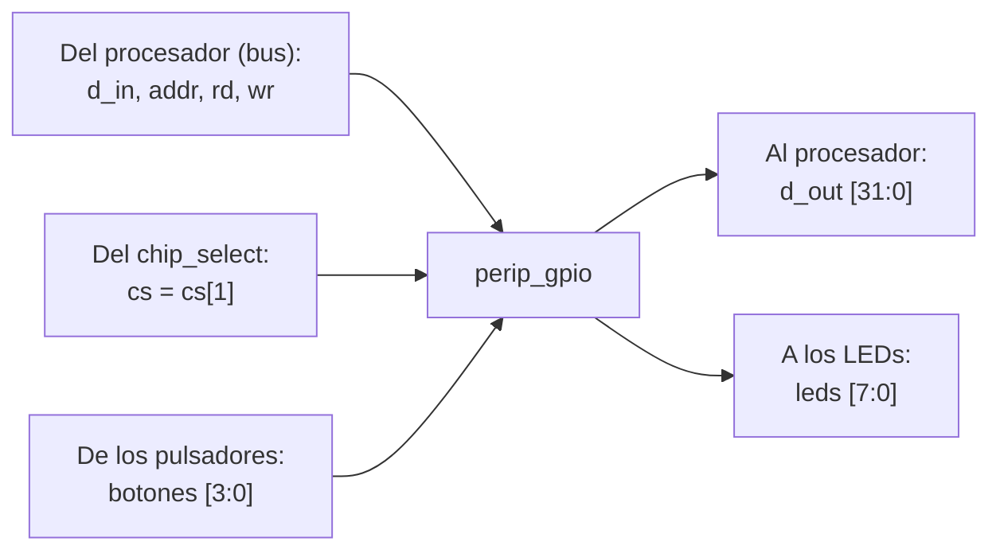
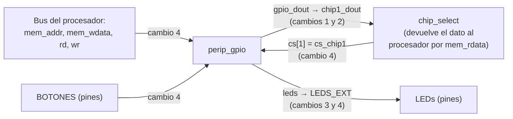

# Semana 2 · Conectar un periférico al SoC

[← Volver a la guía](README.md)

**Objetivo de la semana:** aprender a conectar un periférico al mapa de memoria del SoC y a controlarlo desde C. Es lo que cada grupo hará después con el periférico de su consola.

**Antes de empezar** deben tener funcionando `make sim` de la semana 1 y el mapa de memoria de la tarea 3 en su bitácora: esta semana se usa todo el tiempo.

**Cómo está organizada:**

| | Qué hacen | Dónde |
|---|---|---|
| [Parte A](#parte-a-el-ejemplo-guiado-conectar-el-gpio) | Ejemplo guiado: conocer, probar, conectar y usar un periférico GPIO que ya funciona | Casa, antes del laboratorio |
| [La receta](#la-receta-conectar-un-periférico-en-5-pasos) | Los pasos de la Parte A, resumidos para usarlos en el proyecto | — |
| [Parte B](#parte-b-ahora-ustedes-agregar-el-registro-invertir) | Ahora ustedes: agregarle un registro nuevo al GPIO siguiendo la receta | Casa, antes del laboratorio |
| [En el laboratorio](#en-el-laboratorio) | Llevarlo a la tarjeta y, si alcanza, el experimento del parpadeo | Laboratorio |

**Para entrar al laboratorio** traigan: el testbench con `0 errores` (con la Parte B) y la salida de `make sim PROG=gpio ARGS="+botones=1"`.

Cada paso tiene tres partes: **qué hacer**, **qué pasa por dentro** (cómo se relaciona con lo de la semana 1) y **cómo saber que quedó bien**.

---

## Parte A. El ejemplo guiado: conectar el GPIO

El **GPIO** (*General Purpose Input/Output*, entradas y salidas de propósito general) es el periférico más sencillo posible: un registro para encender LEDs y uno para leer pulsadores. Va en el espacio libre `0x0041_xxxx` que encontraron en la semana 1.

### A0. Preparar

**Qué hacer.** Desde la carpeta del laboratorio (`lab-femtorv/`), traigan la versión más reciente y copien el periférico y su testbench dentro de `soc/`:

```bash
git pull                     # versión más reciente del laboratorio
cd soc
mkdir -p build               # por si borraron build/ con make clean
cp ../plantillas/perip_gpio.v rtl/perip_gpio.v
cp ../plantillas/tb_perip_gpio.v sim/tb_perip_gpio.v
```

Desde aquí, todos los comandos de la semana se ejecutan **dentro de `soc/`**.

**Qué pasa por dentro.** El `Makefile` compila cualquier archivo que esté en `rtl/` y se llame `perip_*.v`. El GPIO ya forma parte del proyecto, pero todavía nadie lo usa: no está conectado al bus.

### A1. Conocer el GPIO

**Qué hacer.** Abran `rtl/perip_gpio.v` y léanlo completo (unas 75 líneas; menos de la mitad son código, el resto son comentarios). Su encabezado tiene la **tabla de registros**:

| Dirección | Nombre | Acceso | Bits | Qué significa | Valor tras reset |
|---|---|---|---|---|---|
| `0x0041_0004` | LEDS | Lectura y escritura | `[7:0]` | Patrón de los LEDs (1 = encendido) | `0x00` |
| `0x0041_0008` | BOTONES | Solo lectura | `[3:0]` | Pulsadores (1 = presionado) | — |
| otra `0x0041_xxxx` | — | — | — | Escribir no hace nada; leer da 0 | — |

Y esta es su **caja negra**, lo que ve el resto del SoC (además de `clk` y `reset`):



**Qué pasa por dentro.** El código tiene las mismas partes que el multiplicador que leyeron en la tarea 3.2 de la semana 1, escritas de forma más corta:

| Parte | En el GPIO | En el multiplicador (`rtl/mult/perip_mult.v`) |
|---|---|---|
| ¿Qué registro? | Se compara `addr[4:0]` con `04` u `08` | Líneas 29 – 40: `addr[4:0]` con `04`, `08`, `0C`, `10`, `14` |
| ¿Qué guardo al escribir? | Si `cs && wr` y la dirección es `04`, `valor_leds` guarda `d_in[7:0]` | Líneas 45 – 59: A guarda `d_in[15:0]` |
| ¿Qué devuelvo al leer? | Si `cs && rd`, un `case` pone en `d_out` el registro pedido, completado con ceros | Líneas 62 – 70 |
| ¿Qué sale del periférico? | `assign leds = valor_leds;` va a los pines | `result` y `done` |

Fíjense en tres cosas de la tabla de registros que se ven en el código:

- **LEDS guarda 8 bits:** `valor_leds` es `reg [7:0]`. De los 32 bits que escribe el procesador, solo caben los 8 bajos.
- **BOTONES no se puede escribir:** en el bloque de escritura no hay ninguna línea para la dirección `08`. Nada lo guarda.
- **Otra dirección se lee 0:** cae en el `default` del `case` de lectura.

**Cómo saber que quedó bien.** Respondan en la bitácora: si el programa escribe `0xFFFFFF3C` en LEDS, ¿qué valor queda en los LEDs y por qué? (En A2 lo van a comprobar).

### A2. Probarlo solo

**Qué hacer.**

```bash
iverilog -g2012 -o build/tb_gpio.vvp sim/tb_perip_gpio.v rtl/perip_gpio.v
vvp -n build/tb_gpio.vvp
```

La salida debe ser esta:

```
VCD info: dumpfile build/tb_perip_gpio.vcd opened for output.
OK     salida leds = 000000a5
OK     leer LEDS = 000000a5
OK     LEDS tras escribir FFFFFF3C = 0000003c
OK     leer BOTONES = 00000009
OK     LEDS tras escribir en BOTONES = 0000003c
OK     LEDS tras escribir en 0x00420004 = 0000003c
OK     leer 0x00410010 = 00000000
OK     LEDS tras reset = 00000000
--- 0 errores ---
sim/tb_perip_gpio.v:119: $finish called at 680 (1ns)
```

Los valores están en hexadecimal. La última línea (`$finish called…`) solo avisa que la simulación terminó: es normal.

**Qué pasa por dentro.** El testbench no tiene procesador: hace de procesador con tres tareas. Ábranlo (`sim/tb_perip_gpio.v`) y ubíquenlas:

| En el testbench | Equivale a |
|---|---|
| `escribir(dirección, dato)` | un `sw` del procesador. Pone `cs = 1` solo si la dirección es `0x0041_xxxx`, como haría el `chip_select` |
| `leer(dirección, variable)` | un `lw` del procesador; deja en `variable` lo que el GPIO puso en `d_out` |
| `comprobar("nombre", obtenido, esperado)` | compara y escribe `OK` o `ERROR` |

Cada prueba comprueba algo de la tabla de registros: que LEDS guarda lo escrito, que solo guarda 8 bits, que BOTONES no se escribe, que otra dirección se lee 0… Busquen en el archivo qué prueba corresponde a cada fila.

**¿Por qué probarlo solo?** Si lo prueban directamente con el procesador y algo falla, el error puede estar en el periférico, en `SOC.v`, en la dirección o en el programa en C. Si el periférico ya pasó su testbench, **el error no está en él**. Es la regla de oro de cualquier diseño con bus: probar cada bloque por separado antes de juntarlos.

**Cómo saber que quedó bien.** Además de los `0 errores`, abran las formas de onda:

```bash
gtkwave build/tb_perip_gpio.vcd &
```

En el panel de la izquierda elijan `tb_perip_gpio` y agreguen `clk`, `cs`, `wr`, `addr`, `d_in` y `leds`. Hagan una captura de la primera escritura (`000000A5` en `d_in`): `leds` cambia a `A5` en el flanco de subida de `clk` en que `cs` y `wr` valen 1.

### A3. Conectarlo al SoC

Hoy la dirección `0x0041_xxxx` ya activa `cs[1]`, pero no hay nada conectado: lo que se escribe se pierde y lo que se lee vale 0 (lo vieron en la semana 1, tarea 3.3). Conectar el periférico es **llenar ese hueco**. Se hace solo en `rtl/SOC.v`: el procesador y `chip_select.v` no se tocan.



El diagrama muestra qué conecta cada uno de los cuatro cambios.

Son cuatro cambios en `rtl/SOC.v`. Los números de línea son los del archivo sin cambios; después de cada cambio, las líneas de abajo se corren una o más posiciones. Si se pierden, busquen el texto con Ctrl+F.

**Cambio 1. Declarar el cable de salida del periférico.** Debajo de la línea 83, `wire [31:0] RAM_rdata;`, agreguen:

```verilog
wire [31:0] gpio_dout;
```

*Por dentro:* cada periférico tiene su propio cable para responder al procesador (`uart_dout`, `mult_dout`). Este es el del GPIO.

**Cambio 2. Llevar ese cable al `chip_select`.** En la línea 88 (busquen `.chip1_dout`), cambien `32'b0` por el cable nuevo:

```verilog
.chip1_dout(gpio_dout),    // antes: .chip1_dout(32'b0),
```

*Por dentro:* cuando el procesador hace un `lw` a `0x0041_xxxx`, el `chip_select` le devuelve lo que llegue por `chip1_dout`. Antes llegaba `32'b0`, por eso en la semana 1 se leía 0. Ahora llega la respuesta del GPIO. **Sin este cambio, el procesador puede escribir en el periférico, pero siempre lee 0.**

**Cambio 3. Borrar la línea que apaga los LEDs.** Al final del archivo, en la sección `6. PERIFÉRICO GPIO` (línea 160), borren:

```verilog
assign LEDS_EXT = 8'b0;
```

*Por dentro:* mientras no existía el periférico, esta línea dejaba los pines en 0. Ahora los va a manejar el GPIO, y un cable no puede tener dos fuentes.

**Cambio 4. Conectar el periférico.** En el lugar de la línea que borraron, escriban la conexión del GPIO. Es la misma del multiplicador (líneas 144 – 153), cambiando lo que es propio del GPIO:

```verilog
perip_gpio gpio (
    .clk    (clk),
    .reset  (!resetn),     // igual que el multiplicador
    .d_in   (mem_wdata),   // igual: el dato del bus
    .cs     (cs_chip1),    // <-- su cs: el espacio 0x0041
    .addr   (mem_addr),    // igual: la dirección del bus
    .rd     (rd),          // igual
    .wr     (wr),          // igual
    .d_out  (gpio_dout),   // <-- su cable de salida (cambio 1)
    .botones(BOTONES),     // <-- pines de entrada
    .leds   (LEDS_EXT)     // <-- pines de salida
);
```

*Por dentro:* las señales del bus son **las mismas para todos los periféricos**: todos ven la misma dirección y el mismo dato. Lo único que distingue a cada uno es su `cs` y su cable de salida. Por eso el `chip_select` puede elegir quién responde. `BOTONES` y `LEDS_EXT` son puertos del SoC que las tarjetas (`boards/`) ya llevan a pines físicos.

**Cómo saber que quedó bien.** El SoC debe seguir funcionando con el programa de la semana 1:

```bash
make sim
```

Debe imprimir lo mismo que antes, terminando en `=== Fin: 155707 ciclos simulados …`. Si algo sale mal:

| Mensaje | Causa |
|---|---|
| `error: Unknown module type: perip_gpio` | El GPIO no está en `rtl/`: repitan el `cp` de A0 |
| `warning: Port 3 (chip1_dout) of chip_select expects 32 bits, got 1` | Falta el cambio 1: si un cable no se declara, Verilog lo crea de **1 bit** |
| Otro error de Icarus | El mensaje dice el archivo y la línea: revisen comas y paréntesis de la conexión |

### A4. Usarlo desde C

**Qué hacer.** Abran `firmware/gpio.c` y completen las dos direcciones según la tabla de registros (cambien el `0x00 /* COMPLETAR */`):

```c
#define GPIO_LEDS      REG(GPIO_BASE + 0x04)
#define GPIO_BOTONES   REG(GPIO_BASE + 0x08)
```

Si quieren, cambien los dos patrones (`PATRON_SUELTO` y `PATRON_PULSADO`). Lean el `main`: escribe `0x2A` en LEDS, lo lee de vuelta, lee BOTONES y luego queda en un bucle que muestra un patrón u otro según el pulsador 0.

Simulen sin pulsador y con el pulsador 0 presionado (`+botones=N` fija el valor de los pulsadores en la simulación):

```bash
make sim PROG=gpio ARGS="+botones=0"
make sim PROG=gpio ARGS="+botones=1"
```

**Qué pasa por dentro.** Es el camino completo, de C hasta el pin:

```
GPIO_LEDS = 0x2A;
  → el compilador genera un  sw  a la dirección 0x0041_0004
  → el procesador pone 0x0041_0004 en mem_addr y 0x2A en mem_wdata
  → el chip_select ve 0041 y activa cs[1]
  → el GPIO ve cs, wr y addr[4:0] = 04, y guarda 0x2A en valor_leds
  → valor_leds sale por leds hacia los pines
```

Leer `GPIO_BOTONES` hace el camino de vuelta con un `lw`: el GPIO pone los pulsadores en `d_out`, el `chip_select` los pasa a `mem_rdata` y el procesador los recibe.

**Cómo saber que quedó bien.** Con `+botones=1` la salida termina así (con los patrones originales):

```
=== Simulacion del SoC: salida de la UART ===
Semana 2: periferico GPIO
LEDS = 0x0000002A
BOTONES = 0x00000001

=== Fin: 124863 ciclos simulados, 68 caracteres recibidos, LEDS_EXT = 00101010 ===
```

- `LEDS = 0x0000002A`: escribieron 0x2A y lo leyeron de vuelta.
- `BOTONES = 0x00000001`: el programa leyó el pulsador 0 presionado.
- `LEDS_EXT` (en binario, 8 bits): lo que quedó en los pines al final.

Completen en la bitácora:

| `+botones=` | `BOTONES` impreso | Patrón que debería verse | `LEDS_EXT` en la simulación |
|---|---|---|---|
| 0 | | `PATRON_SUELTO` | |
| 1 | | `PATRON_PULSADO` | |

Si `LEDS` sale `0x00000000` pero `LEDS_EXT` está bien, falta el cambio 2 de A3. Si `LEDS_EXT` sale `00000000` en los dos casos, revisen las direcciones de `gpio.c` y el cambio 4.

---

## La receta: conectar un periférico en 5 pasos

Esto es lo que hicieron en la Parte A. Es lo mismo que harán con el periférico de su consola:

1. **Tabla de registros.** Decidan qué registros tiene, en qué desplazamiento (`+0x04`, `+0x08`…), si se leen, se escriben o las dos cosas, y qué bits usan.
2. **El periférico en Verilog**, con sus partes: elegir el registro con `addr[4:0]`, guardar cuando `cs && wr`, responder cuando `cs && rd`.
3. **Probarlo solo** con un testbench que use `escribir()` y `leer()`: al menos una prueba por cada fila de la tabla.
4. **Conectarlo en `SOC.v`** en un espacio libre del mapa (`cs[1]` a `cs[5]`): su cable de salida, su `chipX_dout` y su instancia con el `cs` que le toca. Si usa pines que el SoC todavía no tiene, hay que agregarlos también como puertos de `SOC.v`, en el top de la tarjeta (`boards/`) y en su archivo de pines. Con el GPIO no hizo falta porque `BOTONES` y `LEDS_EXT` ya existían.
5. **Sus direcciones en C** (`#define … REG(base + desplazamiento)`) y un programa que las use.

---

## Parte B. Ahora ustedes: agregar el registro INVERTIR

Ahora repitan la receta, sin el código ya escrito. Van a agregarle al GPIO un registro nuevo:

| Dirección | Nombre | Acceso | Bits | Qué significa | Valor tras reset |
|---|---|---|---|---|---|
| `0x0041_000C` | INVERTIR | Lectura y escritura | `[0]` | 1 = los LEDs muestran el patrón invertido | 0 |

Con INVERTIR = 1, si LEDS vale `00000111`, los pines muestran `11111000`. El registro LEDS no cambia; solo cambia lo que sale a los pines. Es un **registro de control**: no guarda un dato para mostrar, sino que cambia cómo se comporta el periférico. Sus periféricos de la consola tendrán registros así.

**¿Hay que tocar `SOC.v` o `chip_select.v`?** No. `0x0041_000C` sigue siendo del espacio `0x0041`, así que el `chip_select` ya activa `cs[1]`. El GPIO es el que mira `addr[4:0] = 0C` y sabe que es INVERTIR.

### B1. El Verilog

En `rtl/perip_gpio.v` hay cuatro lugares marcados con comentarios `PARTE B` (el lugar 2 tiene dos comentarios: uno en el reset y otro en la escritura). En cada lugar, el código de LEDS que está justo arriba es su modelo:

| Lugar | Qué agregar | Modelo (LEDS) | Ayuda |
|---|---|---|---|
| 1 de 4 · Registros | Un registro de 1 bit llamado `invertir` | `reg [7:0] valor_leds;` | Un registro de 1 bit no necesita `[ ]` |
| 2 de 4 · Escritura | En el reset, `invertir` en 0. Si `cs && wr` y la dirección es `0C`, guardar `d_in[0]` | Las dos líneas de `valor_leds` en el mismo bloque | `invertir` guarda solo el bit 0 del dato |
| 3 de 4 · Lectura | Una línea más en el `case`: la dirección `0C` devuelve `invertir` completado con 31 ceros | `5'h04: d_out <= {24'b0, valor_leds};` | 1 bit + 31 ceros = 32 bits |
| 4 de 4 · Salida | Cambiar el `assign leds`: si `invertir` vale 1, sale `~valor_leds`; si no, `valor_leds` | `assign leds = valor_leds;` | El `? :` del blinker; `~` invierte cada bit |

### B2. La prueba

En `sim/tb_perip_gpio.v`, en el lugar marcado `PARTE B`, escriban tres pruebas con `escribir()`, `leer()` y `comprobar()`. Copien la forma de las pruebas que ya están (por ejemplo, las dos primeras, líneas 79 – 85):

1. Escribir 1 en INVERTIR y comprobar que `leds` sale invertido. En ese punto LEDS vale `3C`, así que invertido es `C3`.
2. Leer `0x0041_000C` y comprobar que devuelve 1.
3. Escribir 0 en INVERTIR y comprobar que `leds` vuelve a `3C`.

Simulen igual que en A2. Ahora deben salir **11 líneas `OK`** y `--- 0 errores ---`. Si alguna sale `ERROR`, el mensaje dice qué se obtuvo y qué se esperaba: revisen el lugar del Verilog que corresponde.

### B3. El programa

En `firmware/gpio.c` hay dos líneas comentadas con `PARTE B`:

1. La dirección: quiten el `// PARTE B:` del comienzo de la línea del `#define GPIO_INVERTIR` y completen el desplazamiento, igual que las otras dos direcciones.
2. El uso: quiten el `//` de la línea `GPIO_INVERTIR = b & 1;`. Mientras el pulsador 0 esté presionado, INVERTIR vale 1.

Antes de simular, **predigan** qué valor tendrá `LEDS_EXT` con `+botones=1` y escríbanlo en la bitácora. Pista: con el pulsador presionado, LEDS vale `PATRON_PULSADO` y además INVERTIR vale 1; `LEDS_EXT` tiene 8 bits. Luego compruébenlo:

```bash
make sim PROG=gpio ARGS="+botones=1"
```

Con `+botones=0` el resultado no debe cambiar respecto a A4: INVERTIR vale 0.

---

## En el laboratorio

### L1. En la tarjeta

**Montaje.** Es el mismo del blinker de la semana 1 ([Tarjetas.md](Tarjetas.md#conexiones)):

- **Colorlight:** agreguen el sexto LED (pin H4 de J2) y los pulsadores en J1. Este programa usa el pulsador 0 (pin E4).
- **Tang Nano 9K:** no hay que conectar nada. El pulsador 0 es el botón **S2**; **S1** es el reset.

```bash
make syn PROG=gpio BOARD=colorlight      # o BOARD=tangnano9k
make config BOARD=colorlight
make terminal BOARD=colorlight           # opcional: ver los mensajes (presionen el reset)
```

**Qué pasa por dentro.** El top de cada tarjeta (`boards/…/top_….v`) conecta los pines físicos con `BOTONES` y `LEDS_EXT` del SoC y los adapta: en las dos tarjetas el pulsador presionado pone el pin en 0, así que el top lo invierte para que el SoC vea 1; en la Tang Nano también invierte los LEDs, que se encienden con 0. Por eso el periférico y el programa son iguales en las dos tarjetas. Las tarjetas tienen 6 LEDs: se ven los 6 bits bajos de `LEDS_EXT`.

**Cómo saber que quedó bien.** Sin pulsar, los LEDs muestran `PATRON_SUELTO`. Con el pulsador 0, muestran `PATRON_PULSADO` invertido: los 6 bits bajos del valor que predijeron en B3. (Si no terminaron la Parte B, muestran `PATRON_PULSADO` sin invertir). Graben un video corto o tomen una foto para la bitácora.

### L2. Experimento (opcional): ¿cuánto cuesta una tarea hecha por software?

Si alcanza el tiempo. El programa `firmware/parpadeo.c` enciende y apaga el LED 0 lo más rápido que puede. Completen en él la dirección de LEDS (la misma de `gpio.c`).

Su bucle `while (1)` se convierte en tres instrucciones (pueden verlas en `build/firmware.lst` después de `make firmware PROG=parpadeo`):

| Línea de C | Instrucción | Ciclos |
|---|---|---|
| `GPIO_LEDS = 1;` | `sw a4,0(a5)` | 4 |
| `GPIO_LEDS = 0;` | `sw zero,0(a5)` | 4 |
| vuelve al inicio del `while` | `j ...` | 3 |
| **Una vuelta** | | **11** |

1. Calculen el periodo y la frecuencia de la señal del LED 0 para su tarjeta (25 MHz en la Colorlight, 27 MHz en la Tang Nano).
2. Llévenlo a la tarjeta (`make syn PROG=parpadeo BOARD=…` y `make config BOARD=…`) y midan la frecuencia con el osciloscopio. En la Colorlight, en el pin del LED 0 de J2; en la Tang Nano, vean [Medir una señal](Tarjetas.md#medir-una-señal-o-agregar-un-pin) en Tarjetas.md.
3. La pantalla de la consola necesita un dato de píxel nuevo unas **9 millones de veces por segundo**. Con su resultado, ¿podría el FemtoRV generar esa señal por software? ¿Qué tareas de la consola tendrán que hacerse con un periférico?

---

## Lo que va a la bitácora esta semana

- A1: la respuesta sobre `0xFFFFFF3C`.
- A2: la salida con `0 errores` y la captura de la escritura.
- A3: los cuatro cambios de `SOC.v`, cada uno con una frase de qué hace.
- A4: la tabla de la simulación.
- Parte B: el código que agregaron (Verilog, prueba y C), la salida con `0 errores` y la predicción de B3 comparada con la simulación.
- L1: foto o video en la tarjeta.
- L2 (si lo hicieron): cálculo, medición y respuesta.

## Valor agregado

Conecten como periférico, en otro espacio libre del mapa (`0x0043_0000`, `cs[3]`), el controlador del **laboratorio de periféricos** (servo, generador de tonos, ultrasonido, puente H, motor paso a paso o displays). Sigan la receta completa: tabla de registros, Verilog con sus partes, testbench, la conexión en `SOC.v` (con sus pines nuevos) y un programa en C.

[← Semana 1](Semana1.md) · [Volver a la guía](README.md)
